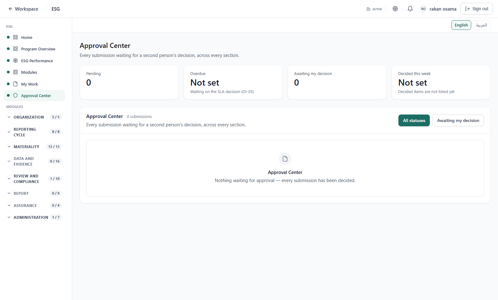

# The Approval Center

Everything submitted for review lands in one place. This is how it works, and which of the 23
screens can currently use it.

**Screen code AC-01 · route `/modules/esg/approvals`.** In the running build it sits in the
**top-level ESG nav** — Home · Program Overview · ESG Performance · Modules · My Work ·
**Approval Center** — above the module groups, not inside one. That placement is right: it is not
a section screen, and BD-115 exists to keep it that way.

---

## 1. How an item gets in

Not by calling an "enqueue" service. It is a **save-time projection** — which is why enrolling a
new object type is a data-model decision, not a UI one.

```
  Section screen                 Workflow service              EF SaveChanges
  ─────────────                  ────────────────              ──────────────
  OnPostSubmitAsync  ───────►  SubmitAsync(versionId)   ───►   ApprovalQueueProjectionInterceptor
                               • requires `handover`            • walks ChangeTracker
                                 permission                       .Entries<IApprovalSubmission>()
                               • Status: Draft → Submitted      • compares QueueStatus now
                                                                  vs its ORIGINAL value
                                                                • null → Pending  ⇒ INSERT
                                                                • Pending → decided ⇒ Decide()
                                                                • → null ⇒ Withdraw()
                                                                • re-submit ⇒ Requeue()
```

Key files:

| Concern | File |
|---|---|
| Page + handlers | `src\ERP.Modules.Esg\Pages\Esg\Approvals\Index.cshtml(.cs)` |
| Decision service | `Application\Approvals\IApprovalDecisionService.cs` · `Application\Services\Implementations\ApprovalDecisionService.cs` |
| Queue read | `Application\Approvals\IApprovalQueueReader.cs` · `Persistence\Repositories\ApprovalQueueReader.cs` |
| **Projection** | `Persistence\Interceptors\ApprovalQueueProjectionInterceptor.cs` |
| Enrolment map | `Application\Approvals\ApprovalQueueFeatures.cs` |
| Queue entity | `Domain\Entities\ApprovalQueueItem.cs` |
| Submission contract | `Domain\Approvals\IApprovalSubmission.cs` |
| Status translation | `Domain\Approvals\ApprovalSubmissionStatus.cs` |
| Visibility | `Pages\Esg\EsgNavPermissions.cs` → `MayApproveAnythingAsync` |

Two details worth knowing:

- **One pending row per object**, enforced by a unique index
  `UX_ApprovalQueueItems_OnePendingPerObject`. Re-submitting a returned record *requeues* the
  same row rather than adding a second.
- The interceptor is registered **before** the audit interceptors, and a registration test
  asserts that order.

---

## 2. The contract a screen must satisfy

To participate, the object behind the screen must:

1. **Implement `IApprovalSubmission`** — exposing a `QueueStatus` that translates its own status
   enum into `Pending / Approved / Rejected / Returned / Withdrawn / null`.
2. **Be listed in `ApprovalQueueFeatures`** with a feature key. `Require(objectType)` **fails
   closed** — an enrolled type with no feature throws.
3. **Have its status enum handled by `WasQueuedAs`** in the projection interceptor. ⚠ This is
   where C-12 currently fails — see [03-FINDINGS.md](03-FINDINGS.md#f-1).
4. **Declare `handover` and `signoff` permissions** for that feature key.
5. **Have a workflow service** exposing `SubmitAsync`, `BeginReviewAsync`, `ApproveAsync`,
   `RejectAsync`, `ReturnForCorrectionAsync` — the Center dispatches to these by object type.

Miss any one and the screen silently does not participate. It will not error; the item simply
never appears.

---

## 3. Who may decide, and what stops them

`ApprovalDecisionService.DecideAsync` runs these in order. Each is a real refusal, not a UI
nicety.

| # | Check | Fails with |
|---|---|---|
| 1 | Route visible at all — `ProjectManager` standing **or** any `*.signoff` permission | 403 |
| 2 | `signoff` on **this item's** feature key | 403 |
| 3 | Item still `Pending` | `ConflictException` — `Esg.Approvals.Err.AlreadyDecided` |
| 4 | **Approver ≠ submitter** | `SelfApprovalBlockedException` + an SoD violation record |
| 5 | Reject or Return carries a note of **≥ 15 words** | `ValidationException` on `Note` |
| 6 | Pick-up — `BeginReviewAsync` on the owning service | skipped for `OmissionRequest` (no review state) |
| 7 | Dispatch — `ApproveAsync` / `RejectAsync` / `ReturnForCorrectionAsync` | — |

**Self-approval is refused in three layers**: the service, `ApprovalQueueItem.Decide()`, and the
database constraint `CK_ApprovalQueueItems_NoSelfApproval`. A validation failure is answered
*in place* so a long note is not lost; every other refusal redirects back to the open modal.

Two special dispatch arms:

- `Gri2AssessmentVersion` → `ApproveAsync(id, approverName: null)`.
- `MaterialTopicSetVersion` → **Approve maps to `FreezeAsync`, and there is no Reject** — a
  reject falls through to `ReturnForCorrectionAsync`. This is deliberate (DIR-001 SG-10).

---

## 4. Which of our 23 screens participate

**10 of 23.** The rest either own no governed object or were deliberately kept local.

| Screen | Object enrolled | Feature key | Status |
|---|---|---|---|
| B-07 Reporting Boundary | `BoundaryBasisVersion` | `boundary` | **works** |
| B-08 Sector Classification | `SectorAssignmentVersion` | `sector` | **works** |
| B-09 Applicable Standards | `CycleStandardSetVersion` | `standards` | **works** |
| B-10 Disclosure Applicability | `DisclosureApplicabilityVersion` | `applicability` | **works** |
| B-11 GRI 2 Assessment | `Gri2AssessmentVersion` | `gri2` | **works** |
| B-13 Omission Requests | `OmissionRequest` | `omissions` | **works** — no review state, pick-up skipped |
| B-14 Cycle Readiness | `CycleReadinessProposal` | `readiness` | **works** — propose creates *and* submits |
| C-01 Methodology | `MaterialityConfigVersion` | `mat-config` | **works** |
| **C-12 Governance Approval** | `MaterialTopicSetVersion` | `mat-approval` | ⚠ **enrolled but never enqueues** — [F-1](03-FINDINGS.md#f-1) |
| C-14 ESG Risks | `EsgRisk` | `mat-risk` | **works** |

### The 13 that do not participate, and why

| Screen | Reason |
|---|---|
| B-05 Reporting Cycles | `ReportingCycle` is not an `IApprovalSubmission`. It has full CRUD and a *phase* machine, but no maker-checker. **Worth a decision:** should creating or re-scoping a cycle need approval? |
| B-15 Cycle record | Derived, owns no fact |
| B-06 Setup Console | Orchestration only, owns no fact |
| C-02 Context · C-03 Stakeholders · C-06 Impact Register | Living registers — plain CRUD by design. **But the audit asserts a gate for C-03** ("Stakeholder universe approved") with no mechanism behind it |
| C-04 Engagement | Local `Offer → Accept / Return` micro-flow, exempted from BD-115 |
| C-07 Impact Assessment | Local review, exempted from BD-115 |
| C-08 Divergence | `Resolve` / `Escalate`, no submit |
| C-09 Topic Mapping | `Confirm` / `Unconfirm` / `Escalate`, no submit |
| C-10 Sector Reconciliation | Terminal `Decide`, no submit |
| C-11 Topics & Ranking | Submits **on behalf of** the topic set (C-12), not itself |
| C-13 Topic Management | No workflow at all — though `handover` and `signoff` permission keys **are declared with nothing behind them** |

---

## 5. What the PM actually sees

### As it runs today



**Captured 9 Sep 2026** from `http://acme.localhost:5270/modules/esg/approvals` — tenant
**acme**, signed in as a Programme Manager. The queue is empty, which is expected: this tenant has
one cycle in Setup and nothing has been submitted.

The capture **confirms from the outside** what §5 records from the spec — and adds two things.

**Header:** *"Every submission waiting for a second person's decision, across every section."*
That sentence is the design in one line: one hub, one second pair of eyes, every section.

| Tile | Live | |
|---|---|---|
| Pending | `0` | built |
| **Overdue** | **`Not set`** | *Waiting on the SLA decision (OI-05)* |
| Awaiting my decision | `0` | built |
| **Decided this week** | **`Not set`** | ***Decided items are not listed yet*** |

**Filters, live:** **All statuses** · **Awaiting my decision** — and neither reaches history.

- 🟠 **A decision is write-only from the PM's point of view.** Approve or return an item and the
  row leaves with nowhere in AC-01 to see it again — not the decision, not the decider, not the
  **≥15-word note** that `ApprovalDecisionService` insisted on. The note is the audit trail of
  the entire maker-checker design, and the screen that collected it cannot show it back.
  `ApprovalQueueItem` stores the decision, so this is a **missing view, not missing data** —
  [F-24](03-FINDINGS.md#f-24).
- 🟠 **The empty state is wrong on a fresh tenant:** *"Nothing waiting for approval — **every
  submission has been decided**."* Nothing has ever been submitted here. Two states are needed:
  *nothing submitted yet* and *all caught up*.
- ✔ The **Overdue** tile is honest about being unbuilt, and names the open item it waits on. It
  needs a decision — *how long may an approval sit before it is late?* — not code.
- ⚠ The capture cannot show the `ObjectType · 8 hex` reference problem
  ([F-10](03-FINDINGS.md#f-10)), because no row exists to render. That finding stands on the code.

### From the spec


`IApprovalQueueReader.PendingAsync(cycleId)` returns every `Pending` row, oldest first.

**Columns built today:** Section · Record · Submitted by · Submitted on · State.
**Filters:** `?state=`, `?section=<featureKey>`, `?mine=1`, `?cycle=`.
**Tiles:** Pending (live) · Overdue (*not built*) · Awaiting my decision (live) · Decided this
week (*not built*).

Deliberately not built yet, per the spec's own freeze record:

- Export handler and the read-only `?drawer=view` preview
- The `Due` column
- **Decided history** — `state=decided` returns an empty list
- Display codes — `RecordRef` renders `"{ObjectType} · {first 8 hex of the id}"`, so the PM sees
  `BoundaryBasisVersion · 3f2a91c4` rather than a human reference

That last one is the most visible gap for a PM working the queue day to day.

---

## 6. The prototype has none of this

The HTML prototype scatters approval across five unrelated surfaces with no shared shape:

| Surface | Scope | Backed by |
|---|---|---|
| `mywork` | per-role inbox | `D.tasks[ROLE]` — **hand-written strings**, not derived from any submission |
| `rev/oapp` | omissions only | `D.omissions` |
| `mat/approval` | topic set only | `D.topicSet` — the Approve button is `disabled` |
| `rev/rwb` | record-level review | — |
| `rev/pgate` | publication gate | `D.gates` |

Nothing in the prototype creates a queue entry, because nothing in the prototype writes a
submission. Treat the prototype as a **UX reference for the section screens only** — the
approval flow it shows is not the one being built.
