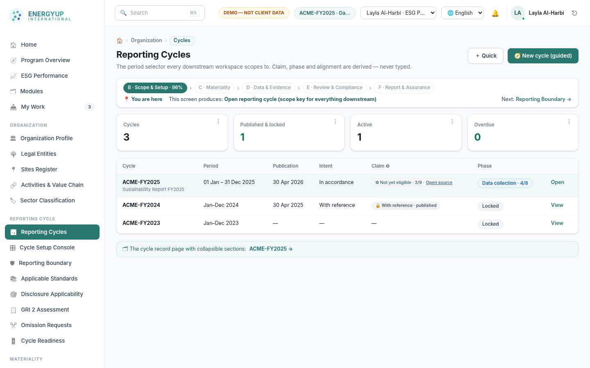
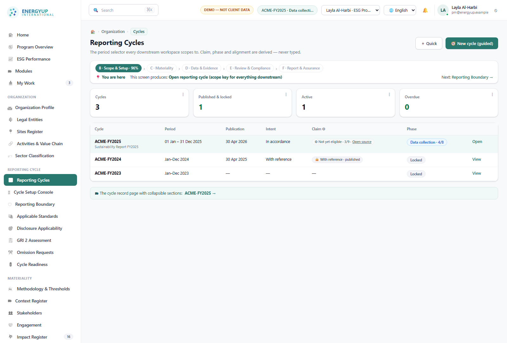
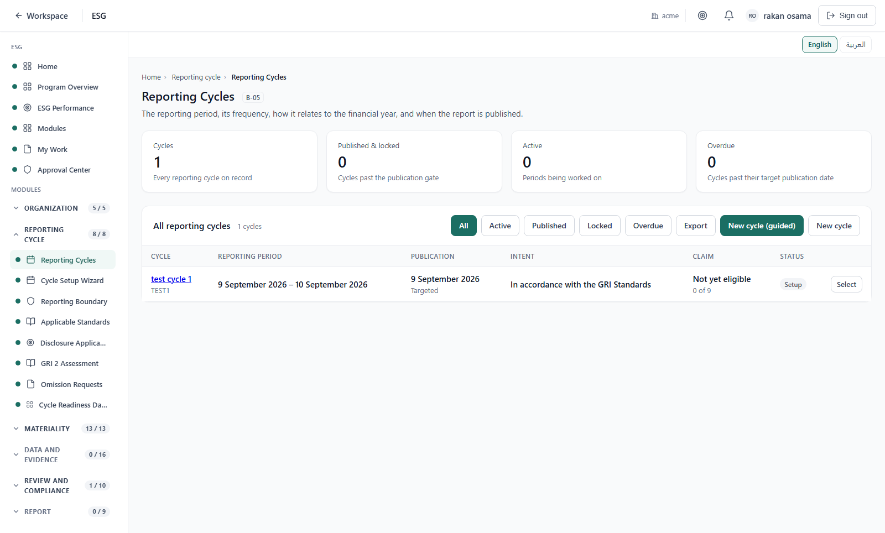
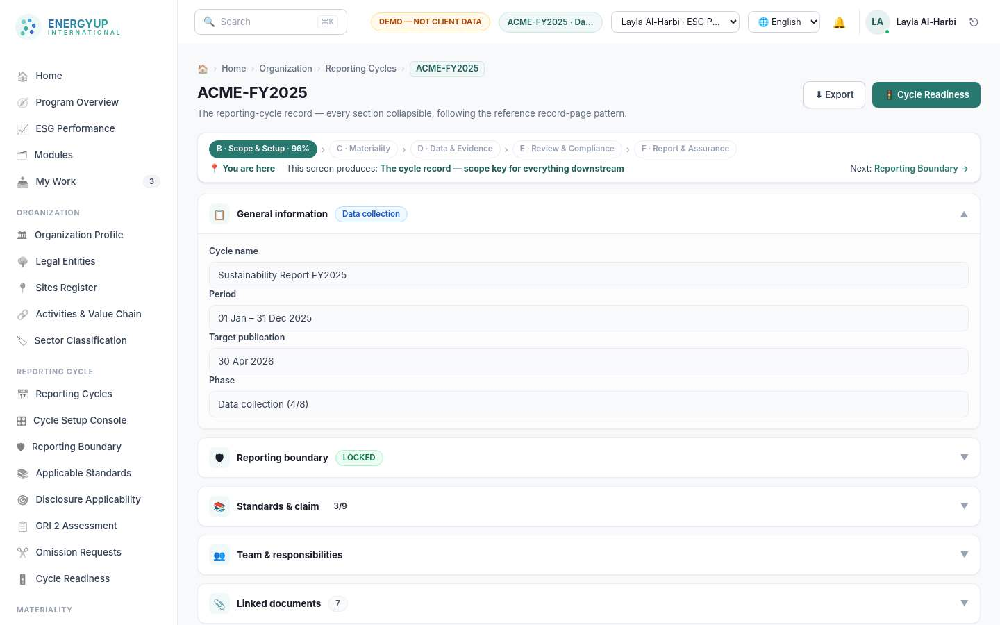
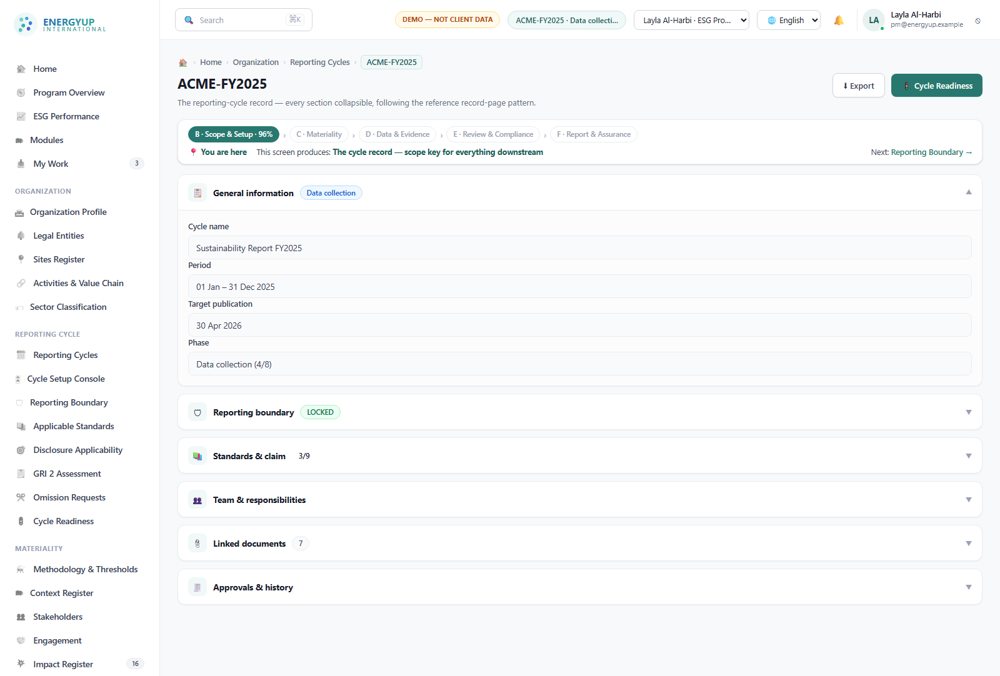

# B-05 — Reporting Cycles

*(includes **B-15 Cycle record**, the read-only detail view)*

| | |
|---|---|
| **Route** | prototype `#/org/cycles` · .NET `/modules/esg/org/cycles` |
| **Audit** | `scr-16` · P2 · UX 9.2 · Master-data register / form |
| **Owner role** | ESG Programme Manager |
| **Owns** | `ReportingCycle` |
| **Upstream** | `org/acts` | 
| **Downstream** | `org/cycledetail` → `setup/console` |
| **.NET spec** | `docs\ESG\build\04-screens\30-cycle\01-cycles.md` |

---

## Purpose

> "The period selector every downstream workspace scopes to. Claim, phase and alignment are
> derived — never typed."

Everything in both groups scopes to the selected cycle. Get the period or the boundary intent
wrong here and every downstream number is answering the wrong question.

---

## 1. What it must contain — the audit

**Inputs** Reporting period · Financial period alignment · Publication target · Intent ·
Assurance plan · Owner
**Outputs** `ReportingCycle` · cycle basis date / phase context
**Completion gate** Valid reporting period + owner + intent
**Disposition** KEEP / INTEGRATE with existing .NET Epic-B

**Captured columns (6, complete):**
`Cycle` · `Period` · `Publication` · `Intent` · `Claim ⚙` · `Phase`

**P2 hardening:** *"Keep reporting/financial periods and intent separate from computed claim.
Add ReleaseSnapshot linkage and true period-lock status from backend, not a derived cosmetic
flag."*

*Actions: not captured — the audit records none for any screen.*

---

## 2. What the prototype renders

`assets/js/07-views.js:215` — 6,395 chars.

| | |
|---|---|
| Table | `Cycle · Period · Publication · Intent · Claim ⚙ · Phase` — matches the audit exactly |
| Rows | **3 hard-coded `<tr>`** (FY2025 / FY2024 / FY2023) |
| Reads | `D.cycle` only — a *single* object, while the tiles claim "3 Cycles" |
| Forms | `cycleForm()` — opened by `＋ Quick` and by row `Edit`, **two-argument `drawer()` ⇒ writes nothing** |
| Wizard | 7-step guided create; its final button audits and toasts, **never pushes to any register** |

So the register shows three cycles that do not exist as data, and neither creation path creates
anything.

---

## 3. What .NET implements

### As it runs today

**Captured 9 Sep 2026** from `http://acme.localhost:5270` — tenant **acme**, signed in as a
Programme Manager. One cycle exists — **test cycle 1 / TEST1** — so this screen shows a
populated register rather than an empty state.

**Register columns as built:** `CYCLE` (name over code) · `REPORTING PERIOD` · `PUBLICATION`
(date + *Targeted*) · `INTENT` · `CLAIM` · `STATUS`

**Tiles:** Cycles · Published & locked · Active · Overdue
**Actions:** filter chips All / Active / Published / Locked / Overdue · Export ·
**New cycle (guided)** · **New cycle** · row **Select** · the cycle name links through to B-15

- ✔ **Two create paths** — a guided wizard and a direct form. Neither the audit nor the prototype
  has this.
- 🔴 **No Submit and no Approve anywhere on the screen** — the visual confirmation of
  [F-9](../03-FINDINGS.md#f-9). Every other governed screen in this group carries a version bar;
  this one does not.
- ⚠ The claim cell reads **"Not yet eligible · 0 of 9"** — *nine* claim gates. B-14 counts
  **seven** readiness gates. Two different gate sets, and the docs must not conflate them.
- B-15 is reached by clicking the cycle name. It takes a cycle id, so `shoot-dotnet.mjs` does not
  capture it as a standalone route.

### The code behind it

| | |
|---|---|
| Pages | `Pages\Esg\Cycles\Index.cshtml(.cs)`, `Index.Wizard.cs`, `CyclePhaseBar.cs`, `CycleRegisterFilter.cs` |
| Services | `IReportingCycleService` · `IReportingCycleRegisterService` · `IReportingCyclePhaseService` · `ICycleTransitionService` |
| Entity | `ReportingCycle` (+ `.Children.cs`, `.Phases.cs`) |
| States | `ReportingCyclePhase` (Setup…Locked) **and** `CycleStateCodes` C-01…C-14 — both persisted |
| Permissions | `esg.cycles.{view,add,edit,delete}` |

---

## 4. Gap

| Requirement | Audit | Prototype | .NET | Verdict |
|---|---|---|---|---|
| Register with the 6 columns | ✔ | ✔ layout only | ✔ | **OK** |
| Rows from a real collection | — | ✗ 3 literal rows | ✔ | prototype **STUB** |
| Create a cycle | ✔ gate | ✗ both paths inert | ✔ `CreateAsync` | prototype **STUB** |
| Edit | — | ✗ | ✔ `UpdateAsync` | prototype **STUB** |
| Delete | — | ✗ | ✔ soft `DeleteAsync` | **OK** in .NET |
| Claim / phase derived, not typed | ✔ | ✔ shown as ⚙ | ✔ | **OK** |
| **Submit for review** | *not captured* | ✗ | ✗ | **[F-9](../03-FINDINGS.md#f-9)** |
| ReleaseSnapshot linkage + true period lock | ✔ P2 | ✗ | *not verified* | **open** |

---

## 5. CRUD & workflow

| Op | Prototype | .NET |
|---|---|---|
| Create | `＋ Quick` / wizard — **STUB** | `IReportingCycleService.CreateAsync` |
| Read | `D.cycle` + literals | `GetAllAsync` / `GetAsync` / `GetRegisterAsync` |
| Update | row `Edit` — **STUB** | `UpdateAsync` |
| Delete | — | `DeleteAsync` (soft) |
| Submit | — | **none** |
| Approve / Return | — | **none** |
| Other | — | phase Advance / Return / Publish / Lock; `ICycleTransitionService` |

**Cycles have a phase machine, not an approval machine.** `Cycles.IndexModel` is one of the five
screens exempted from BD-115 — its "return" is a *phase* return, not a verdict.

---

## 6. Approval Center

**Does not participate.** `ReportingCycle` is not an `IApprovalSubmission` and has no feature in
`ApprovalQueueFeatures`. Creating a cycle, moving its period, changing its intent or its
assurance plan are all unreviewed single acts — see [F-9](../03-FINDINGS.md#f-9).

---

## B-15 — the cycle record

| | |
|---|---|
| **Route** | prototype `#/org/cycledetail` · .NET `/modules/esg/org/cycles/{id:guid}` |
| **Audit** | `scr-17` · P2 — **no capability id**; labelled "V14 operational/support view" |
| **Completion gate** | *"Derived only — no completion gate"* |

**Captured columns (8):** `Cycle name` · `Period` · `Target publication` · `Phase` ·
`Entities in scope` · `Sites` · `Target claim` · `External assurance`

**P2 hardening:** *"Read-only orchestration. Remove any duplicated editable cycle facts; every
edit must deep-link to the authoritative owner screen."*

`assets/js/09-workspace-shell.js:143` — a 13-row `
` definition list, no table.
Reads `D.cycle`, `D.evidence`, `D.audit`. Read-only by design; its only actions navigate to
`org/cycles` and `setup/console`. **This is the group's best-behaved screen** — it owns no fact
and pretends to own none.

Not in the .NET sidebar (`EsgNavigation.cs` has no row for it) although the page exists.

---

## 7. Open questions

1. **Should a cycle need approval?** ([F-9](../03-FINDINGS.md#f-9)) Every other foundation object
   in this group has maker-checker. If the answer is no, record it as a decision.
2. The audit asks for **ReleaseSnapshot linkage and a true period-lock status "from backend, not
   a derived cosmetic flag"** — confirm which of the two persisted state fields
   (`Phase` vs `State`) carries it. BQ-19 is open on why both exist.
3. B-15 has no capability id in the audit but is **B-15** in `EsgScreenCatalog`. It is also
   absent from the sidebar — deliberate, or an omission?
