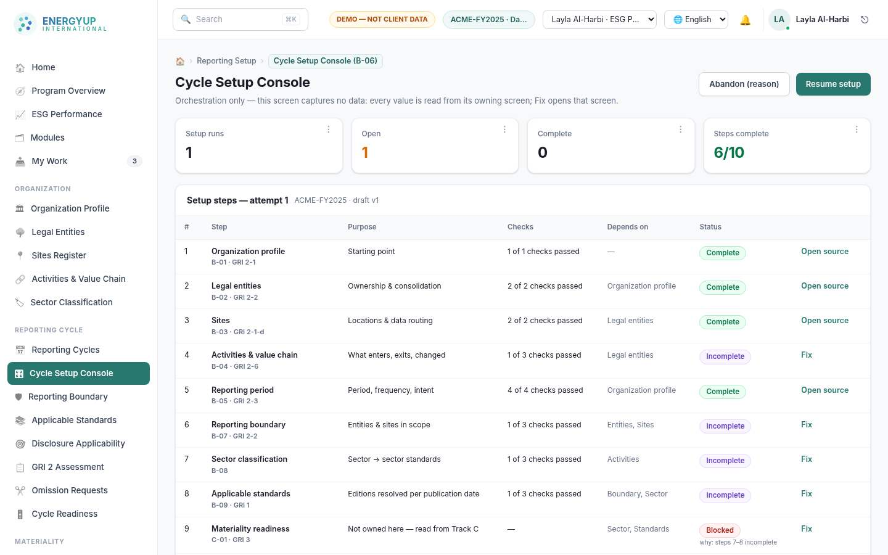
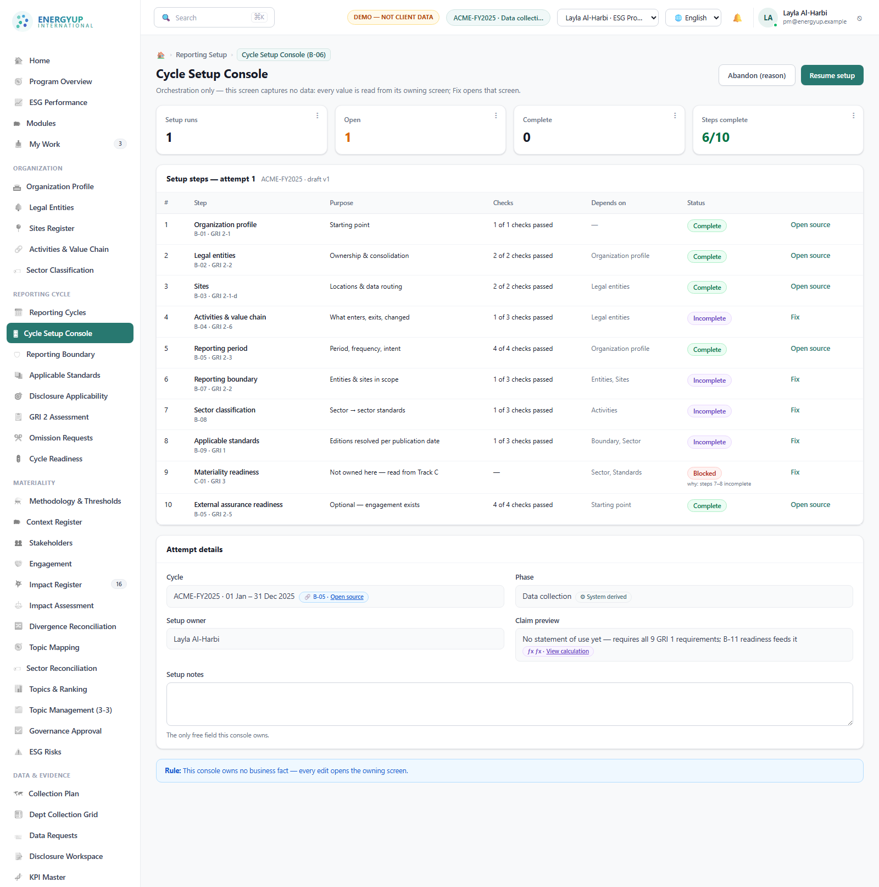
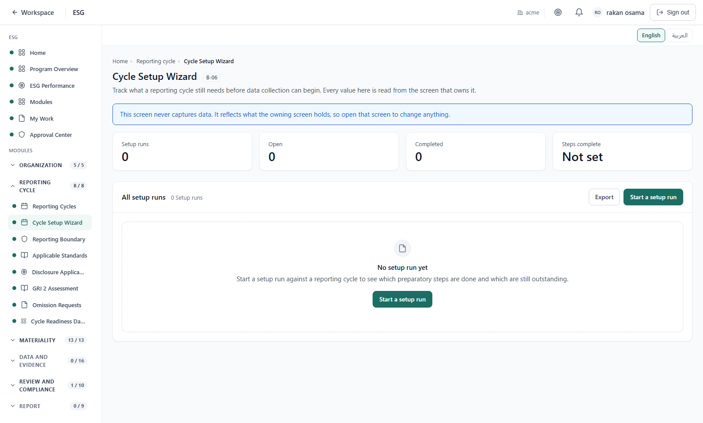

# B-06 — Cycle Setup Console

| | |
|---|---|
| **Route** | prototype `#/setup/console` · .NET `/modules/esg/setup/console` |
| **Audit** | `scr-18` · P2 · UX 9.2 · Setup / governance workbench |
| **Owner role** | ESG Programme Manager |
| **Owns** | **nothing** — orchestration only |
| **Upstream** | organization master + reporting cycle · **Downstream** `setup/boundary` |
| **.NET spec** | `docs\ESG\build\04-screens\30-cycle\02-console.md` |

---

## Purpose

> "Orchestration only — this screen captures no data: every value is read from its owning
> screen; Fix opens that screen."

The console's on-screen notice states the rule plainly: **"This console owns no business fact —
every edit opens the owning screen."** That is the whole design. The risk it exists to avoid is a
second copy of B-01…B-11 data drifting from the originals.

---

## 1. What it must contain — the audit

**Inputs** Approved B-01…B-11/B-13 states · **Outputs** setup progress / blocker orchestration
**Completion gate** All required setup steps resolved

**Captured columns — 10, AT THE CAP, so truncated** ([F-17](../03-FINDINGS.md#f-17)), and a flat
merge of the header block with the step table:

> `Cycle` · `Phase` · `Setup owner` · `Claim preview` · `Setup notes` — then —
> `#` · `Step` · `Purpose` · `Checks` · `Depends on`

The step table's own **Status** and **Fix** columns are described in the hardening text but are
not in the chip list, which is the clearest single illustration of the 10-chip cap.

**P2 hardening:** *"Maintain as orchestration only. No duplicated B-01…B-11 data. Show explicit
Done/Missing/Blocked reason with exact source object and fix link."*

---

## 2. What the prototype renders

`assets/js/07-views.js:264` — 8,125 chars, **2 tables**, 4 literal `<tr>`, reads `D.cycle` and
`D.bndDraft`.

The step table is present with Done/Missing/Blocked and a Fix link, which is the audit's actual
requirement. But `SETUPSTEPS` is a **hand-typed 10-row array**: every check-count and verdict is
a literal, so a step reads "Done" whether or not its owning screen is done. The console reports
its own hard-coded opinion rather than reading the screens it claims to orchestrate — the exact
failure its notice warns against.

Only one drawer, and it is **not** a stub: the setup-notes editor writes `D.setupNotes`.

---

## 3. What .NET implements

### As it runs today

**Captured 9 Sep 2026** from `http://acme.localhost:5270` — tenant **acme**, signed in as a
Programme Manager. No setup run has been started, so the screen is in its empty state.

**Named "Cycle Setup Wizard" in .NET**, not "Setup Console".

**Banner:** *"This screen never captures data. It reflects what the owning screen holds, so open
that screen to change anything."*

**Tiles:** Setup runs · Open · Completed · **Steps complete — `Not set`**
**Actions:** Export · **Start a setup run** — the only write on the screen

- ✔ The banner states the read-only contract outright, which is exactly the discipline the
  prototype's editable notes field breaks.
- ⚠ Refines what the CRUD matrix records: this screen creates and advances a `CycleSetupRun`, but
  it **stores no field value of its own**. "Update" here means advancing a run, never capturing
  data.
- ⚠ `Steps complete` renders **`Not set`** instead of a computed zero —
  [F-21](../03-FINDINGS.md#f-21).

### The code behind it

| | |
|---|---|
| Pages | `Pages\Esg\CycleSetup\Index.cshtml(.cs)`, `SetupRunBar.cs`, `SetupStepView.cs` |
| Services | `ICycleSetupRunService` · `ICycleSetupReadinessService` |
| Entities | `CycleSetupRun` (+ `.Lifecycle.cs`), `CycleSetupRunStep` |
| States | `CycleSetupRunStatus` Draft/InProgress/Completed/Abandoned · `CycleSetupStepState` Complete/Available/Blocked/NotAvailable/Disabled |
| Permissions | `esg.cyclesetup.{view,add,edit,delete}` — deliberately **no handover, no signoff** |

---

## 4. Gap

| Requirement | Audit | Prototype | .NET | Verdict |
|---|---|---|---|---|
| Header: cycle · phase · owner · claim preview · notes | ✔ | ✔ | ✔ | **OK** |
| Step table with Purpose / Checks / Depends on | ✔ | ✔ | ✔ | **OK** |
| **Steps computed from the owning screens** | ✔ | ✗ hand-typed array | ✔ | prototype **STUB** |
| Explicit Done / Missing / **Blocked reason** | ✔ | partial — literal verdicts | ✔ `CycleSetupStepState` | **OK** in .NET |
| Fix link to the exact source object | ✔ | ✔ | ✔ | **OK** |
| Owns no business fact | ✔ | ✔ except setup notes (allowed) | ✔ | **OK** |
| Abandon with a reason | *not captured* | drawer, **STUB** | ✔ `AbandonAsync(reason)` | **OK** in .NET |

---

## 5. CRUD & workflow

| Op | Prototype | .NET |
|---|---|---|
| Create | — | `CreateAsync` (a setup *run*) |
| Read | derived + literals | `GetRegisterAsync` / `GetForCycleAsync` / `GetActiveForCycleAsync` |
| Update | setup notes only — **writes** | `UpdateAsync`, `SetStepOverrideAsync` |
| Delete | — | `DeleteAsync` |
| Submit / Approve | — | **none, by design** |
| Other | `↻ Re-evaluate` (audit + toast) | `StartAsync`, `CompleteAsync`, `AbandonAsync(reason)` |

**No maker-checker, and that is correct** — a console that owns no fact has nothing to approve.
The permission set omits `handover` and `signoff` deliberately.

Note `SetStepOverrideAsync`: a step can be overridden. The audit captures no override column
here (it captures one on B-14 instead, also without a mechanism —
[F-18](../03-FINDINGS.md#f-18)). Worth confirming which screen owns the override.

---

## 6. Approval Center

**Does not participate**, correctly. `CycleSetupRun` is not an `IApprovalSubmission`.

---

## 7. Open questions

1. The captured column set is truncated. Confirm the step table's full columns from the .NET
   `SetupStepView` rather than from the audit.
2. Who may **override** a setup step, and is it audited? `SetStepOverrideAsync` exists with only
   `edit` permission behind it — an override is normally a `signoff`-grade act.
3. The prototype's `setup/readiness` alias renders this console's Gates tab. In .NET they are two
   separate pages (B-06 and B-14). Confirm the intended relationship — see
   [B-14](B-14-cycle-readiness.md).
