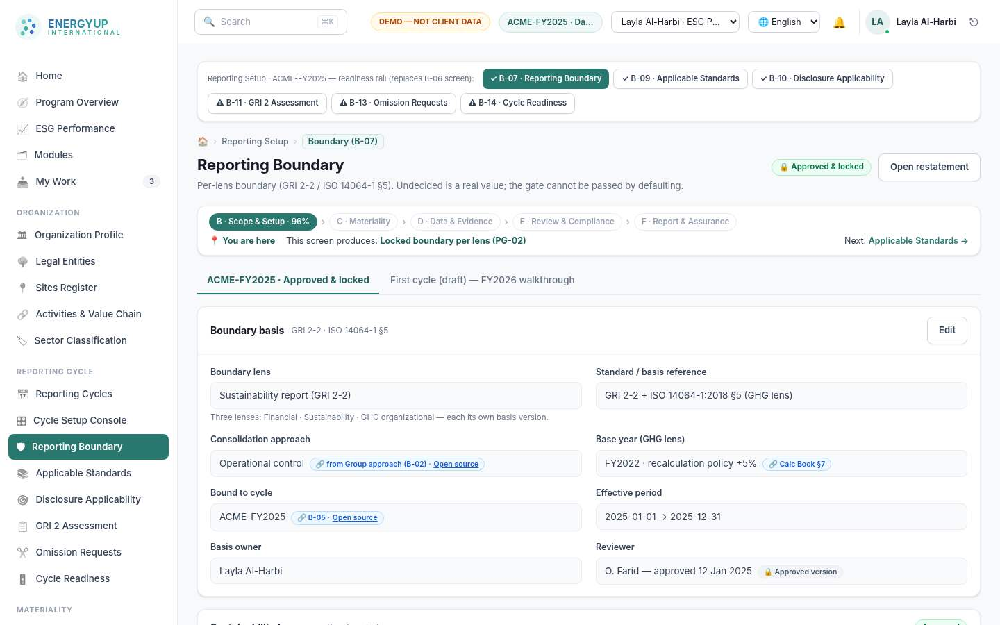
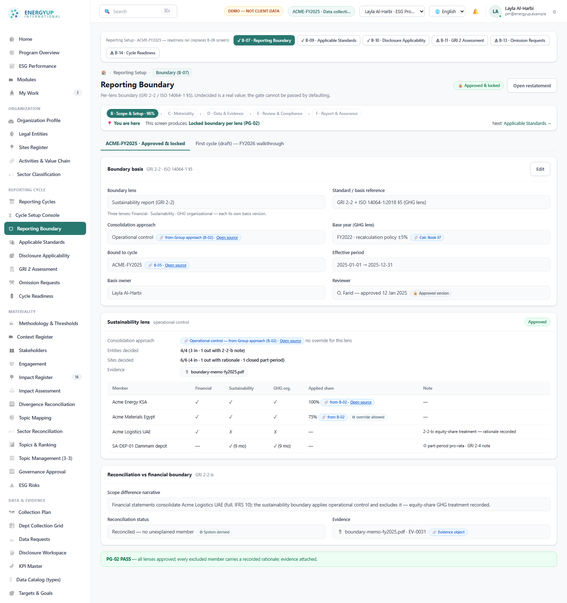
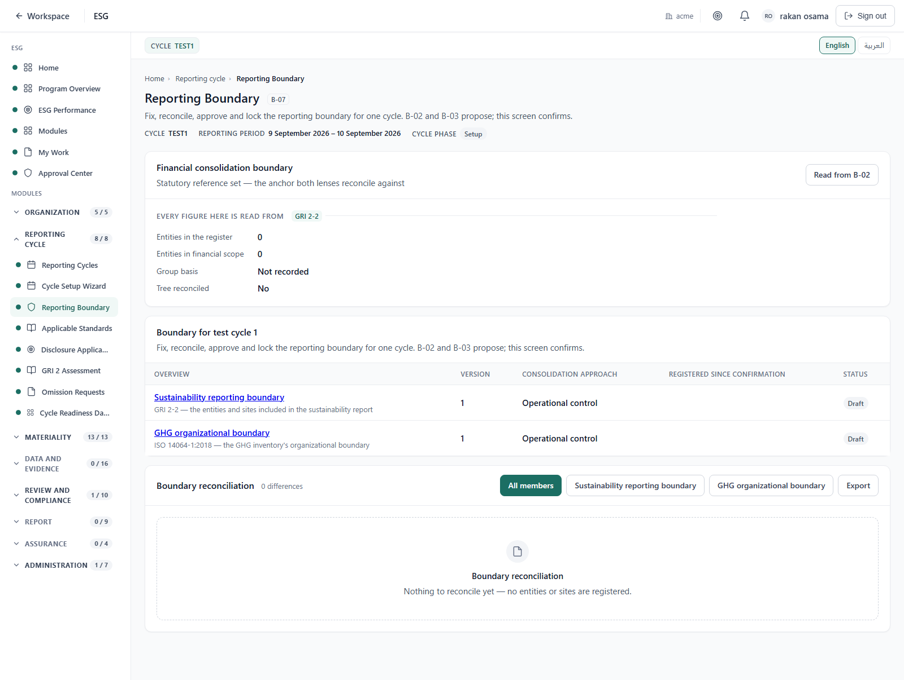

# B-07 — Reporting Boundary

| | |
|---|---|
| **Route** | prototype `#/setup/boundary` · .NET `/modules/esg/setup/boundary` |
| **Audit** | `scr-19` · **P1** · UX **9.5** · Setup / governance workbench |
| **Owner role** | ESG Programme Manager / Governance Reviewer |
| **Owns** | `BoundaryBasisVersion` |
| **Upstream** | `org/entities` + `org/sites` + cycle basis · **Downstream** `org/sector` → `setup/standards` |
| **Gate** | **PG-02** |
| **.NET spec** | `docs\ESG\build\04-screens\30-cycle\03-boundary.md` |

---

## Purpose

> "Per-lens boundary (GRI 2-2 / ISO 14064-1 §5). Undecided is a real value; the gate cannot be
> passed by defaulting."

Three lenses, and they legitimately disagree: an entity can be **consolidated in full** on the
financial lens and **excluded** on the sustainability lens because the basis there is operational
control. That disagreement is not an error to reconcile away — it is a fact to explain.

---

## 1. What it must contain — the audit

**Inputs** Entity/site versions · boundary basis/lens · control/ownership treatment ·
rationale/evidence
**Outputs** `BoundaryVersion` · In / Out / **Undecided** decisions
**Completion gate** **No mandatory Undecided boundary rows**

**Captured columns — 10, AT THE CAP, so truncated** ([F-17](../03-FINDINGS.md#f-17)):

> `Boundary lens` · `Standard / basis reference` · `Consolidation approach` ·
> `Base year (GHG lens)` · `Bound to cycle` · `Effective period` · `Basis owner` · `Reviewer` ·
> `Scope difference narrative` · `Reconciliation status`

That is the **basis** table only. The member decision grid — the actual Include/Exclude/Undecided
matrix the Purpose is about — has **no captured columns at all**.

**P1 hardening:** *"Keep Include/Exclude/Undecided as real decisions, versioned per lens.
Enforce no final gate while mandatory rows are Undecided; capture reconciliation and evidence."*

**Visible notice:** "PG-02 PASS — all lenses approved; every excluded member carries a recorded
rationale; evidence attached."

---

## 2. What the prototype renders

`assets/js/07-views.js:316` — 6,810 chars, reads only `D.cycle`.

| | |
|---|---|
| Basis block | a `formGrid`, not a table — lens, standard, consolidation, base year, bound-to-cycle, effective period, owner, reviewer |
| Member table | `Member · Financial · Sustainability · GHG org. · Applied share · Note` — **5 hard-coded `<tr>`** |
| Decisions | rendered as ✓ / ✗ glyphs — **the three-state value is not visible as a state** |
| Forms | `bndBasisForm()` — **two-argument `drawer()` ⇒ writes nothing** |
| Tabs | a second tab (`D.bndDraft`) is the only genuinely live grid in the group |

Two problems visible in the screenshot above:

- **[F-7](../03-FINDINGS.md#f-7)** the tile reads **4/4** entities and **6/6** sites, while the
  sentence beside it says *"4/4 (3 in · 1 out with 2-2-b note)"* and the data says 3 of 4 are in
  the sustainability boundary. Three readings, one screen.
- **[F-14](../03-FINDINGS.md#f-14)** the evidence chip cites `EV-0031`, which is not in
  `D.evidence`.

There is no Undecided anywhere in the prototype's member grid — every cell is ✓ or ✗. The single
most important rule on this screen is not represented.

---

## 3. What .NET implements

### As it runs today

**Captured 9 Sep 2026** from `http://acme.localhost:5270` — tenant **acme**, signed in as a
Programme Manager. Cycle **TEST1**. Both boundary lenses exist as v1 drafts; no legal
entities or sites are registered yet.

**Three blocks, in order:**

1. **Financial consolidation boundary** — the statutory anchor, read-only, with a **Read from
   B-02** action. Fields: `Entities in the register` · `Entities in financial scope` ·
   **`Group basis`** (`Not recorded`) · **`Tree reconciled`** (`No`). Labelled *"every figure
   here is read from GRI 2-2"*.
2. **The basis table** — columns `OVERVIEW` (name over standard) · `VERSION` ·
   `CONSOLIDATION APPROACH` · `REGISTERED SINCE CONFIRMATION` · `STATUS`. Two rows, live:
   **Sustainability reporting boundary** (GRI 2-2) and **GHG organizational boundary**
   (ISO 14064-1:2018), both v1 · Operational control · Draft.
3. **Boundary reconciliation** — `0 differences`, with lens tabs **All members** /
   **Sustainability reporting boundary** / **GHG organizational boundary** + Export.

- ✔ **The member decision grid the audit never captured is this third block** — and it is
  *lens-scoped*, which the audit's flat chip list could not have shown.
- ⚠ Its columns cannot be read from an empty tenant, so that half of the gap register's B-07 row
  stays open. Re-shoot once entities are registered.
- ✔ Cycle scoping is explicit: a `CYCLE TEST1` chip plus a context strip reading
  `CYCLE · REPORTING PERIOD · CYCLE PHASE`.

### The code behind it

| | |
|---|---|
| Pages | `Pages\Esg\Boundary\Index.cshtml(.cs)`, `BoundaryMatrixFilter.cs` |
| Services | `IBoundaryBasisService` · `IBoundaryWorkflowService` · `IBoundaryOverviewService` |
| Entities | `BoundaryBasis`, `BoundaryBasisVersion` (+ `.Children.cs`, `.Transitions.cs`), `BoundaryScopeEntity`, `BoundaryScopeSite`, `BoundaryBasisStandard` |
| Permissions | `esg.boundary.{view,add,edit,delete,handover,signoff}` — **complete** |

The **only** screen in the group whose service surface is complete: create, next version, read,
update, reseed, delete draft, submit, begin review, approve, reject, return, lock.

---

## 4. Gap

| Requirement | Audit | Prototype | .NET | Verdict |
|---|---|---|---|---|
| Basis table, 10 captured columns | ✔ | ✔ as a form, not a table | ✔ | **OK** |
| Member grid | *columns not captured* | ✔ 5 literal rows | ✔ | ⚪ **re-elicit columns** |
| **Include / Exclude / Undecided as three states** | ✔ | ✗ ✓/✗ only | ✔ | prototype **MISSING** |
| Versioned **per lens** | ✔ | ✗ | ✔ `BoundaryBasisVersion` | **OK** in .NET |
| Rationale + evidence on exclusion | ✔ | shown in a Note column | ✔ | **OK** |
| Reconciliation status | ✔ | ✔ derived | ✔ | **OK** |
| **No gate pass while mandatory rows Undecided** | ✔ | ✗ no Undecided exists | ✔ | **OK** in .NET |
| Member counts consistent | — | ✗ [F-7](../03-FINDINGS.md#f-7) | — | prototype defect |
| Basis edit writes | — | ✗ **STUB** | ✔ `UpdateAsync` | prototype **STUB** |

---

## 5. CRUD & workflow

| Op | Prototype | .NET |
|---|---|---|
| Create | — | `CreateAsync`, `StartNextVersionAsync` |
| Read | 5 literal rows | `GetVersionAsync`, `GetVersionsAsync`, `GetAllVersionsAsync` |
| Update | `bndBasisForm()` **STUB** | `UpdateAsync`, `ReseedAsync` |
| Delete | — | `DeleteDraftAsync` |
| **Submit** | — | `IBoundaryWorkflowService.SubmitAsync` |
| Approve / Reject / Return | — | `ApproveAsync` / `RejectAsync` / `ReturnForCorrectionAsync` |
| Other | — | `BeginReviewAsync`, `LockAsync` |

---

## 6. Approval Center

**Participates.** `BoundaryBasisVersion` → feature key **`boundary`**.

Submit moves the version `Draft → Submitted`; the projection interceptor writes the queue row;
the PM approves with `boundary.signoff`, and cannot be the submitter. Approving unlocks B-08 and
B-09.

---

## 7. Open questions

1. **The member grid's column set was never captured.** It is the core of the screen. Re-elicit
   it — the .NET `BoundaryMatrixFilter` and `BoundaryScopeEntity`/`BoundaryScopeSite` are the
   best sources.
2. Which lens is authoritative for the **report**? The audit implies sustainability (GRI 2-2);
   confirm and state it, since the tiles must count something specific.
3. What makes a member row **mandatory** for the gate? "No mandatory Undecided rows" needs a
   definition of mandatory.
4. On an upstream entity/site version change, is the boundary flagged **stale** rather than
   silently re-resolved? The traceability contract requires it; confirm it is implemented.
