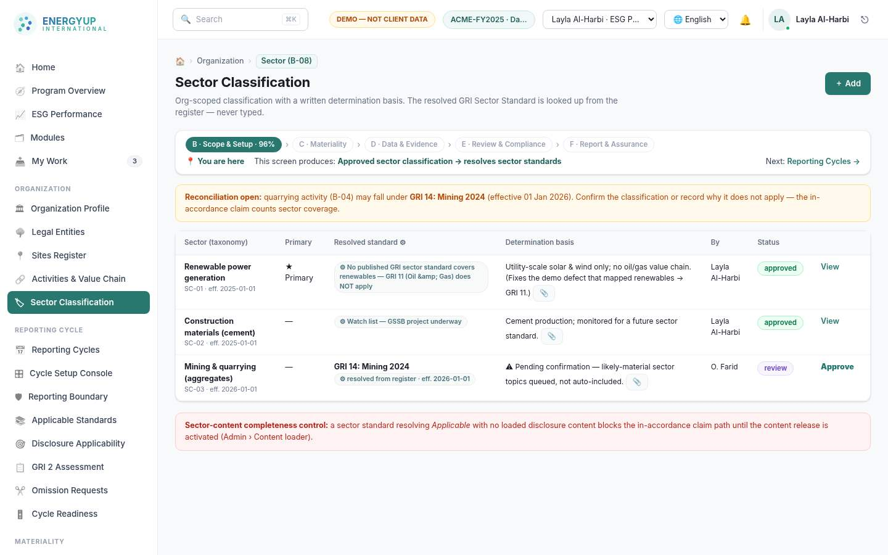
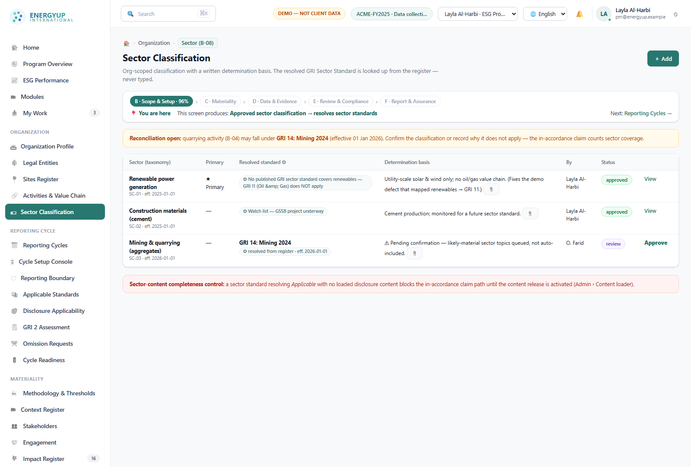
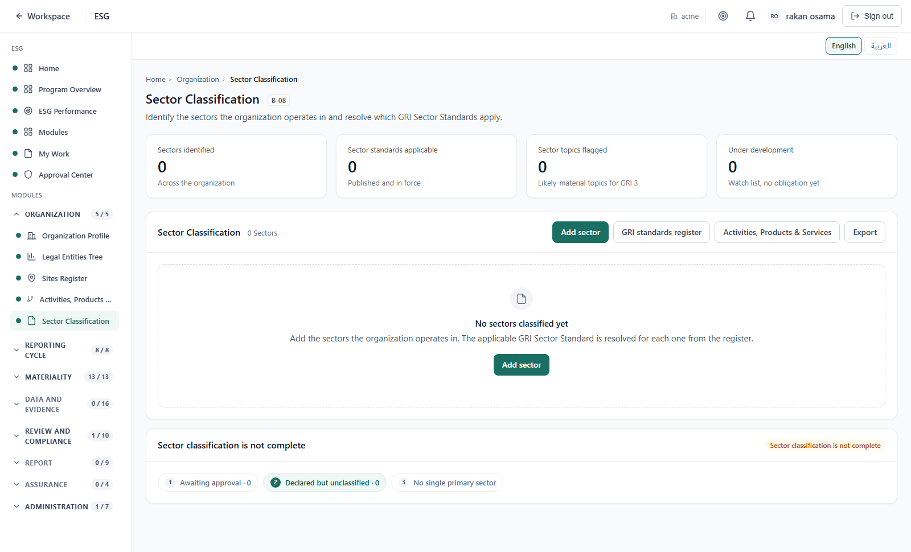

# B-08 — Sector Classification

| | |
|---|---|
| **Route** | prototype `#/org/sector` · .NET `/modules/esg/org/sector` |
| **Audit** | `scr-20` · P2 · UX 9.2 · Master-data register / form |
| **Owner role** | ESG Programme Manager / Technical Reviewer |
| **Owns** | `SectorAssignmentVersion` |
| **Upstream** | `org/acts` + boundary + taxonomy · **Downstream** `setup/standards` |
| **.NET spec** | `docs\ESG\build\04-screens\20-organization\05-sector.md` |

> **Note the nav group.** B-08 sits in **Organization**, not Reporting Cycle — in the audit, in
> the prototype sidebar and in `EsgNavigation.cs`. It is documented here because the cycle
> journey runs through it: boundary → sector → standards.

---

## Purpose

> "Org-scoped classification with a written determination basis. The resolved GRI Sector
> Standard is looked up from the register — never typed."

---

## 1. What it must contain — the audit

**Inputs** Activities · taxonomy · determination basis · evidence
**Outputs** `SectorClassificationVersion` · resolved sector-standard candidate
**Completion gate** Classification approved with basis/evidence

**Captured columns (6, complete):**
`Sector (taxonomy)` · `Primary` · `Resolved standard ⚙` · `Determination basis` · `By` · `Status`

**P2 hardening:** *"Resolution must come from governed standards registry/content release.
Approval triggers downstream applicability re-resolution and change-impact/stale flags."*

**Two visible notices, both consequential:**

1. *"Reconciliation open: quarrying activity (B-04) may fall under GRI 14: Mining 2024 (effective
   01 Jan 2026). Confirm the classification or record why it does not apply — the in-accordance
   claim counts sector coverage."*
2. *"Sector-content completeness control: a sector standard resolving Applicable with **no loaded
   disclosure content blocks the in-accordance claim path** until the content release is
   activated (Admin › Content loader)."*

The second is a real trap: a correct classification can still block the claim if nobody loaded
the content.

---

## 2. What the prototype renders

`assets/js/07-views.js:206` — 2,243 chars, reads **`D.sectors`** (3 rows — a real register).

Table columns match the audit exactly. **This is the only screen in the group whose Add button
actually writes:** `＋ Add` → `secClsForm()` + `secClsFoot()` → `secClsSave(st)` unshifts a row
into `D.sectors` and audits it.

Row actions are status-dependent — approved → `View` (toast), review/submitted → **`Approve` →
`secClsApprove()` writes**, draft → `Edit` → *toast only, no form opens*.

**It also has the group's only working submit:** `secClsFoot()` offers "Save draft" and
"Submit for review →", calling `secClsSave('draft' | 'submitted')`.

One inconsistency: the route carries **no `setupRail()`** even though it is a step in the setup
journey — every sibling screen has one.

---

## 3. What .NET implements

### As it runs today

**Captured 9 Sep 2026** from `http://acme.localhost:5270` — tenant **acme**, signed in as a
Programme Manager. No sectors classified yet.

- 🟡 **It lives under ORGANIZATION in .NET, not Reporting Cycle.** The prototype and the audit
  both group it with the cycle. One of the two nav placements is wrong; decide which.

**Tiles:** Sectors identified · Sector standards applicable · Sector topics flagged ·
**Under development** (*"Watch list, no obligation yet"*)
**Actions:** **Add sector** · GRI standards register · Activities, Products & Services · Export

- ✔ **A named blocker panel** at the foot — *"Sector classification is not complete"* — with
  numbered chips: ① Awaiting approval · 0 ② Declared but unclassified · 0 ③ **No single primary
  sector**. The "exactly one primary sector" rule is surfaced as a reason, not a silent
  validation.
- This blocker pattern recurs on B-09 and B-14 and is the clearest thing in the build for
  answering *"why is this gate not met?"*. Nothing in the prototype does it.

### The code behind it

| | |
|---|---|
| Pages | `Pages\Esg\Sectors\Index.cshtml(.cs)`, `Detail.cshtml(.cs)`, `Register.cshtml(.cs)` (read-only GRI register) |
| Services | `ISectorAssignmentService` · `ISectorWorkflowService` · `ISectorRegisterService` |
| Entities | `SectorAssignment`, `SectorAssignmentVersion` (+ `.Transitions.cs`), `GriSectorTopic` |
| Permissions | `esg.sector.{view,add,edit,delete,handover,signoff}` — **complete** |

`ISectorRegisterService` exposes `GetSuggestedSectorsAsync` and `PreviewAsync` — the resolution
is looked up and previewed, never typed, exactly as the audit requires.

---

## 4. Gap

| Requirement | Audit | Prototype | .NET | Verdict |
|---|---|---|---|---|
| 6-column register | ✔ | ✔ | ✔ | **OK** |
| Resolved standard looked up, not typed | ✔ | ✔ ⚙ | ✔ `PreviewAsync` | **OK** |
| Determination basis + evidence | ✔ | ✔ | ✔ | **OK** |
| Create | — | ✔ **writes** | ✔ `CreateAsync` | **OK** |
| Edit a draft | — | ✗ toast only | ✔ `UpdateAsync` | prototype **STUB** |
| Delete | — | ✗ | ✔ `DeleteAsync(versionId)` | **OK** in .NET |
| Submit for review | — | ✔ **writes** | ✔ `SubmitAsync` | **OK** |
| Approve | ✔ gate | ✔ `secClsApprove()` | ✔ `ApproveAsync` | **OK** |
| **Return for correction** | — | ✗ | ✔ `ReturnForCorrectionAsync` | prototype **MISSING** |
| Approval re-resolves downstream + flags stale | ✔ P2 | ✗ | *not verified* | **open** |
| Sector-content completeness blocks the claim | ✔ notice | notice only | *not verified* | **open** |
| `setupRail()` on the route | — | ✗ | n/a | prototype inconsistency |

---

## 5. CRUD & workflow

| Op | Prototype | .NET |
|---|---|---|
| Create | ✔ `secClsSave()` | `CreateAsync`, `StartNextVersionAsync` |
| Read | `D.sectors` | `GetAsync`, `GetVersionAsync`, `GetRegisterAsync`, `GetAssignmentsAsync` |
| Update | ✗ | `UpdateAsync` |
| Delete | ✗ | `DeleteAsync(versionId)` |
| Submit | ✔ `secClsSave('submitted')` | `SubmitAsync` |
| Approve / Reject / Return | Approve only | all three + `BeginReviewAsync`, `LockAsync` |

---

## 6. Approval Center

**Participates.** `SectorAssignmentVersion` → feature key **`sector`**.

Approving is the trigger the P2 hardening cares about: it must re-resolve B-09 Applicable
Standards and mark dependent approved objects **stale** rather than silently updating them.

---

## 7. Open questions

1. **Is the downstream re-resolution on approval implemented?** It is the hardening item and I
   could not confirm it from the service signatures alone.
2. The **GRI 14 Mining 2024** reconciliation notice is hard-coded in the prototype. In .NET, is
   an unconfirmed sector candidate surfaced as a blocking item, and where?
3. The **content-release check** — where does "resolved Applicable but no content loaded" get
   detected, and does it block the claim as the notice says?
4. Should B-08 carry the setup rail, given it is a setup step? Cosmetic, but it is the only step
   without one.
