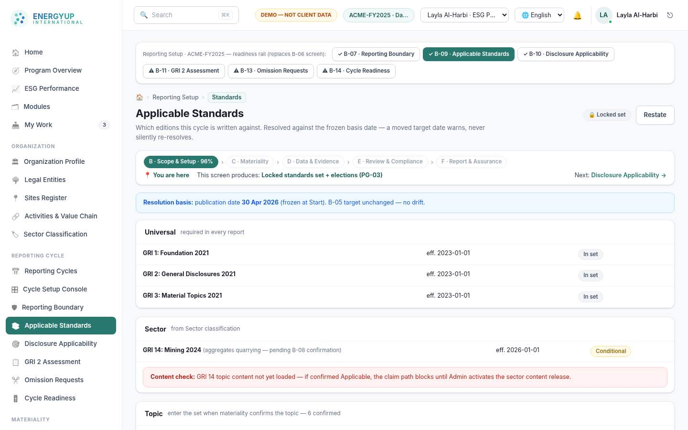
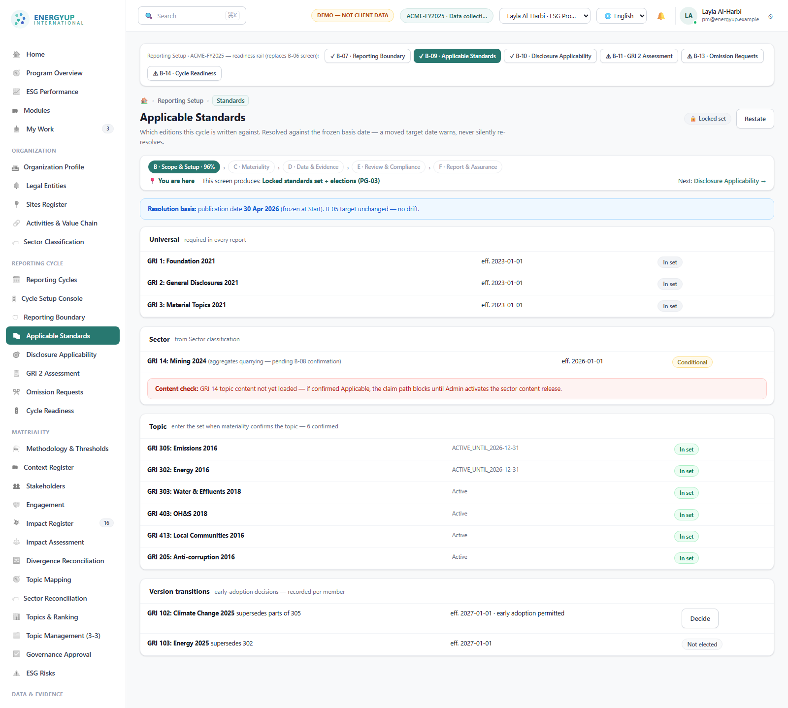
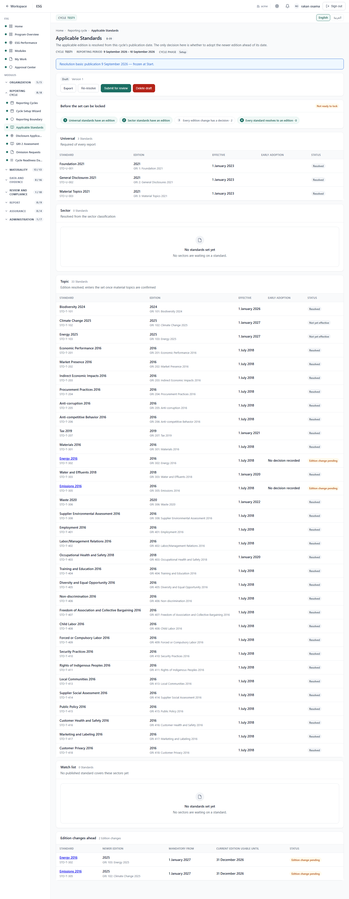

# B-09 — Applicable Standards

> ⚪ **This is the worst-specified screen in either group.** The audit captured **zero columns**
> for it. See [F-5](../03-FINDINGS.md#f-5).

| | |
|---|---|
| **Route** | prototype `#/setup/standards` · .NET `/modules/esg/setup/standards` |
| **Audit** | `scr-21` · **P1** · UX **9.5** · Setup / governance workbench |
| **Owner role** | Methodology Owner / ESG Programme Manager |
| **Owns** | `CycleStandardSetVersion` |
| **Upstream** | cycle basis date + sector classification + content release · **Downstream** `setup/applic` |
| **.NET spec** | `docs\ESG\build\04-screens\30-cycle\04-standards.md` |

---

## Purpose

> "Which editions this cycle is written against. Resolved against the frozen basis date — a moved
> target date warns, never silently re-resolves."

---

## 1. What it must contain — the audit

**Inputs** Cycle basis / publication date · sector classification · content release
**Outputs** `ApplicableStandardsSetVersion` · edition / effective-date resolution
**Completion gate** Applicable editions resolved **as-of the basis date**

### ⚠ Captured columns: **none**

The `
` block contains a single sentinel chip:

> *"Derived / navigation screen — business inputs arrive from linked authoritative objects"*

That sentinel is used on 25 of the 85 audited screens, and this is the **only** one in either of
our two groups. It is not credible here: the screenshot shows four populated tables, and the
screen produces a versioned governed object. **The column set has to be re-elicited from
scratch** — nothing can be built to spec from the audit alone.

**P1 hardening:** *"Resolve edition AS-OF frozen basis date through ContentRelease. Show
early-adoption decision as governed human choice; activation changes must propagate stale
impact."*

**Visible notices:**
1. *"Resolution basis: publication date 30 Apr 2026 (frozen at Start). B-05 target unchanged — no
   drift."*
2. *"Content check: GRI 14 topic content not yet loaded — if confirmed Applicable, the claim path
   blocks until Admin activates the sector content release."*

---

## 2. What the prototype renders

`assets/js/07-views.js:367` — 2,845 chars. **The thinnest governance screen in the group.**

| | |
|---|---|
| Tables | **4**, and **not one has a header row** — `<thead>` is absent from all four |
| Rows | **7 hard-coded `<tr>`** |
| `D.*` reads | **zero** |
| Forms | `electForm()` — **two-argument `drawer()` ⇒ writes nothing**, so an election can never be recorded |
| Actions | `Decide` per transition row; `Restate` → toast |

The four blocks visible are **Universal · Sector · Topic · Version transitions**. That structure
is the most useful artefact this screen currently provides, and it is the natural starting point
for re-eliciting the column set.

Because `electForm()` cannot write, the "elections open" count can never decrease — the screen
can never reach its own completion gate.

---

## 3. What .NET implements

### As it runs today

**Captured 9 Sep 2026** from `http://acme.localhost:5270` — tenant **acme**, signed in as a
Programme Manager. Cycle **TEST1**, with **36 standards** seeded — 3 universal and 33 topic.
This is the most data-rich capture in the set.

> ### ✅ This closes [F-5](../03-FINDINGS.md#f-5) — the largest open item in the whole document set
>
> The audit captured **zero** columns for B-09. The running screen resolves it completely.

**Every register on the screen shares one column set:**
`STANDARD` (title over internal code, e.g. `STD-U-001`) · `EDITION` (year over full GRI
citation) · `EFFECTIVE` · `EARLY ADOPTION` · `STATUS`

**Four registers**, each with its own rule as a subtitle:

| Register | Live count | Subtitle |
|---|:-:|---|
| Universal | 3 | Required of every report |
| Sector | 0 | Resolved from the sector classification |
| Topic | 33 | Edition resolved; enters the set once material topics are confirmed |
| Watch list | 0 | No published standard covers these sectors yet |

**A fifth table — "Edition changes ahead"** (2 rows live), with different columns:
`STANDARD` · `NEWER EDITION` · `MANDATORY FROM` · `CURRENT EDITION USABLE UNTIL` · `STATUS`

**Status vocabulary observed:** `Resolved` · `Not yet effective` · **`Edition change pending`**

**Version bar:** `Draft · Version 1` — **Export · Re-resolve · Submit for review · Delete draft**
**Lock blockers:** ① Universal standards have an edition ② Sector standards have an edition
③ **Every edition change has a decision · 2** ④ Every standard resolves to an edition · 0 —
with **Not ready to lock** at the right.
**Resolution basis:** *"publication 9 September 2026 — frozen at Start."*

- ✔ Live, Energy 2016 and Emissions 2016 show `No decision recorded` → `Edition change pending`,
  which is precisely the audit's "the only decision here is whether to adopt the newer edition
  ahead of its date".
- ✔ **This is the reference implementation of a governed version bar** — Export / Re-resolve /
  Submit for review / Delete draft. C-01 offers only *Edit draft* on the same kind of object
  ([F-19](../03-FINDINGS.md#f-19)).

### The code behind it

| | |
|---|---|
| Pages | `Pages\Esg\Standards\Index.cshtml(.cs)` |
| Services | `ICycleStandardSetService` · `ICycleStandardWorkflowService` · `IStandardSetOverviewService` · `IGriStandardRegisterService` |
| Entities | `CycleStandardSet`, `CycleStandardSetVersion` (+ `.Children.cs`, `.Transitions.cs`), `CycleStandardMember`, `GriStandard*` |
| States | `StandardResolutionState` — Resolved · TransitionPending · EarlyAdopted · NotYetEffective · Unresolvable · Superseded |
| Permissions | `esg.standards.{view,add,edit,delete,handover,signoff}` |

`StandardResolutionState` is the strongest evidence of what the missing columns should be: every
member row carries a resolution state, and **TransitionPending** / **EarlyAdopted** are exactly
the "governed human choice" the hardening text demands.

---

## 4. Gap

| Requirement | Audit | Prototype | .NET | Verdict |
|---|---|---|---|---|
| **Column set** | ⚪ **none captured** | 4 tables, no headers | ✅ **`STANDARD · EDITION · EFFECTIVE · EARLY ADOPTION · STATUS`** | ✅ **RESOLVED — see §3** |
| Universal / Sector / Topic / transitions blocks | *not captured* | ✔ structure only | ✔ | prototype is the reference |
| Resolution as-of the **frozen** basis date | ✔ | notice only | ✔ | **OK** in .NET |
| A moved target date **warns**, never re-resolves | ✔ | ✗ | *not verified* | **open** |
| Early-adoption election as a governed choice | ✔ | ✗ **STUB** | ✔ `DecideAsync` + `EarlyAdopted` | prototype **STUB** |
| Content-release check blocks the claim | ✔ notice | notice only | *not verified* | **open** |
| Set-level Update | — | — | **absent by design** — fields are resolved, not typed | **OK** |
| Submit / approve | *not captured* | ✗ | ✔ full workflow | prototype **MISSING** |

---

## 5. CRUD & workflow

| Op | Prototype | .NET |
|---|---|---|
| Create | — | `StartAsync` — the only creation path |
| Read | 7 literals | `GetAsync`, `GetMemberAsync`, `GetRegisterAsync` |
| Update | `electForm()` **STUB** | `DecideAsync` (per member), `ReResolveAsync`, `RestateAsync` |
| Delete | — | `DeleteDraftAsync` |
| Submit | — | `SubmitAsync` |
| Approve / Reject / Return | — | all three + `BeginReviewAsync`, `LockAsync` |

There is deliberately **no set-level Update** — the set is resolved from the basis date and the
sector, and only individual member decisions are human input. That is the right shape and worth
preserving.

---

## 6. Approval Center

**Participates.** `CycleStandardSetVersion` → feature key **`standards`**.

---

## 7. Open questions

**These are blocking, not advisory — the screen has no captured spec.**

1. **What are the columns of each of the four tables?** Universal, Sector, Topic, Version
   transitions. Derive from `CycleStandardMember` + `StandardResolutionState` and confirm with
   the Methodology Owner.
2. **What does an early-adoption election capture?** Adopt yes/no, owner, rationale, restatement
   note, effective date — none of it is specified anywhere I could find.
3. **What does "a moved target date warns" look like?** Which screen shows the warning, and does
   it block anything?
4. How is a **version transition** (a successor standard superseding a predecessor) represented
   in the member table — one row or two?
5. Does `ReResolveAsync` mark dependent approved objects stale, per the traceability contract?
