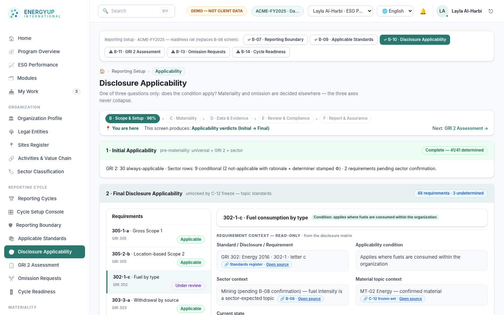
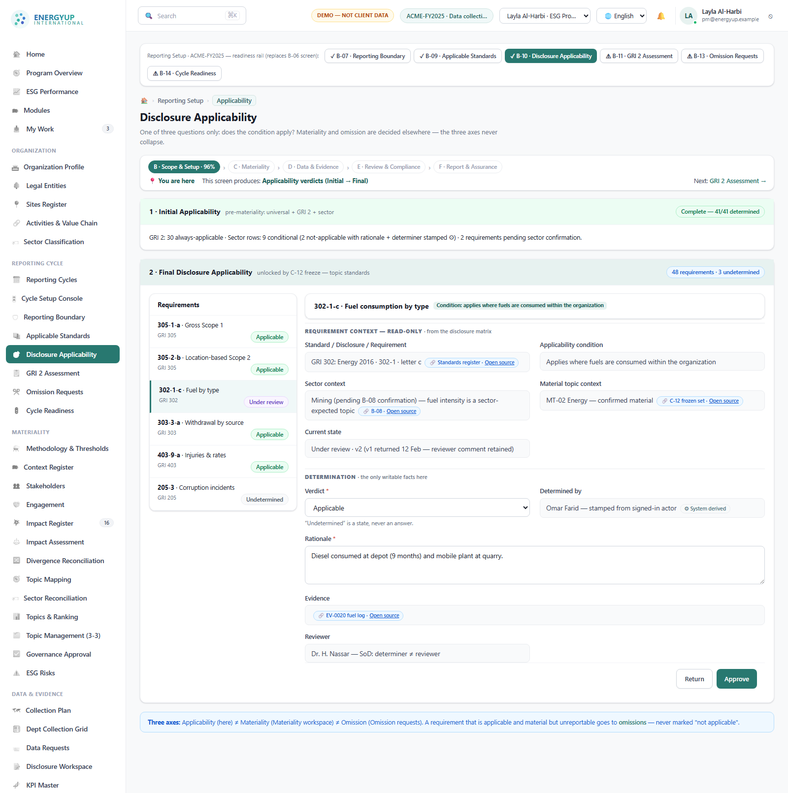
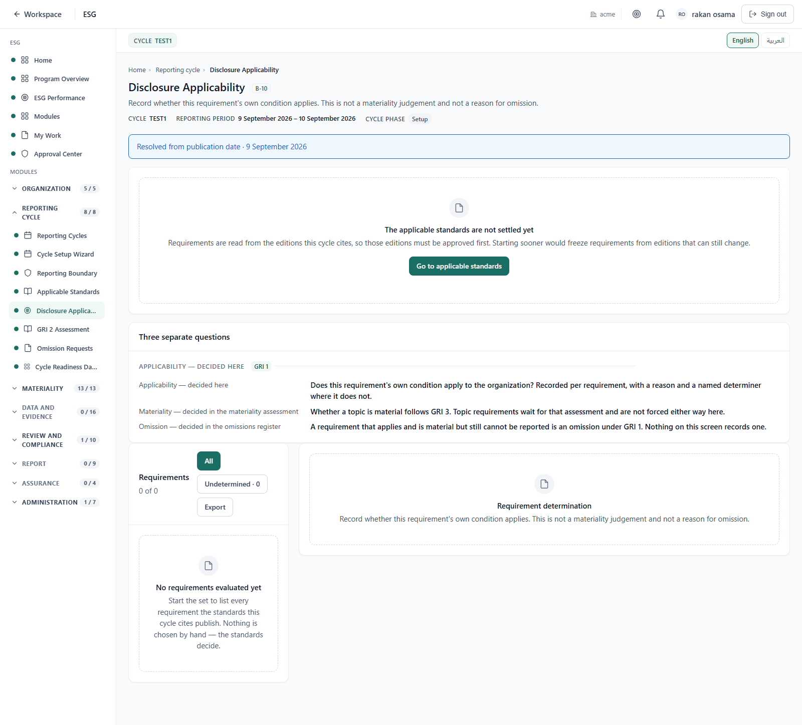

# B-10 — Disclosure Applicability

| | |
|---|---|
| **Route** | prototype `#/setup/applic` · .NET `/modules/esg/setup/applic` |
| **Audit** | `scr-22` · **P1** · UX **9.5** · Setup / governance workbench |
| **Owner role** | ESG Programme Manager / Technical Reviewer |
| **Owns** | `DisclosureApplicabilityVersion` |
| **Upstream** | standards + boundary + conditional requirements |
| **Downstream** | `setup/gri2` + `mat/config` + `data/plan` |
| **.NET spec** | `docs\ESG\build\04-screens\30-cycle\05-applic.md` |

---

## Purpose

> "One of three questions only: does the condition apply? Materiality and omission are decided
> elsewhere — the three axes never collapse."

This is the screen the whole "three axes" rule exists to protect. Its on-screen notice states it:

> **Applicability (here) ≠ Materiality (Materiality workspace) ≠ Omission (Omission requests).
> A requirement that is applicable and material but unreportable goes to omissions — never marked
> "not applicable".**

---

## 1. What it must contain — the audit

**Inputs** Standards set · boundary · disclosure conditions · sector context
**Outputs** `DisclosureApplicabilityDecision` · requirements activated for assessment/collection
**Completion gate** Every required disclosure has an applicability decision

**Captured columns — 10, AT THE CAP, so possibly truncated** ([F-17](../03-FINDINGS.md#f-17)):

> `Standard / Disclosure / Requirement` · `Applicability condition` · `Sector context` ·
> `Material topic context` · `Current state` · `Verdict *` · `Determined by` · `Rationale *` ·
> `Evidence` · `Reviewer`

The `*` markers survived the capture: **Verdict and Rationale are mandatory**. This is one of
only two screens where any field-level requirement is recorded at all.

**P1 hardening:** *"Keep applicability separate from materiality and omission. Store final
decision+rationale+evidence; no label collision or **auto 'not applicable' from missing data**."*

---

## 2. What the prototype renders

`assets/js/07-views.js:385` — 3,893 chars.

| | |
|---|---|
| Tables | **none.** A searchable queue list plus a single-record detail `formGrid` |
| `D.*` reads | **zero** — six requirement rows hard-coded |
| Queue | **has no click handler** — the detail pane is pinned to one requirement |
| Forms | none — the verdict is an inline control with no save |
| Footer | `Return` → toast · `Approve` → audit + toast, **never changes state** |

**The queue is not clickable.** You can see six requirements and inspect exactly one of them.
For a screen whose gate is "*every* required disclosure has a decision", that is the central
failure: there is no way to reach the other five.

Note the audit describes a **register**; the prototype implements a **queue + detail** layout.
Neither is wrong, but the captured columns describe the register, so the two do not line up. The
.NET build follows the register shape.

---

## 3. What .NET implements

### As it runs today

**Captured 9 Sep 2026** from `http://acme.localhost:5270` — tenant **acme**, signed in as a
Programme Manager. Cycle **TEST1**. The screen is **gated shut** — which is what makes this
capture useful.

- ✔ **The B-09 → B-10 gate works and explains itself:** *"The applicable standards are not settled
  yet — Requirements are read from the editions this cycle cites, so those editions must be
  approved first. Starting sooner would freeze requirements from editions that can still change."*
  with a **Go to applicable standards** button. A blocked screen that says why and where to go.

**"Three separate questions"** — the conceptual core, on the screen itself:

| | |
|---|---|
| **Applicability — decided here** | Does this requirement's own condition apply? Recorded per requirement, with a reason and a **named determiner** where it does not. |
| Materiality — decided in the materiality assessment | Topic requirements wait for GRI 3 and are not forced either way here. |
| Omission — decided in the omissions register | A requirement that applies and is material but cannot be reported is an omission under GRI 1. **Nothing on this screen records one.** |

- ✔ This is the audit's "not a materiality judgement and not a reason for omission", built as
  standing screen copy rather than a validation message.
- ✔ **"named determiner"** is the attribution the audit asked for and could not find.
- **Master–detail:** left list `Requirements 0 of 0` with **All / Undetermined · 0 / Export**;
  right pane **Requirement determination**.
- ✔ Empty state states the derivation rule: *"Nothing is chosen by hand — **the standards
  decide**."* The prototype's version of this screen reads nothing at all.

### The code behind it

| | |
|---|---|
| Pages | `Pages\Esg\Applicability\Index.cshtml(.cs)`, `ApplicabilityRailFilter.cs` |
| Services | `IDisclosureApplicabilityService` · `IDisclosureApplicabilityWorkflowService` · `IDisclosureApplicabilityOverviewService` |
| Entities | `DisclosureApplicabilitySet`, `DisclosureApplicabilityVersion` (+2), `DisclosureDetermination` |
| States | `DeterminationState` — **Undetermined** · Applicable · NotApplicable · **PendingMateriality** · **AlwaysApplicable** |
| Permissions | `esg.applicability.{view,add,edit,delete,handover,signoff}` |

`DeterminationState` is better than the audit's binary verdict: **PendingMateriality** is exactly
the state that stops a requirement being wrongly marked "not applicable" while Epic C is still
running, and **AlwaysApplicable** covers the disclosures that can never be conditional.

---

## 4. Gap

| Requirement | Audit | Prototype | .NET | Verdict |
|---|---|---|---|---|
| Register with the 10 columns | ✔ | ✗ queue + detail, no table | ✔ | prototype **MISSING** |
| **Queue/rows selectable** | implied by the gate | ✗ **pinned to one row** | ✔ | prototype **MISSING** |
| Verdict mandatory | ✔ `*` | inline, no save | ✔ `DetermineAsync` | prototype **STUB** |
| Rationale mandatory | ✔ `*` | inline, no save | ✔ | prototype **STUB** |
| Determined by ⚙ / Reviewer | ✔ | displayed | ✔ | **OK** |
| Evidence | ✔ | displayed | ✔ | **OK** |
| **No auto "not applicable" from missing data** | ✔ P1 | n/a | ✔ `Undetermined` + `PendingMateriality` | **OK** in .NET |
| Three axes kept apart | ✔ | ✔ notice present | ✔ | **OK** |
| Approve changes state | — | ✗ audits only | ✔ | prototype **STUB** |
| Rows from a register | — | ✗ 6 literals, 0 reads | ✔ | prototype **STUB** |

---

## 5. CRUD & workflow

| Op | Prototype | .NET |
|---|---|---|
| Create | — | `StartAsync` (the set) |
| Read | 6 literals | `GetAsync`, `GetDeterminationAsync` |
| Update | inline, no save | **`DetermineAsync`** (per determination), `ReResolveAsync`, `RestateAsync` |
| Delete | — | `DeleteDraftAsync` |
| Submit | — | `SubmitAsync` |
| Approve / Reject / Return | toast only | all three + `BeginReviewAsync`, `LockAsync` |

As with B-09 there is **no set-level Update** — only per-requirement determinations. Correct.

---

## 6. Approval Center

**Participates.** `DisclosureApplicabilityVersion` → feature key **`applicability`**.

Approving activates requirements for B-11, C-01 and the Collection Plan — this is the widest
downstream unlock in the group.

---

## 7. Open questions

1. The captured columns are **at the 10-chip cap**; a `Reviewer` column is present but there is
   no `Reviewed on` or decision date. Confirm the full set from `DisclosureDetermination`.
2. **`PendingMateriality` and `AlwaysApplicable` are not in the audit at all.** They are good
   additions — confirm they are documented in the frozen spec so the audit's binary verdict is
   not treated as the requirement.
3. What re-opens a determination when B-09 re-resolves? `ReResolveAsync` exists; confirm whether
   an already-approved determination is preserved, superseded or flagged stale.
4. The prototype's queue+detail layout versus the audit's register — confirm the .NET register
   is the intended UX, since the captured columns only make sense as a table.
