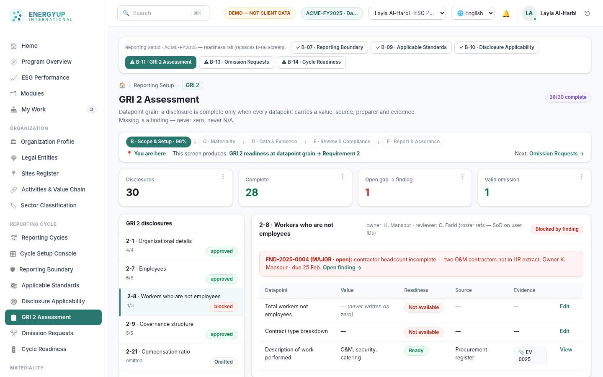
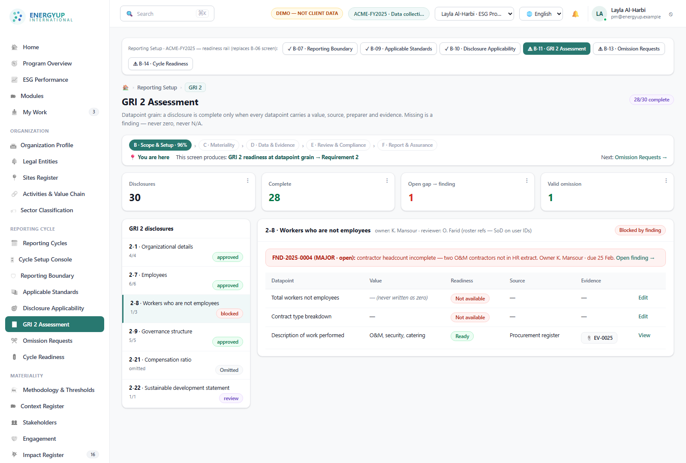
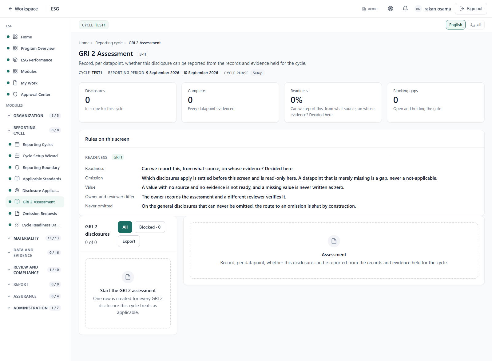

# B-11 — GRI 2 Assessment

> 🔴 **P0 — the highest-priority screen in the Reporting Cycle group.**

| | |
|---|---|
| **Route** | prototype `#/setup/gri2` · .NET `/modules/esg/setup/gri2` |
| **Audit** | `scr-23` · **P0** · UX 9.2 · Setup / governance workbench |
| **Owner role** | Data Owner / ESG Reviewer |
| **Owns** | `Gri2AssessmentVersion` |
| **Upstream** | applicable GRI 2 disclosures + datapoint definitions |
| **Downstream** | `setup/omissions` (if needed) · `setup/readiness` · `data/plan` |
| **.NET spec** | `docs\ESG\build\04-screens\30-cycle\06-gri2.md` |

---

## Purpose

> "Datapoint grain: a disclosure is complete only when every datapoint carries a value, source,
> preparer and evidence. **Missing is a finding — never zero, never N/A.**"

That last sentence is the whole screen. Completion is counted per **datapoint**, not per
disclosure checkbox, and an incomplete datapoint raises a **Finding** rather than being quietly
recorded as nil.

---

## 1. What it must contain — the audit

**Inputs** Applicable GRI 2 requirements · datapoint definitions · assigned owners ·
data/evidence
**Outputs** `GRI2Assessment` state · data requirements · findings/gaps where incomplete
**Completion gate** Every applicable GRI 2 requirement has complete datapoints **or a controlled
gap/omission path**
**Disposition** ADAPT — authoritative datapoint model + audit

**Captured columns (5):**
`Datapoint` · `Value` · `Readiness` · `Source` · `Evidence`

⚠ **The Purpose demands a *preparer* per datapoint and no preparer column was captured** —
see [F-18](../03-FINDINGS.md#f-18).

**P0 hardening:** *"migrate ReportedValue string to typed **DatapointRecord + ValueState +
dimensions + audit**. Completion is datapoint-level, not disclosure checkbox."*

**Visible notice** — an example of the finding path working:
> *"FND-2025-0004 (MAJOR · open): contractor headcount incomplete — two O&M contractors not in HR
> extract. Owner K. Mansour · due 25 Feb."*

---

## 2. What the prototype renders

`assets/js/07-views.js:411` — 6,886 chars.

| | |
|---|---|
| Table | `Datapoint · Value · Readiness · Source · Evidence` — matches the audit |
| Rows | **4 hard-coded `<tr>`** |
| `D.*` reads | **zero** |
| Queue | disclosure list — **no click handler** |
| Forms | `dpEntryForm()` opened from **three** places, all **two-argument `drawer()` ⇒ writes nothing** |

`dpEntryForm()` is roughly a **30-field** form — value state, readiness, source, estimation
basis, data quality, variance, restatement, assurance flag, evidence dropzone. It is the most
elaborate form in the prototype and it discards everything typed into it. Worse, it takes **no
argument**, so all three Edit links open the *same* datapoint regardless of which row was
clicked.

This is why the audit rates the screen P0.

---

## 3. What .NET implements

### As it runs today

**Captured 9 Sep 2026** from `http://acme.localhost:5270` — tenant **acme**, signed in as a
Programme Manager. Cycle **TEST1**; the assessment has not been started.

**Tiles:** Disclosures · Complete · **Readiness %** · **Blocking gaps** (*"Open and holding the
gate"*)

**"Rules on this screen"** — five rules, stated on the page:

| | |
|---|---|
| Readiness | Can we report this, from what source, on whose evidence? Decided here. |
| Omission | Which disclosures apply is settled before this screen and is read-only here. **A datapoint that is merely missing is a gap, never a not-applicable.** |
| Value | A value with no source and no evidence is not ready, and **a missing value is never written as zero**. |
| **Owner and reviewer differ** | The owner records the assessment and **a different reviewer verifies it**. |
| **Never omitted** | On the general disclosures that can never be omitted, the route to an omission is **shut by construction**. |

- ✔ **"Owner and reviewer differ" is the answer to the audit's missing *preparer*.** Attribution
  is modelled as owner + verifying reviewer rather than a single preparer field. Confirm the
  column names against the frozen spec before building against it.
- ✔ **"Shut by construction"** implements TRN-D22 as a constraint, matching B-13's *"refused on
  save"*. Same rule, enforced at both ends.
- **Master–detail:** `GRI 2 disclosures 0 of 0` with **All / Blocked · 0 / Export**.
- Creation is derived, not manual: *"One row is created for every GRI 2 disclosure this cycle
  treats as applicable."*

### The code behind it

| | |
|---|---|
| Pages | `Pages\Esg\Gri2\Index.cshtml(.cs)`, `Index.Drawers.cshtml.cs`, `Gri2RailFilter.cs` |
| Services | `IGri2AssessmentService` · `IGri2AssessmentWorkflowService` · `IGri2AssessmentOverviewService` |
| Entities | `Gri2AssessmentSet`, `Gri2AssessmentVersion` (+2), `DisclosureAssessment`, **`AssessmentDatapoint`**, **`AssessmentGap`** |
| States | `AssessmentStatus` — NotApplicable · NotStarted · Blocked · InProgress · Complete |
| Permissions | `esg.gri2.{view,add,edit,delete,handover,signoff}` |

**The P0 hardening is done.** `AssessmentDatapoint` is a first-class entity with its own
`SaveDatapointAsync` / `DeleteDatapointAsync`, and `AssessmentGap` gives the controlled gap path
its own object with `SaveGapAsync` / `DeleteGapAsync`. Completion is genuinely datapoint-level.

---

## 4. Gap

| Requirement | Audit | Prototype | .NET | Verdict |
|---|---|---|---|---|
| Datapoint table, 5 columns | ✔ | ✔ layout only | ✔ | **OK** |
| **Preparer per datapoint** | Purpose only, no column | ✗ | ✅ **owner + a different verifying reviewer** | ✅ **RESOLVED — see §3** |
| Typed `DatapointRecord` + **ValueState** | ✔ P0 | ✗ string form | ✔ `AssessmentDatapoint` | **OK** in .NET |
| Completion at datapoint grain | ✔ | ✗ | ✔ `AssessmentStatus` | **OK** in .NET |
| **Missing ⇒ Finding, never zero/N-A** | ✔ | notice only | ✔ `AssessmentGap` | **OK** in .NET |
| Controlled gap / omission path | ✔ gate | link to B-13 | ✔ | **OK** |
| Disclosure queue selectable | implied | ✗ no handler | ✔ | prototype **MISSING** |
| Edit opens the **clicked** datapoint | implied | ✗ takes no argument | ✔ | prototype **STUB** |
| Datapoint entry writes | ✔ | ✗ **STUB ×3** | ✔ `SaveDatapointAsync` | prototype **STUB** |
| **Delete the draft version** | — | ✗ | ✗ **absent** | **[F-15](../03-FINDINGS.md#f-15)** |
| Submit / approve | *not captured* | ✗ | ✔ full workflow | prototype **MISSING** |

---

## 5. CRUD & workflow

| Op | Prototype | .NET |
|---|---|---|
| Create | — | `StartAsync` (the set) |
| Read | 4 literals | `GetAsync`, `GetDisclosureAsync` |
| Update | `dpEntryForm()` **STUB** | `UpdateAsync`, `AssignAsync`, `ReResolveAsync`, `SaveDatapointAsync`, `SaveGapAsync` |
| Delete | — | datapoints and gaps only — **the version itself cannot be deleted** ([F-15](../03-FINDINGS.md#f-15)) |
| Submit | — | `SubmitAsync` |
| Approve | — | `ApproveAsync(id, approverName?)` — note the extra argument, unused by the Center |
| Reject / Return | — | `RejectAsync` / `ReturnForCorrectionAsync` |
| Other | — | `BeginReviewAsync`, `LockAsync`, **`StartRestatementAsync`** |

`AssignAsync` is the assignment of an owner to a disclosure — the closest thing to the missing
*preparer* concept. Worth confirming whether it satisfies the Purpose's requirement.

---

## 6. Approval Center

**Participates.** `Gri2AssessmentVersion` → feature key **`gri2`**.

One special case: the Center dispatches `ApproveAsync(id, null, ct)` — the approver-name argument
is never supplied. Harmless if the service falls back to the acting user, but worth checking that
it does rather than storing null.

---

## 7. Open questions

1. **Where is the preparer recorded per datapoint?** The Purpose requires it, no column captures
   it, and `AssignAsync` works at disclosure level. Confirm the grain.
2. **Why can a GRI 2 draft version not be deleted** when boundary, standards, applicability and
   sector all can? ([F-15](../03-FINDINGS.md#f-15))
3. `ApproveAsync` takes an `approverName` the Approval Center does not pass — confirm the
   fallback.
4. What exactly does `ValueState` enumerate? The audit says "never zero, never N/A" but does not
   list the permitted states. This needs to be explicit, since it is the rule the screen exists
   to enforce.
