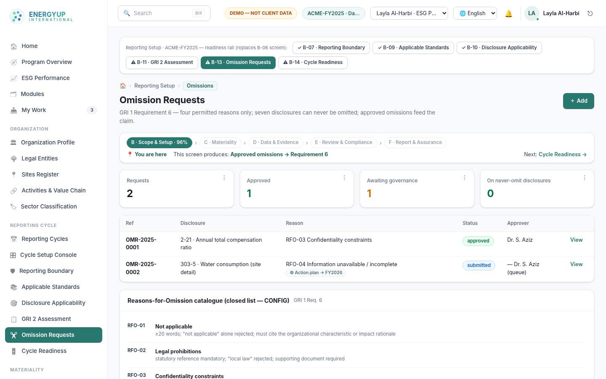
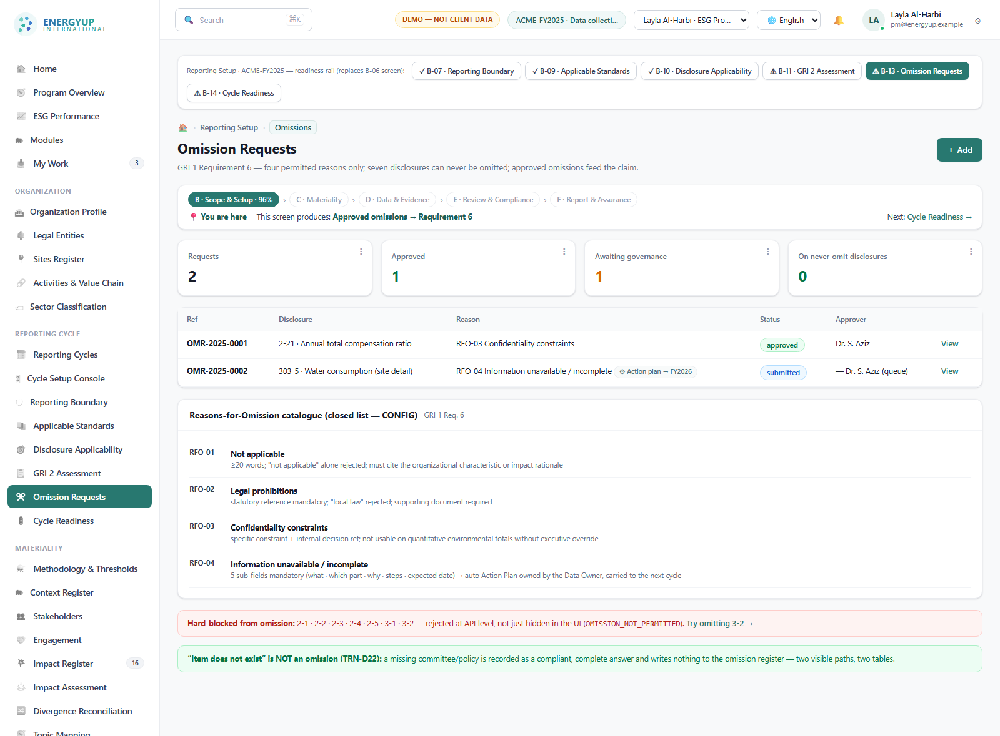
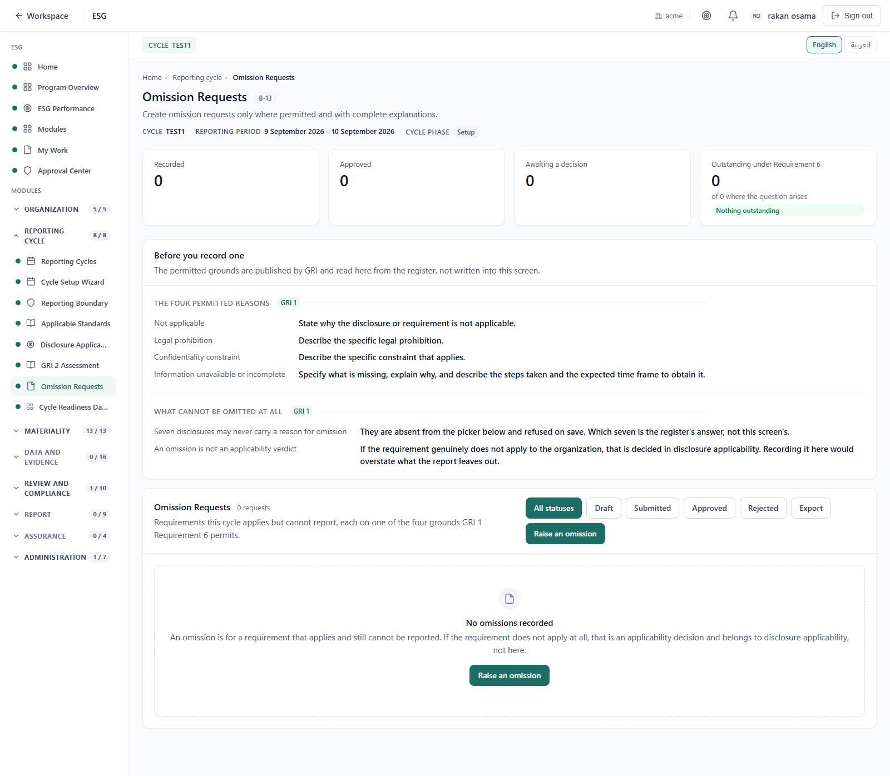

# B-13 — Omission Requests

| | |
|---|---|
| **Route** | prototype `#/setup/omissions` · .NET `/modules/esg/setup/omissions` |
| **Audit** | `scr-24` · P2 · UX 9.2 · Setup / governance workbench |
| **Owner role** | Requestor / Governance Approver |
| **Owns** | `OmissionRequest` |
| **Upstream** | an unavailable or inapplicable disclosure requirement · **Downstream** `rev/oapp` → `setup/readiness` |
| **.NET spec** | `docs\ESG\build\04-screens\30-cycle\07-omissions.md` |

---

## Purpose

> "GRI 1 Requirement 6 — four permitted reasons only; seven disclosures can never be omitted;
> approved omissions feed the claim."

**This is the most completely specified workflow in the Reporting Cycle group** — the only one
where the audit records segregation of duties, an API-level refusal and an immutable decision
history.

---

## 1. What it must contain — the audit

**Inputs** Disclosure requirement · permitted RFO code · explanation · evidence · requester
**Outputs** `OmissionRequest` · governance decision task
**Completion gate** Permitted reason complete + governance decision
**Disposition** KEEP + EXTEND — governed omission workflow

**Captured columns (5):** `Ref` · `Disclosure` · `Reason` · `Status` · `Approver`

⚠ The screen's own notice says **"two visible paths, two tables"** and only **one** 5-chip list
was captured — the second table's columns are missing ([F-17](../03-FINDINGS.md#f-17)).

**P2 hardening:** *"Keep four permitted reasons and blocked disclosures. Enforce
**requester ≠ approver**, evidence, action plan for information-unavailable, and **immutable
decision history**."*

### The two rules that make this screen

**1. Seven disclosures can never be omitted** — `2-1 · 2-2 · 2-3 · 2-4 · 2-5 · 3-1 · 3-2` —
> *"rejected at API level, not just hidden in the UI (`OMISSION_NOT_PERMITTED`)."*

**2. "Item does not exist" is NOT an omission (TRN-D22)** —
> *"a missing committee/policy is recorded as a **compliant, complete answer** and writes nothing
> to the omission register — two visible paths, two tables."*

That second rule is the one implementations get wrong. A company with no sustainability committee
answers 2-9 completely by saying so; filing an omission there would understate the claim.

---

## 2. What the prototype renders

`assets/js/07-views.js:458` — 6,564 chars, reads **`D.omissions`** (a real register).

**The healthiest screen in the group** — roughly 90% driven by `D.omissions`, `CONFIG.RFO` and
`CONFIG.omissionBlocked`:

| | |
|---|---|
| Register | `Ref · Disclosure · Reason · Status · Approver` — matches the audit |
| RFO catalogue | four reasons rendered from `CONFIG.RFO`, each with a `Use` button |
| Hard-blocked table | `Disclosure · Why it may never be omitted · Correct alternative` — the second table the audit failed to capture |
| Demo | `Try omitting 3-2` → `tryBlockedOmission()` shows a simulated **HTTP 422** |

**One serious defect:** `＋ Add` opens `omForm()` whose primary button reads **"Submit to
governance →"** — and the handler is `closeDrawer(); audit(...); toast(...)`. It never pushes to
`D.omissions`. A user will believe they filed an omission request. Both `omForm()` and
`omDetail()` are two-argument `drawer()` calls.

---

## 3. What .NET implements

### As it runs today

**Captured 9 Sep 2026** from `http://acme.localhost:5270` — tenant **acme**, signed in as a
Programme Manager. Cycle **TEST1**; no omissions recorded.

**Tiles:** Recorded · Approved · Awaiting a decision · **Outstanding under Requirement 6**
(*"of 0 where the question arises"*) with a green **Nothing outstanding** pill.

**"Before you record one"** — the permitted grounds, read from the register, not written into the
screen:

| The four permitted reasons | What the explanation must say |
|---|---|
| Not applicable | State why the disclosure or requirement is not applicable. |
| Legal prohibition | Describe the specific legal prohibition. |
| Confidentiality constraint | Describe the specific constraint that applies. |
| Information unavailable or incomplete | Specify what is missing, explain why, and describe the steps taken and the expected time frame to obtain it. |

**"What cannot be omitted at all"**
- *"**Seven disclosures may never carry a reason for omission** — they are absent from the picker
  below and **refused on save**. Which seven is the register's answer, not this screen's."*
- *"An omission is not an applicability verdict"* — if it genuinely does not apply, that is B-10.

- ✔ **This is the audit's "two visible paths, two tables"** — built as two explainer blocks above
  one register rather than as two tables. The prototype's second table
  (`Disclosure · Why it may never be omitted · Correct alternative`) carries the same content in
  tabular form. Both are valid; they are not a contradiction.
- **Register:** filters **All statuses / Draft / Submitted / Approved / Rejected** · Export ·
  **Raise an omission**.
- ⚠ The filter set goes Draft → Submitted → Approved/Rejected with **no under-review state** —
  the visual confirmation of the "✔ no review state" note in the CRUD matrix.

### The code behind it

| | |
|---|---|
| Pages | `Pages\Esg\Omissions\Index.cshtml(.cs)`, `Index.Drawer.cshtml.cs` |
| Services | `IOmissionRequestService` · `IOmissionRequestWorkflowService` |
| Entities | `OmissionRequest`, **`OmissionBlockedDisclosure`**, `OmissionRule`, `GriOmissionReason` |
| States | `OmissionRequestStatus` — Draft · Submitted · Approved · Rejected |
| Permissions | `esg.omissions.{view,add,edit,delete,handover,signoff}` |

`OmissionBlockedDisclosure` as an **entity** is the right implementation of the never-omit rule —
it is data, enforced server-side, not a UI check.

---

## 4. Gap

| Requirement | Audit | Prototype | .NET | Verdict |
|---|---|---|---|---|
| Register, 5 columns | ✔ | ✔ **live** | ✔ | **OK** |
| Four permitted reasons only | ✔ | ✔ from `CONFIG.RFO` | ✔ `GriOmissionReason` | **OK** |
| Seven hard-blocked disclosures | ✔ | ✔ + 422 demo | ✔ `OmissionBlockedDisclosure` | **OK** |
| Refused at **API level** | ✔ | simulated | ✔ | **OK** |
| **"Item does not exist" is a separate path** | ✔ TRN-D22 | ✔ second table | *not verified* | **open** |
| Second table's columns | ⚪ not captured | ✔ 3 columns | — | ⚪ take from the prototype |
| **Requester ≠ approver** | ✔ | ✗ | ✔ SoD in the Center | **OK** in .NET |
| Action plan for information-unavailable | ✔ | in the form (**STUB**) | *not verified* | **open** |
| Immutable decision history | ✔ | ✗ | ✔ queue + audit | **OK** in .NET |
| **Create writes** | ✔ | ✗ **STUB — says "Submit to governance"** | ✔ `SaveAsync` | prototype **STUB** |
| Submit | ✔ | ✗ no-op | ✔ `SubmitAsync` | prototype **STUB** |

---

## 5. CRUD & workflow

| Op | Prototype | .NET |
|---|---|---|
| Create | `＋ Add` **STUB** | `SaveAsync` (upsert) |
| Read | `D.omissions` | `GetForCycleAsync`, `GetByIdAsync`, `GetReasonsAsync`, `GetCoverageAsync` |
| Update | — | `SaveAsync` |
| Delete | — | `DeleteDraftAsync` |
| Submit | button, no-op | `SubmitAsync` |
| Approve / Reject / Return | — | `ApproveAsync` / `RejectAsync` / `ReturnForCorrectionAsync` |
| Begin review | — | **deliberately absent** — no review state |

---

## 6. Approval Center

**Participates.** `OmissionRequest` → feature key **`omissions`**.

The one type with a **different lifecycle**: `OmissionRequestStatus` has no review state, so the
Center **skips pick-up** (`BeginReviewAsync`) for it and goes straight to the decision. Its
status translation is its own — `OmissionRequest.QueueStatusFor(...)`, one of only two enums the
projection interceptor handles (which is precisely why [F-1](../03-FINDINGS.md#f-1) exists for
the third).

> The prototype routes approval to a separate screen `rev/oapp`. **That page does not exist in
> .NET** — its spec is written (`04-screens\60-review-compliance\04-oapp.md`) but there is no
> page model. Omission approval happens in the Approval Center. Do not build `rev/oapp`.

---

## 7. Open questions

1. **Is the TRN-D22 "item does not exist" path implemented in .NET?** It is the rule most likely
   to be lost in translation, and it is not visible in the service surface. It should be a
   completion state on B-11, not an omission.
2. The **action plan** required for RFO-04 (information unavailable) — which entity holds it, and
   is it carried into the next cycle as the prototype's help text claims?
3. The second table's columns were never captured; this document takes them from the prototype
   (`Disclosure · Why it may never be omitted · Correct alternative`). Confirm.
4. `GetCoverageAsync` suggests omission coverage feeds the claim — confirm which claim
   requirement consumes it.
