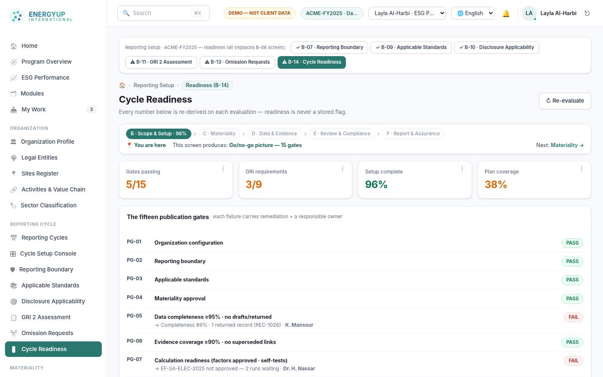
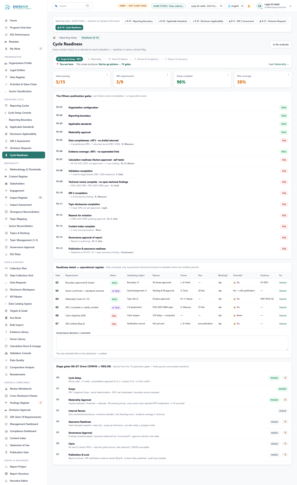
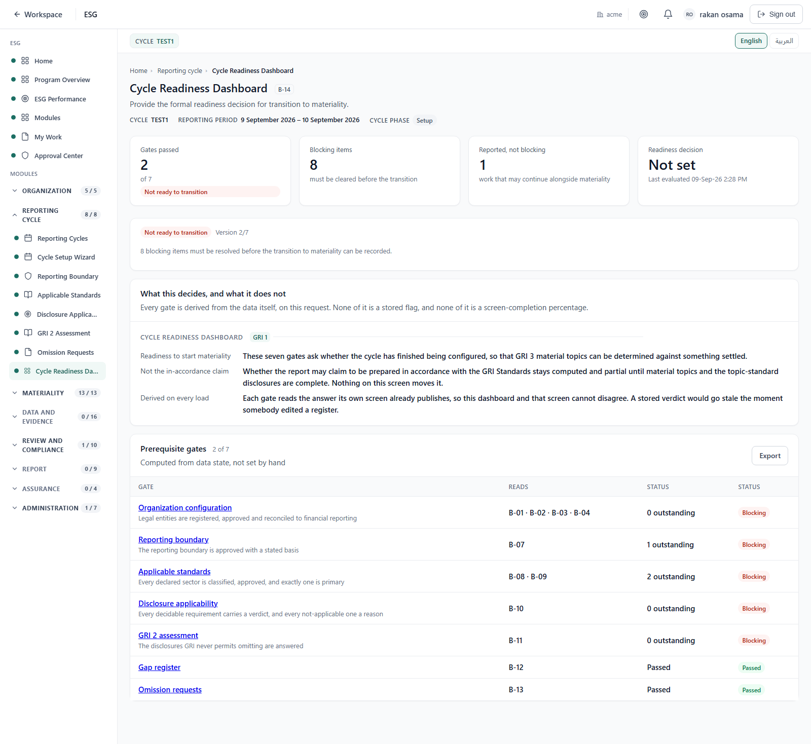

# B-14 — Cycle Readiness

| | |
|---|---|
| **Route** | prototype `#/setup/readiness` · .NET `/modules/esg/setup/readiness` |
| **Audit** | `scr-25` · **P1** · UX 9.2 · Dashboard / orchestration |
| **Owner role** | ESG Programme Manager |
| **Owns** | `CycleReadinessProposal` (+ `CycleReadinessDecision`) |
| **Upstream** | all foundation/setup objects · **Downstream** `mat/config` |
| **.NET spec** | `docs\ESG\build\04-screens\30-cycle\08-readiness.md` |

---

## Purpose

> "Every number below is re-derived on each evaluation — **readiness is never a stored flag**."

The screen's authoritative-data rule is stricter than every other screen's:

> "This screen is derived/orchestration only and **must not own business facts**."

---

## 1. What it must contain — the audit

**Inputs** All setup/foundation gate states · **Outputs** derived readiness · blocking reasons /
fix links
**Completion gate** Foundation gates pass before materiality/data requests
**Disposition** BUILD derived readiness/control logic

**Captured columns — 10, AT THE CAP** ([F-17](../03-FINDINGS.md#f-17)), a flat merge of a
governance field with the gate table:

> `Governance decision / comment` — then —
> `Gate` · `Requirement` · `Status` · `Underlying object` · `Reason` · `Owner` · `Due` ·
> `Blocking?` · `Override?`

**P1 hardening:** *"**No stored Ready flag.** Derive each gate with reason, source object, owner,
due date and change-impact recalculation."*

⚠ An **`Override?`** column is captured with **no override workflow, approver or reason
mechanism** described anywhere in the block — see [F-18](../03-FINDINGS.md#f-18).

---

## 2. What the prototype renders

`assets/js/08-engine.js:681` — 4,060 chars, reads **`D.gates`** (15 real publication gates).

The gate table has all the captured columns and is genuinely derived. But the screen renders
**three different gate vocabularies at once**:

1. the real **PG-01…PG-15** from `D.gates`;
2. **G0–G7** stage gates from `CONFIG.stageGates`;
3. a third **hard-coded six-row register** whose ids contradict CONFIG — its
   **G2 = "Boundary approved"** against `CONFIG.stageGates[2]` = **"Materiality Approval"**.

Same id, two meanings, one screen — [F-6](../03-FINDINGS.md#f-6). Delete the third table.

The governance decision/comment field is present but writes nothing.

> **Prototype-only quirk:** `#/setup/readiness` in the *current* prototype is a real screen, but
> some builds alias it to the Setup Console's Gates tab. In .NET they are two distinct pages
> (B-06 and B-14) with different objects. Treat them as separate.

---

## 3. What .NET implements

### As it runs today

**Captured 9 Sep 2026** from `http://acme.localhost:5270` — tenant **acme**, signed in as a
Programme Manager. Cycle **TEST1** — **2 of 7 gates passed**, so this capture shows the
dashboard doing real work.

**Tiles:** **Gates passed 2 of 7** + *Not ready to transition* · **Blocking items 8** ·
**Reported, not blocking 1** · **Readiness decision `Not set`** with a last-evaluated timestamp.

**"What this decides, and what it does not"**
- *Readiness to start materiality* — the seven gates ask whether the cycle has finished being
  configured, so GRI 3 topics can be determined against something settled.
- *Not the in-accordance claim* — that stays computed and partial until material topics and
  topic-standard disclosures are complete. **Nothing on this screen moves it.**
- ***Derived on every load*** — *"Each gate reads the answer its own screen already publishes, so
  this dashboard and that screen cannot disagree. A stored verdict would go stale the moment
  somebody edited a register."*

**Prerequisite gates** — `GATE` (name + rule) · `READS` (the screens it derives from) ·
outstanding count · badge:

| Gate | Reads | Live |
|---|---|---|
| Organization configuration | B-01 · B-02 · B-03 · B-04 | 0 outstanding · Blocking |
| Reporting boundary | B-07 | 1 outstanding · Blocking |
| Applicable standards | B-08 · B-09 | 2 outstanding · Blocking |
| Disclosure applicability | B-10 | 0 outstanding · Blocking |
| GRI 2 assessment | B-11 | 0 outstanding · Blocking |
| **Gap register** | **B-12** | Passed |
| Omission requests | B-13 | Passed |

- ✔ **This resolves the audit's `Override?` column — by refusing it.** There is no override
  column and no override action. Every gate is computed on load and *"not set by hand"*. The .NET
  build took the opposite decision from the captured column; record the decision and do not build
  the override.
- ✔ **B-12 appears here as a gate** although it has no screen of its own — exactly as the audit
  described it ("gaps unified in `rev/findings`").
- ✔ "Derived on every load" is the direct answer to the prototype's fake, hard-coded gate register
  ([F-6](../03-FINDINGS.md#f-6)).
- ⚠ **Two adjacent columns are both headed `STATUS`** — one holds the outstanding count, the
  other the badge ([F-22](../03-FINDINGS.md#f-22)).
- ⚠ `Readiness decision` renders **`Not set`** ([F-21](../03-FINDINGS.md#f-21)).

### The code behind it

| | |
|---|---|
| Pages | `Pages\Esg\Readiness\Index.cshtml(.cs)` |
| Services | `ICycleReadinessService` (computed board) · `ICycleReadinessWorkflowService` |
| Entities | `CycleReadinessProposal`, **`CycleReadinessDecision`** |
| States | `CycleReadinessGate` — OrganizationConfiguration · ReportingBoundary · ApplicableStandards · DisclosureApplicability · Gri2Assessment · GapRegister · OmissionRequests |
| Permissions | `esg.readiness.{view,handover,signoff}` — **no add/edit/delete, by design** |

The permission set is the design statement: you cannot create, edit or delete readiness. You can
only **propose** it and **sign it off**. `CycleReadinessDecision` is an immutable evidence row
written by `ApproveAsync`.

`CycleReadinessGate` is the concrete answer to "which foundation gates" — seven, named.

---

## 4. Gap

| Requirement | Audit | Prototype | .NET | Verdict |
|---|---|---|---|---|
| Gate table with the 9 columns | ✔ | ✔ | ✔ | **OK** |
| **Derived, never a stored flag** | ✔ P1 | ✔ from `D.gates` | ✔ computed board | **OK** |
| Reason · source object · owner · due | ✔ | ✔ | ✔ | **OK** |
| Change-impact recalculation | ✔ | ✗ | *not verified* | **open** |
| Fix links | ✔ | ✔ | ✔ | **OK** |
| **One gate vocabulary** | implied | ✗ **three** ([F-6](../03-FINDINGS.md#f-6)) | ✔ `CycleReadinessGate` | prototype defect |
| **`Override?` mechanism** | column only | column only | ✗ **deliberately none** — gates derived on every load | ✅ **RESOLVED by refusal — see §3** |
| Governance decision / comment | ✔ | field, no save | ✔ on the decision | **OK** in .NET |
| Owns no business fact | ✔ | ✔ | ✔ proposal + decision only | **OK** |

---

## 5. CRUD & workflow

| Op | Prototype | .NET |
|---|---|---|
| Create | — | **`ProposeAsync` — creates *and* submits in one act** |
| Read | `D.gates` | `ICycleReadinessService.GetAsync` (recomputed every call) |
| Update | — | **none, by design** |
| Delete | — | **none, by design** |
| Submit | — | `ProposeAsync` |
| Approve / Reject / Return | — | `ApproveAsync` / `RejectAsync` / `ReturnForCorrectionAsync` + `BeginReviewAsync` |

**There is no create-without-submit.** Proposing readiness *is* asking for sign-off — you cannot
draft it and sit on it. That is a deliberate design (BD-126) and a good one: a saved-but-unsent
readiness draft would be a stored readiness flag by another name.

---

## 6. Approval Center

**Participates.** `CycleReadinessProposal` → feature key **`readiness`**.

Approving writes a `CycleReadinessDecision` — an immutable evidence row, not a status flip — and
unlocks C-01, letting Materiality begin.

---

## 7. Open questions

1. **What is the `Override?` column for?** A gate that can be overridden needs an authority, a
   mandatory reason and an audit event. None exists. Either implement it as a `signoff`-grade act
   or remove the column. ([F-18](../03-FINDINGS.md#f-18))
2. `CycleSetupRun` has `SetStepOverrideAsync` under mere `edit` permission — is *that* the
   override this column refers to? If so it sits on the wrong screen and at the wrong grade.
3. **Change-impact recalculation:** when an approved upstream object changes after readiness is
   approved, is the decision marked stale? The traceability contract requires it.
4. `CycleReadinessGate` lists **GapRegister** as a gate — but B-12 has no screen (gaps live in
   `rev/findings`). Confirm the gate reads from there.
