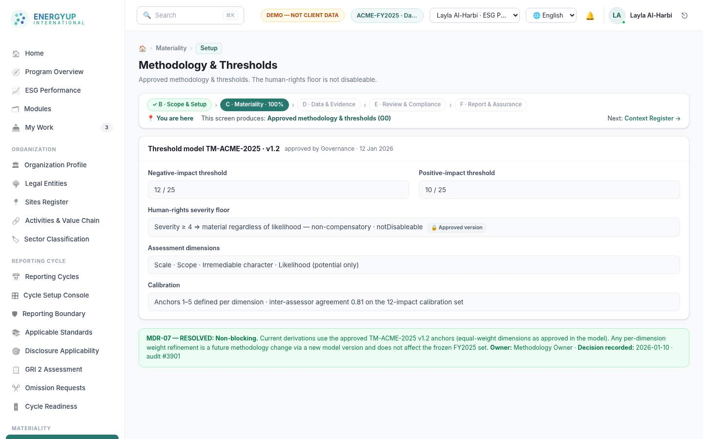
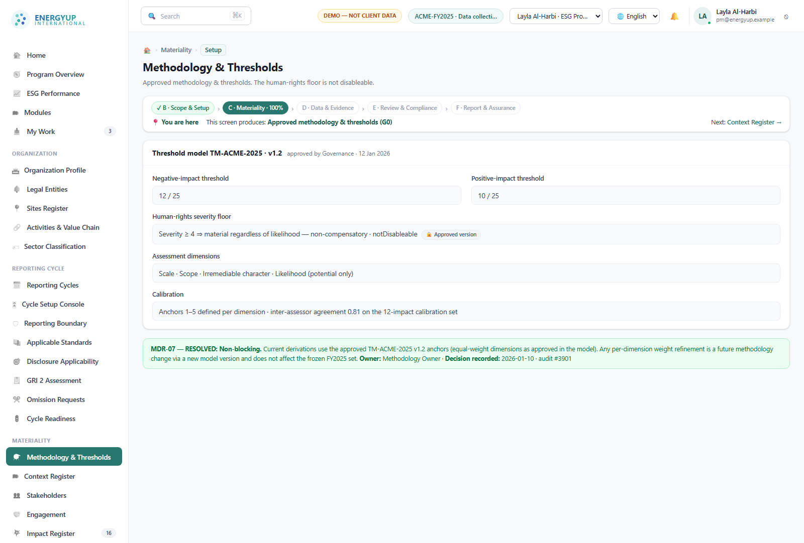
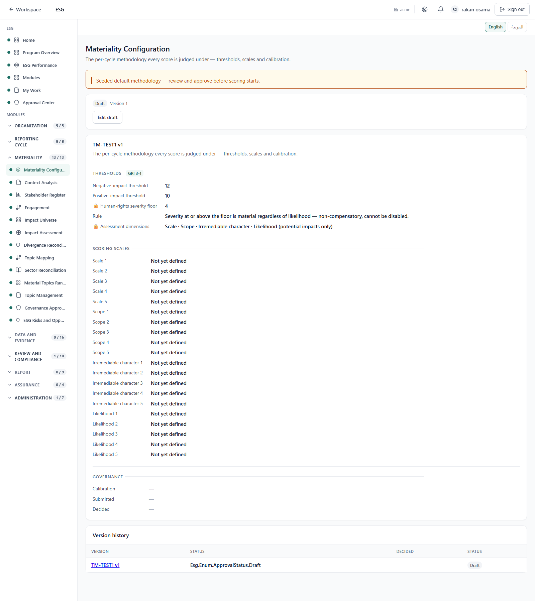

# C-01 — Methodology & Thresholds

| | |
|---|---|
| **Route** | prototype `#/mat/config` · .NET `/modules/esg/mat/config` |
| **Audit** | `scr-26` · **P1** · UX 9.2 |
| **Owner role** | Methodology Owner |
| **Owns** | `MaterialityConfigVersion` |
| **Upstream** | `setup/readiness` + methodology governance · **Downstream** `mat/context` |
| **.NET spec** | `docs\ESG\build\04-screens\40-materiality\01-config.md` |

---

## Purpose

> "Approved methodology & thresholds. **The human-rights floor is not disableable.**"

Every assessment in C-07 must reference an **approved, effective-dated** MethodologyVersion. If
the methodology is unresolved, an assessment yields `NOT_EVALUATED` — not a default score.

---

## 1. What it must contain — the audit

**Inputs** Approved methodology decisions · threshold/scoring rules · human-rights floor
**Outputs** `MaterialityMethodologyVersion` · **Completion gate** Methodology version approved

**Captured columns (5, complete):**
`Negative-impact threshold` · `Positive-impact threshold` · `Human-rights severity floor` ·
`Assessment dimensions` · `Calibration`

**P1 hardening:** *"**No invented/default threshold.** MethodologyVersion must be approved,
effective-dated and referenced by every assessment; unresolved decisions yield NOT_EVALUATED."*

**Visible notice** — a resolved methodology query worth keeping as an example of the pattern:
> *"MDR-07 — RESOLVED: Non-blocking. Current derivations use the approved TM-ACME-2025 v1.2
> anchors (equal-weight dimensions as approved in the model). Any per-dimension weight refinement
> is a future methodology change via a new model version and does not affect the frozen FY2025
> set. Owner: Methodology Owner · Decision recorded: 2026-01-10 · audit #3901"*

---

## 2. What the prototype renders

`assets/js/07-views.js:503` — 1,598 chars. **100% literal.**

| | |
|---|---|
| Tables | **none** |
| `D.*` reads | **zero** |
| Rows | a six-field read-only `formGrid` + the MDR-07 notice |
| Actions | `pageHead` actions are `''` — **no affordances at all** |

Thresholds render as `12 / 25` and `10 / 25`. There is no version, no effective date, no approval
state, and no way to change any of it. As a specification of *what a methodology contains* it is
useful; as a screen it does nothing.

---

## 3. What .NET implements

### As it runs today

**Captured 9 Sep 2026** from `http://acme.localhost:5270` — tenant **acme**, signed in as a
Programme Manager. A **seeded default methodology** exists — `TM-TEST1 v1`, Draft.

**Notice:** *"Seeded default methodology — review and approve before scoring starts."* A
methodology is not created by hand; one ships with the cycle.

**Version bar:** `Draft · Version 1` — **`Edit draft`, and nothing else.**

> 🔴 **There is no Submit for review on this screen**, though `MaterialityConfigVersion` is
> enrolled in the Approval Center under `mat-config`. Compare B-09, which offers Export ·
> Re-resolve · **Submit for review** · Delete draft on the same class of object. Nor is there a
> Delete draft, matching the unimplemented `DeleteMatConfig` key —
> [F-19](../03-FINDINGS.md#f-19).

**Thresholds (GRI 3-1), live:**

| | |
|---|---|
| Negative-impact threshold | **12** |
| Positive-impact threshold | **10** |
| 🔒 **Human-rights severity floor** | **4** |
| Rule | *Severity at or above the floor is material regardless of likelihood — **non-compensatory, cannot be disabled***. |
| 🔒 Assessment dimensions | Scale · Scope · Irremediable character · **Likelihood (potential impacts only)** |

- ✔ **The human-rights floor is padlocked and the screen states it cannot be disabled.** No longer
  an audit-only assertion — though a test is still what proves it.
- ✔ Likelihood applying to *potential impacts only* is the GRI 3 rule, encoded in the label.
- ⚠ **Scoring scales: 20 descriptors** (Scale 1–5, Scope 1–5, Irremediable character 1–5,
  Likelihood 1–5) — **every one reads `Not yet defined`**. The seed ships thresholds but no scale
  wording, so somebody must write 20 descriptors before a score means anything. Nothing on the
  screen says this is outstanding.
- **Governance:** Calibration · Submitted · Decided — all `—`.
- 🔴 **The version history renders the raw enum `Esg.Enum.ApprovalStatus.Draft`** in its Status
  cell — a missing i18n key leaking a .NET type name into the UI, and the same row's second Status
  column shows a correct `Draft` pill ([F-20](../03-FINDINGS.md#f-20)).
- ⚠ No screen-code chip. B-05…B-14 all render one; **no materiality screen does**
  ([F-23](../03-FINDINGS.md#f-23)).

### The code behind it

| | |
|---|---|
| Page | `Pages\Esg\Materiality\Config.cshtml(.cs)` |
| Services | `IMaterialityConfigService` · `IMaterialityConfigWorkflowService` |
| Entities | `MaterialityConfig`, `MaterialityConfigVersion` (+ `.Transitions.cs`) |
| Value object | `Domain\ValueObjects\MaterialityThresholdModel.cs` |
| Permissions | `esg.mat-config.{view,add,edit,delete,handover,signoff}` |

---

## 4. Gap

| Requirement | Audit | Prototype | .NET | Verdict |
|---|---|---|---|---|
| The 5 captured fields | ✔ | ✔ read-only | ✔ | **OK** |
| **Versioned + effective-dated** | ✔ | ✗ no version shown | ✔ `MaterialityConfigVersion` | prototype **MISSING** |
| Approved before use | ✔ gate | ✗ | ✔ full workflow | **OK** in .NET |
| Referenced by every assessment | ✔ | ✗ | *not verified* | **open** |
| Unresolved ⇒ `NOT_EVALUATED` | ✔ | ✗ | *not verified* | **open** |
| HR floor **not disableable** | ✔ | ✔ stated in text | *not verified* | **open** |
| Change = new version, not an edit | ✔ notice | ✗ | ✔ `StartNextVersionAsync` | **OK** in .NET |
| **Delete** | — | ✗ | ✗ key declared, **no method** | **[F-8](../03-FINDINGS.md#f-8)** |

---

## 5. CRUD & workflow

| Op | Prototype | .NET |
|---|---|---|
| Create | — | `SaveDraftAsync`, `StartNextVersionAsync` |
| Read | literals | `GetAsync`, `GetVersionAsync` |
| Update | — | `SaveDraftAsync` |
| Delete | — | **none** — `DeleteMatConfig` permission exists with nothing behind it |
| Submit | — | `SubmitAsync` |
| Approve / Reject / Return | — | all three + `BeginReviewAsync`, `LockAsync` |

---

## 6. Approval Center

**Participates.** `MaterialityConfigVersion` → feature key **`mat-config`**.

Approved by the **Methodology Owner**, not the PM — this is the one place in Epic C where the
methodology authority, not the programme authority, signs off.

---

## 7. Open questions

1. **Is `NOT_EVALUATED` implemented?** It is the P1 hardening's stated behaviour for an
   unresolved methodology, and I could not find it in `ImpactAssessmentStatus`
   (Assessed · Reviewed · Submitted · Returned · Frozen).
2. **How is the HR floor made non-disableable in code?** The audit says "not disableable"; is
   that a validation rule, a value-object invariant, or convention?
3. Does an assessment store the **MethodologyVersion id** it was scored under? Without it, a new
   methodology version silently reinterprets old scores.
4. `DeleteMatConfig` is declared with no implementation ([F-8](../03-FINDINGS.md#f-8)) — remove
   the key, or implement draft deletion.
