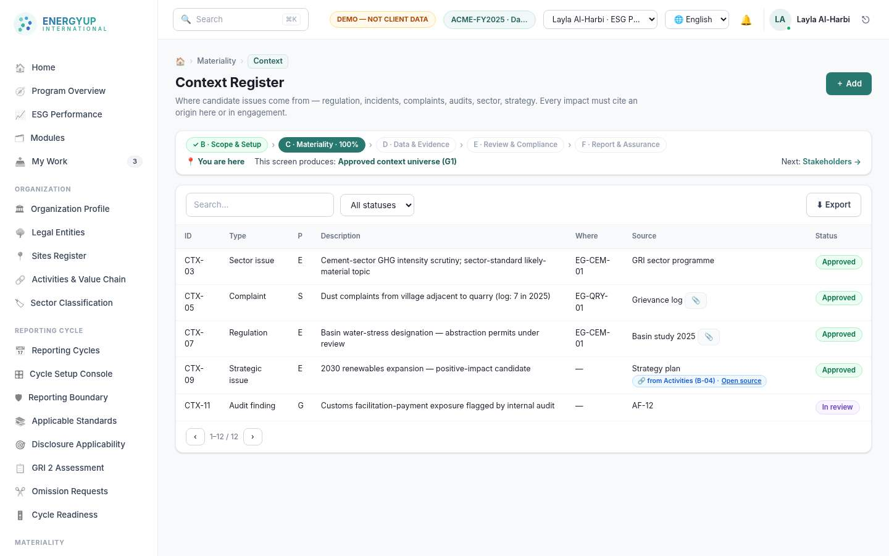
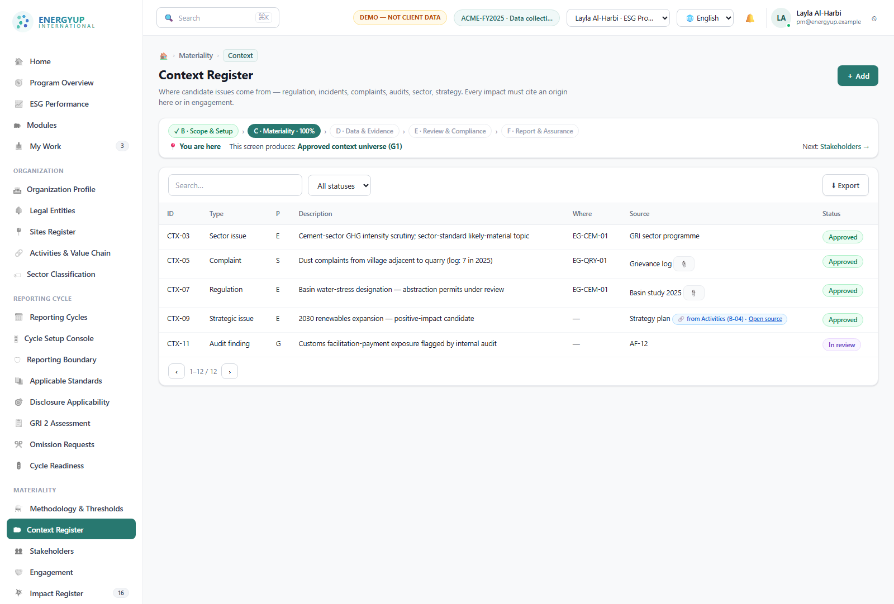
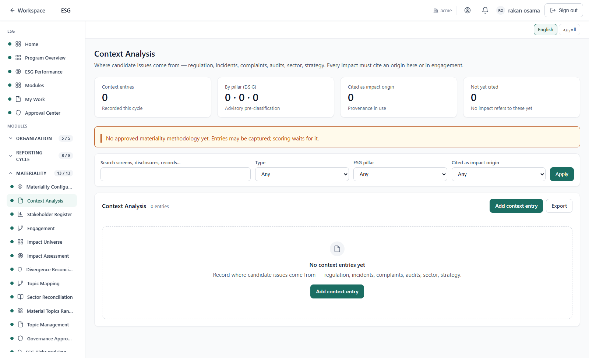

# C-02 — Context Register

| | |
|---|---|
| **Route** | prototype `#/mat/context` · .NET `/modules/esg/mat/context` |
| **Audit** | `scr-27` · **P1** · UX 9.2 |
| **Owner role** | ESG Programme Manager / Materiality Team |
| **Owns** | `ContextEntry` |
| **Upstream** | `org/acts` + sector + regulation/incidents/audits |
| **Downstream** | `mat/stake` + `mat/engage` + `mat/impacts` |
| **.NET spec** | `docs\ESG\build\04-screens\40-materiality\02-context.md` |

---

## Purpose

> "Where candidate issues come from — regulation, incidents, complaints, audits, sector,
> strategy. **Every impact must cite an origin here or in engagement.**"

This screen exists so that C-06 can enforce its own rule. An impact with no origin cannot be
saved, and this register is one of the two places an origin can come from.

---

## 1. What it must contain — the audit

**Inputs** Activities/sites/value chain · regulations · incidents · complaints · audits ·
strategy · sector
**Outputs** `ContextItem` / issue-universe sources
**Completion gate** Required context sources covered

**Captured columns (7, complete):**
`ID` · `Type` · `P` · `Description` · `Where` · `Source` · `Status`

**P1 hardening:** *"Broaden structured origins and **deduplicate issues by controlled IDs**. Each
context item should show **whether/where it generated an Impact**."*

That second half is a real requirement and it is not in the column set: there is no
"generated impact" column.

---

## 2. What the prototype renders

`assets/js/07-views.js:512` — 1,684 chars.

| | |
|---|---|
| Table | `ID · Type · P · Description · Where · Source · Status` — matches the audit |
| Rows | **6 hard-coded `<tr>`** (CTX-03, 05, 07, 09, 11 …) |
| `D.*` reads | **zero — there is no context register in `D`** |
| Row actions | **none** |
| Add | `＋ Add` → `ctxForm()` — **two-argument `drawer()` ⇒ writes nothing**, an 18-field form |
| Pager | reads `1–12 / 12` over 6 rows — [F-16](../03-FINDINGS.md#f-16) |

---

## 3. What .NET implements

### As it runs today

**Captured 9 Sep 2026** from `http://acme.localhost:5270` — tenant **acme**, signed in as a
Programme Manager. No context entries recorded.

**Subtitle carries the rule:** *"Where candidate issues come from — regulation, incidents,
complaints, audits, sector, strategy. **Every impact must cite an origin here or in
engagement**."*

**Tiles:** Context entries · By pillar (E·S·G) *"Advisory pre-classification"* ·
**Cited as impact origin** *"Provenance in use"* · **Not yet cited** *"No impact refers to these
yet"*

- ✔ **This closes the gap register's C-02 row** — "whether/where it generated an Impact" is a
  first-class pair of tiles *and* a filter, not a missing column.
- ✔ "Advisory pre-classification" on the pillar tile is the right hedge: E/S/G here is a hint,
  not a determination.
- **Filters:** search · Type · ESG pillar · **Cited as impact origin**
- **Actions:** **Add context entry** · Export
- ✔ The methodology blocker is deliberately *partial*: *"No approved materiality methodology yet.
  **Entries may be captured; scoring waits for it.**"* Capture is not gated; scoring is. Compare
  C-07, which is gated outright.

### The code behind it

| | |
|---|---|
| Page | `Pages\Esg\Materiality\Context.cshtml(.cs)` |
| Service | `IContextEntryService` |
| Entity | `ContextEntry` |
| States | `ContextIssueType` — Regulation … WorkforceIssue (8 values) |
| Permissions | `esg.mat-context.{view,add,edit,delete}` — **plain CRUD, no handover/signoff** |

---

## 4. Gap

| Requirement | Audit | Prototype | .NET | Verdict |
|---|---|---|---|---|
| 7-column register | ✔ | ✔ layout only | ✔ | **OK** |
| Rows from a register | — | ✗ **no register exists** | ✔ | prototype **MISSING** |
| Create | — | ✗ **STUB** (18 fields) | ✔ `CreateAsync` | prototype **STUB** |
| Update / Delete | — | ✗ no row actions | ✔ | prototype **MISSING** |
| Structured origin types | ✔ P1 | text only | ✔ `ContextIssueType` (8) | **OK** in .NET |
| **Deduplicate by controlled id** | ✔ P1 | ✗ | *not verified* | **open** |
| **Show whether/where it generated an Impact** | ✔ P1 | ✗ | *not verified* | **open** — no column for it |
| Status state machine | column exists | pill only | *not verified* | **open** |
| Workflow | **none by design** | — | none | **OK** |

---

## 5. CRUD & workflow

| Op | Prototype | .NET |
|---|---|---|
| Create | `ctxForm()` **STUB** | `CreateAsync` |
| Read | 6 literals | `GetRegisterAsync`, `GetByIdAsync` |
| Update | — | `UpdateAsync` |
| Delete | — | `DeleteAsync` |
| Submit / Approve | **none, by design** | none |

A living register with no maker-checker is the right call — context items are evidence of what
was considered, not governed assertions. The governed decision happens later, at C-11/C-12.

---

## 6. Approval Center

**Does not participate**, correctly.

---

## 7. Open questions

1. **What does the `Status` column mean?** It is captured, rendered as a pill, and has no state
   machine behind it in either implementation. Enumerate it or drop it.
2. The P1 hardening wants each context item to **show whether it generated an Impact**. That
   needs a derived column (`Impacts: 2`) and a link. Neither exists — add it, since it is the
   only way to see coverage gaps.
3. **Deduplication by controlled id** — is there a uniqueness rule, or is it advisory?
4. "Required context sources covered" is the completion gate — **which sources are required?**
   Eight `ContextIssueType` values exist; is coverage of all eight the gate, or a subset?
