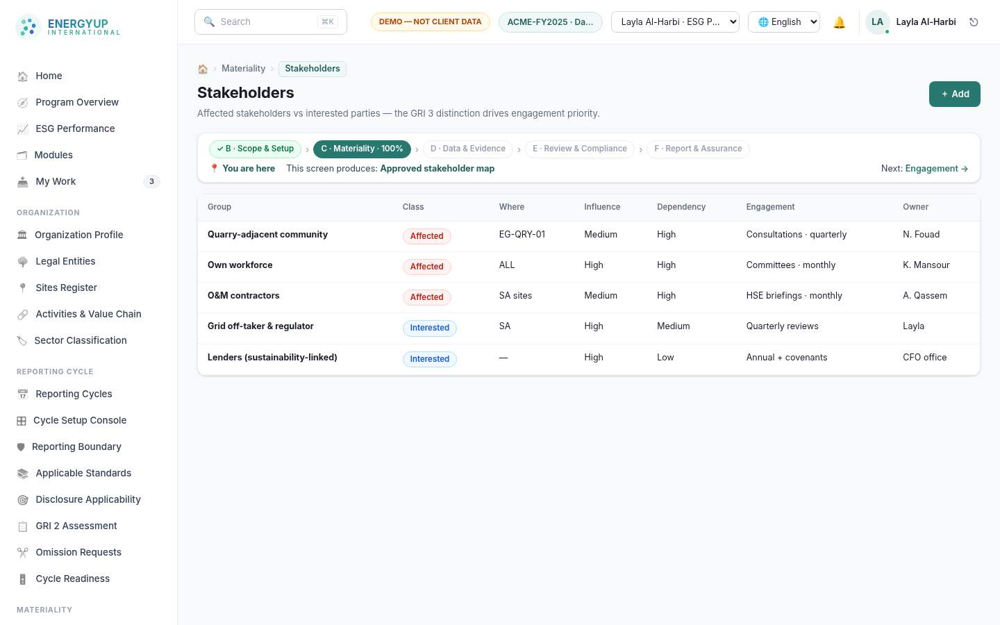
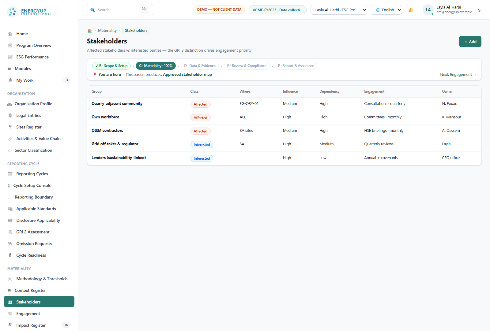
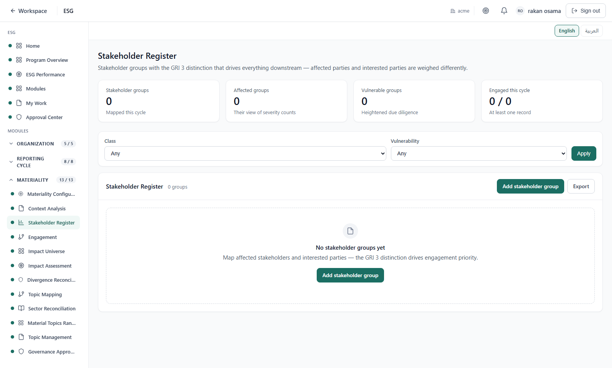

# C-03 — Stakeholders

| | |
|---|---|
| **Route** | prototype `#/mat/stake` · .NET `/modules/esg/mat/stake` |
| **Audit** | `scr-28` · **P1** · UX 9.2 |
| **Owner role** | Materiality Team |
| **Owns** | `Stakeholder` |
| **Upstream** | `mat/context` · **Downstream** `mat/engage` |
| **.NET spec** | `docs\ESG\build\04-screens\40-materiality\03-stake.md` |

---

## Purpose

> "**Affected stakeholders vs interested parties** — the GRI 3 distinction drives engagement
> priority."

That distinction is the entire point of the screen. Affected stakeholders are the people the
organization's impacts land on; interested parties merely care. GRI 3 requires engagement with
the former, and conflating the two lets a company substitute investor calls for community
consultation.

---

## 1. What it must contain — the audit

**Inputs** Context items · affected/interested stakeholder groups
**Outputs** `StakeholderGroup` records · engagement priority
**Completion gate** **Stakeholder universe approved**

**Captured columns (7, complete):**
`Group` · `Class` · `Where` · `Influence` · `Dependency` · `Engagement` · `Owner`

**P1 hardening:** *"**Separate affected stakeholders from interested parties**; preserve
evidence/basis and link each group to engagement and impacts."*

⚠ **The gate says "approved" and nothing captured can approve.** There is no status column, no
approver, no approval action, and the screen has no workflow in any layer — see
[F-18](../03-FINDINGS.md#f-18).

---

## 2. What the prototype renders

`assets/js/07-views.js:522` — 1,361 chars. **The smallest screen in the group.**

| | |
|---|---|
| Table | matches the audit's 7 columns exactly |
| Rows | **6 hard-coded `<tr>`** |
| `D.*` reads | **zero — there is no stakeholder register in `D`** |
| Row actions | **none — the table has no actions column at all** |
| Add | `＋ Add` → `stkForm()` — **two-argument `drawer()` ⇒ writes nothing** |

`Class` is the column carrying the affected/interested distinction, and it renders as free text.

---

## 3. What .NET implements

### As it runs today

**Captured 9 Sep 2026** from `http://acme.localhost:5270` — tenant **acme**, signed in as a
Programme Manager. No stakeholder groups mapped.

> ### ✅ Affected vs interested **is** modelled — correcting §4
>
> The subtitle reads *"Stakeholder groups with the **GRI 3 distinction** that drives everything
> downstream — **affected parties and interested parties are weighed differently**"*, there is a
> **`Class`** filter, and a tile **Affected groups — *"Their view of severity counts"***.
> `StakeholderCategory` (sector) is a **different axis**, not the missing one.

**Tiles:** Stakeholder groups · **Affected groups** *"Their view of severity counts"* ·
**Vulnerable groups** *"Heightened due diligence"* · Engaged this cycle `0 / 0`

- ✔ **Vulnerability is modelled too** — a fourth tile and a `Vulnerability` filter. The audit
  captured neither.
- **Filters:** Class · Vulnerability
- **Actions:** **Add stakeholder group** · Export
- ⚠ **Still no approval affordance** — no status, no approver, no submit. The audit's
  *"stakeholder universe approved"* gate remains unimplemented in **both** layers. That half of
  [F-18](../03-FINDINGS.md#f-18) stands.

### The code behind it

| | |
|---|---|
| Page | `Pages\Esg\Materiality\Stakeholders.cshtml(.cs)` |
| Service | `IStakeholderService` |
| Entity | `Stakeholder` |
| States | `StakeholderCategory` — Community … CivilSociety (7 values) |
| Permissions | `esg.mat-stake.{view,add,edit,delete}` — plain CRUD |

`GetPickerAsync` exists, so stakeholders are selectable from C-04 Engagement — the "link each
group to engagement" half of the hardening.

---

## 4. Gap

| Requirement | Audit | Prototype | .NET | Verdict |
|---|---|---|---|---|
| 7-column register | ✔ | ✔ layout only | ✔ | **OK** |
| Rows from a register | — | ✗ **no register exists** | ✔ | prototype **MISSING** |
| Create / Update / Delete | — | ✗ **STUB** / none / none | ✔ all three | prototype **STUB** |
| **Affected vs interested as a real distinction** | ✔ P1 | free text in `Class` | ✔ **`Class` filter + *Affected groups* tile** | ✅ **OK** — see §3 |
| **Vulnerability** | *not captured* | ✗ | ✔ filter + *Vulnerable groups* tile | ✅ **OK in .NET** |
| Evidence / basis preserved | ✔ P1 | ✗ | *not verified* | **open** |
| Link to engagement | ✔ P1 | ✗ | ✔ `GetPickerAsync` | **OK** in .NET |
| Link to impacts | ✔ P1 | ✗ | *not verified* | **open** |
| **"Stakeholder universe approved"** | ✔ gate | ✗ | ✗ no workflow | ⚪ **[F-18](../03-FINDINGS.md#f-18)** |

✅ **Checked, and it is modelled.** `StakeholderCategory` enumerates *who* they are (Community,
CivilSociety …) — but that is a **second** axis, not the missing one. The running screen carries a
separate **`Class`** filter and an **Affected groups** tile reading *"Their view of severity
counts"*, and the subtitle names the GRI 3 distinction outright. It also models **vulnerability**,
which the audit never captured.

⚠ What is still missing is the **approval** of the stakeholder universe — no status, no approver,
no submit, in either layer ([F-18](../03-FINDINGS.md#f-18)).

---

## 5. CRUD & workflow

| Op | Prototype | .NET |
|---|---|---|
| Create | `stkForm()` **STUB** | `CreateAsync` |
| Read | 6 literals | `GetRegisterAsync`, `GetByIdAsync`, `GetPickerAsync` |
| Update | — | `UpdateAsync` |
| Delete | — | `DeleteAsync` |
| Submit / Approve | **none anywhere** | none |

---

## 6. Approval Center

**Does not participate** — but unlike C-02, the audit *asserts a gate that would require it*.
Either the gate is wrong or the workflow is missing. This needs a decision, not an assumption.

---

## 7. Open questions

1. **Is the affected-vs-interested distinction actually modelled?** `StakeholderCategory` looks
   like a *sector* of stakeholder, not a GRI 3 class. If it is the only field, the screen cannot
   satisfy its own Purpose.
2. **What approves the "stakeholder universe"?** ([F-18](../03-FINDINGS.md#f-18)) Options: add a
   `handover`/`signoff` pair and enrol `Stakeholder` in the Approval Center; fold the approval
   into C-12; or remove the gate. The last is defensible — but say so.
3. Where is the **evidence/basis** for a group's influence and dependency ratings? Both are
   captured as columns with no source.
4. Should a stakeholder group show **which impacts it is linked to**, mirroring the same request
   on C-02?
