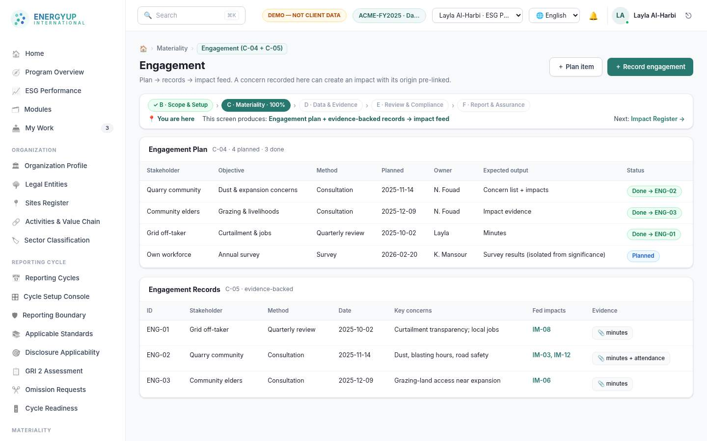
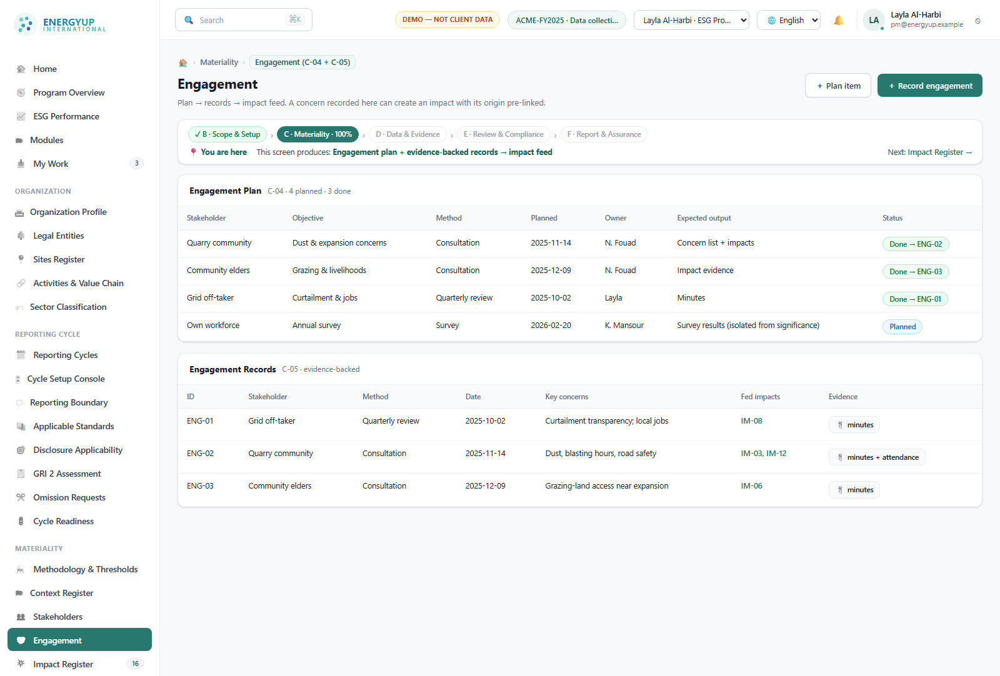
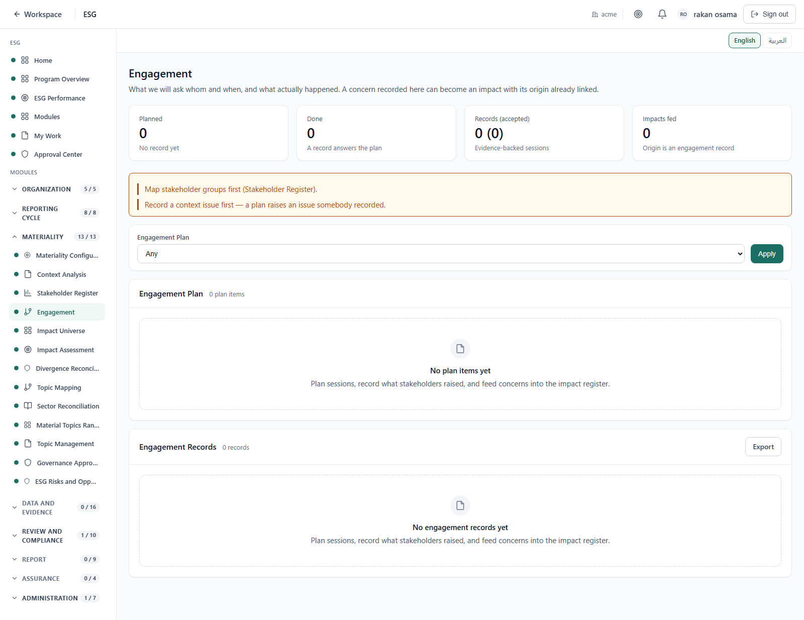

# C-04 — Engagement

*(the audit's "C-04/C-05 consolidated" — one screen, two entities)*

| | |
|---|---|
| **Route** | prototype `#/mat/engage` · .NET `/modules/esg/mat/engage` |
| **Audit** | `scr-29` · **P1** · UX 9.2 |
| **Owner role** | Materiality Team / Stakeholder Lead |
| **Owns** | `EngagementPlan` **and** `EngagementRecord` |
| **Upstream** | `mat/stake` + context · **Downstream** `mat/impacts` |
| **.NET spec** | `docs\ESG\build\04-screens\40-materiality\04-engage.md` |

> **On the code.** The audit calls this "C-04/C-05 consolidated"; `EsgScreenCatalog` keeps
> **C-04** and has no C-05 — catalogue C-05 "Engagement Records" was absorbed. The audit's own
> delta panel: *"`mat/engage` carries engagement planning and records **while keeping objects
> distinct**."* One screen, two entities, two lifecycles.

---

## Purpose

> "Plan → records → impact feed. **A concern recorded here can create an impact with its origin
> pre-linked.**"

That last clause is the screen's reason to exist: it is the second of the two legal origins for
an impact (the other being C-02 context).

---

## 1. What it must contain — the audit

**Inputs** Stakeholder groups · engagement plan · meetings/surveys/complaints
**Outputs** `EngagementRecord` · traceable concerns feeding impacts
**Completion gate** Relevant engagements recorded/evidenced

**Captured columns — 10, AT THE CAP, and a flat merge of TWO tables with no boundary marked**
([F-17](../03-FINDINGS.md#f-17)):

> **Plan:** `Stakeholder` · `Objective` · `Method` · `Planned` · `Owner` · `Expected output` ·
> `Status`
> **Records** *(cut off here):* `ID` · `Date` · `Key concerns` · …

The records table is truncated mid-way. Its remaining columns are unknown from the audit.

**P1 hardening:** *"Keep Plan and Record in one workspace but **separate objects**. Each
concern/insight must be **traceable into an Impact origin**, never just narrative notes."*

---

## 2. What the prototype renders

`assets/js/08-engine.js:312` — 5,193 chars. **Both tables are literal.**

| | |
|---|---|
| Plan table | `Stakeholder · Objective · Method · Planned · Who · Expected output · Status` — **4 hard-coded rows** |
| Records table | `ID · Stakeholder · Method · Date · Key concerns · Fed impacts · Evidence` — **3 hard-coded rows** (ENG-01/02/03) |
| `D.*` reads | none for engagement |
| Row actions | **none on either table** |
| Add | `＋ Plan item` → `engPlanForm()` and `＋ Record engagement` → `engForm()` — **both two-argument `drawer()` ⇒ write nothing** |

The prototype's records table supplies the columns the audit truncated — **`Fed impacts`** is
exactly the traceability the hardening asks for, and it is worth preserving.

**The headline behaviour is not implemented.** "A concern recorded here can create an impact with
its origin pre-linked" appears in the purpose text and the form help; there is no code that does
it.

---

## 3. What .NET implements

### As it runs today

**Captured 9 Sep 2026** from `http://acme.localhost:5270` — tenant **acme**, signed in as a
Programme Manager. Nothing planned or recorded.

**Subtitle:** *"What we will ask whom and when, and what actually happened. A concern recorded
here **can become an impact with its origin already linked**."*

- ✔ **Two registers on one screen** — **Engagement Plan** and **Engagement Records**, each with
  its own count. This is exactly the C-04 / C-05 merge, built.

**Tiles:** Planned · Done *"A record answers the plan"* · **Records (accepted) `0 (0)`**
*"Evidence-backed sessions"* · **Impacts fed** *"Origin is an engagement record"*

- ✔ **`Impacts fed` is the "Fed impacts" column** the prototype carried and the audit truncated —
  here as a derived tile.
- ✔ `Records (accepted)` showing *total (accepted)* separates a session that happened from a
  session whose evidence was accepted.
- **Two ordering blockers:** *"Map stakeholder groups first (Stakeholder Register)."* and
  *"Record a context issue first — a plan raises an issue somebody recorded."*
- ⚠ **Neither register shows an Add button in this capture** — only Export, on Records. Both
  blockers above are unmet on this tenant, so the likely reading is that creation is gated until a
  stakeholder group and a context entry exist. **Not verified** — re-shoot once the tenant has
  both.

### The code behind it

| | |
|---|---|
| Page | `Pages\Esg\Materiality\Engagement.cshtml(.cs)` |
| Service | `IEngagementService` — separate methods per entity |
| Entities | `EngagementPlan`, `EngagementRecord` |
| Permissions | `esg.mat-engage.{view,add,edit,delete,handover,signoff}` |

**`EngagementRecord` has its own micro-workflow**, distinct from every other screen:
`OfferRecordAsync` → `AcceptRecordAsync` / `ReturnRecordAsync`, plus `UnacceptRecordAsync`.
`EngagementPlan` has none.

---

## 4. Gap

| Requirement | Audit | Prototype | .NET | Verdict |
|---|---|---|---|---|
| Plan table, 7 columns | ✔ | ✔ layout only | ✔ | **OK** |
| Records table columns | ⚪ truncated | ✔ 7 columns | ✔ | ⚪ take from the prototype |
| Plan and Record as **separate objects** | ✔ | one screen, two literal tables | ✔ two entities | **OK** |
| Create either | — | ✗ **STUB ×2** | ✔ both | prototype **STUB** |
| Update / Delete either | — | ✗ no row actions | ✔ both | prototype **MISSING** |
| **Concern → Impact with origin pre-linked** | ✔ | ✗ described, not built | *not verified* | **open — the screen's whole purpose** |
| `Fed impacts` traceability column | ⚪ not captured | ✔ present | *not verified* | **open** |
| Evidence on a record | ✔ gate | ✔ column | *not verified* | **open** |
| Record accept/return flow | *not captured* | ✗ | ✔ Offer/Accept/Return | **OK** in .NET |

---

## 5. CRUD & workflow

| Op | Prototype | .NET |
|---|---|---|
| Create | `engPlanForm()` / `engForm()` — **both STUB** | `CreatePlanAsync` · `CreateRecordAsync` |
| Read | 7 literal rows | `GetRegisterAsync`, `GetPlanAsync`, `GetRecordAsync` |
| Update | — | `UpdatePlanAsync` · `UpdateRecordAsync` |
| Delete | — | `DeletePlanAsync` · `DeleteRecordAsync` |
| Submit | — | **`OfferRecordAsync`** (records only) |
| Accept / Return | — | `AcceptRecordAsync` / `ReturnRecordAsync` / `UnacceptRecordAsync` |
| Reject | — | **none** |

---

## 6. Approval Center

**Does not participate — deliberately.** `EngagementModel` is one of the five page models
explicitly exempted from BD-115's "no section screen may decide" rule, because Offer/Accept is a
**local micro-flow** between the engagement owner and the recorder, not a governance verdict.

The exemption is recorded and tested. Do not "fix" it by routing engagement records to the
Approval Center.

---

## 7. Open questions

1. **Build the concern → impact hand-off.** It is the screen's stated purpose, it is the P1
   hardening, and it exists in neither implementation. What should it create — a draft `Impact`
   with `Origin = ENG-nn` pre-filled?
2. The records table's columns beyond `Key concerns` were never captured. This document takes
   them from the prototype; confirm against `EngagementRecord`.
3. `EngagementRecord` has Accept/Return but **no Reject**. Deliberate, like C-12? Record it.
4. What is the plan's `Status` state machine? Captured as a column, undefined everywhere.
