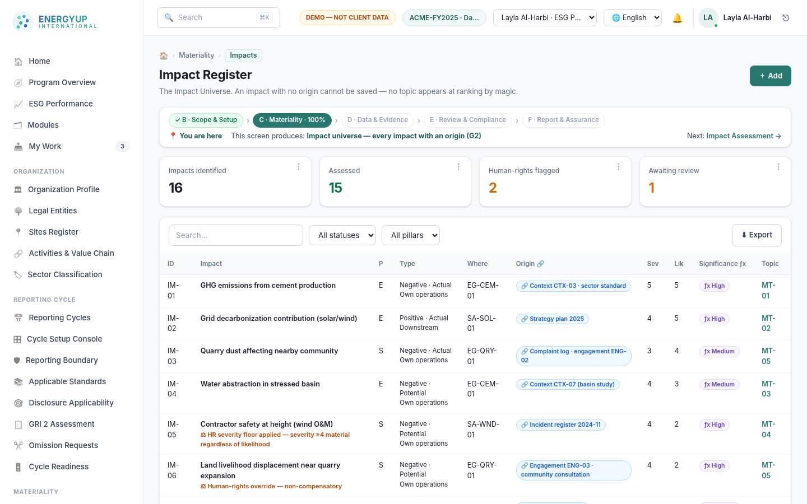
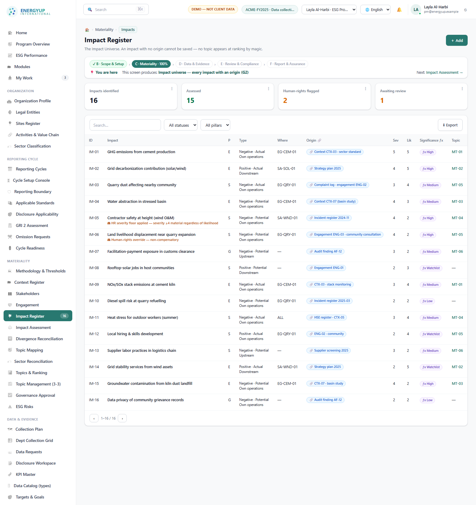
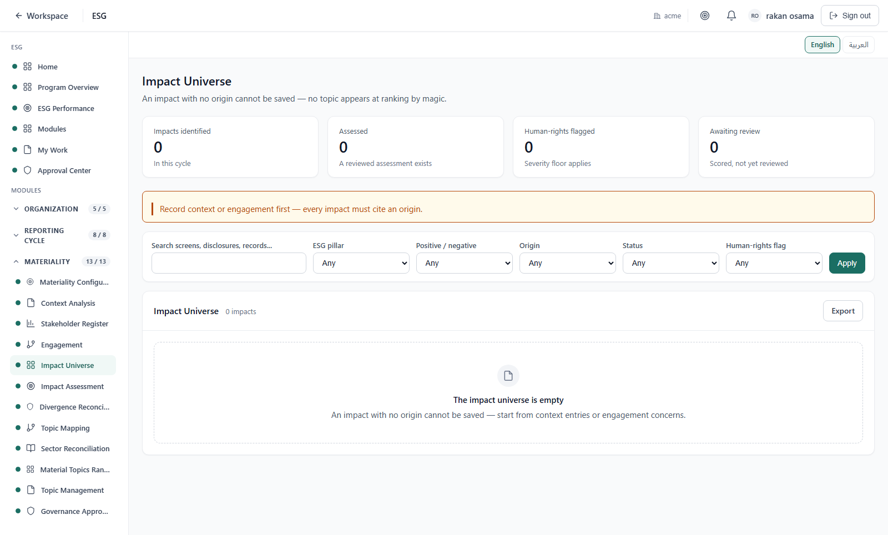

# C-06 — Impact Register

> 🔴 **P0 · UX 9.6 — jointly the highest-rated screen in either group.**

| | |
|---|---|
| **Route** | prototype `#/mat/impacts` · .NET `/modules/esg/mat/impacts` |
| **Audit** | `scr-30` · **P0** · UX **9.6** |
| **Owner role** | Materiality Team |
| **Owns** | `Impact` |
| **Upstream** | context + engagement + activities/sites · **Downstream** `mat/assess` |
| **.NET spec** | `docs\ESG\build\04-screens\40-materiality\05-impacts.md` |

---

## Purpose

> "The Impact Universe. **An impact with no origin cannot be saved** — no topic appears at
> ranking by magic."

This is the anti-hand-waving rule of the whole of Epic C. Every material topic must trace back to
impacts, and every impact must trace back to a context item or an engagement record. Without it,
"materiality" becomes a workshop opinion.

---

## 1. What it must contain — the audit

**Inputs** Context/engagement origin · activity/entity/site · stakeholder · value-chain position
**Outputs** `ImpactVersion` / Impact Universe
**Completion gate** **Every impact has a mandatory origin**

**Captured columns — 10, AT THE CAP** ([F-17](../03-FINDINGS.md#f-17)):

> `ID` · `Impact` · `P` · `Type` · `Where` · `Origin 🔗` · `Sev` · `Lik` · `Significance ƒx` ·
> `Topic`

`🔗` marks a link-out, `ƒx` a derived value — so **Significance is computed here, not typed**.

**P0 hardening:** *"make Impact Universe the mandatory entry. **No impact without origin,
affected stakeholder/value-chain context and evidence/rationale**; use governed versioning."*

Note the hardening demands three things the column set does not show: **affected stakeholder**,
**value-chain position** and **evidence/rationale**. They are in the Inputs but not the columns.

---

## 2. What the prototype renders

`assets/js/07-views.js:533` — 1,286 chars. Reads **`D.impacts`** (16 rows — a real register).

| | |
|---|---|
| Table | all 10 captured columns, correctly |
| Rows | live from `D.impacts` |
| **Row actions** | **none — there is no edit path to any impact** |
| Add | `＋ Add` → `impForm()` — **two-argument `drawer()` ⇒ writes nothing** (~20 fields, including the 3-3-b involvement rule) |

The table is one of the better ones in the prototype — real data, right columns, derived
significance shown as `ƒx`. But you cannot open a row, and you cannot create one.

*(Checked: the tiles and pager read 16 against `D.impacts.length === 16` — consistent. This
screen does **not** have the count defect that [F-16](../03-FINDINGS.md#f-16) records elsewhere.)*

---

## 3. What .NET implements

### As it runs today

**Captured 9 Sep 2026** from `http://acme.localhost:5270` — tenant **acme**, signed in as a
Programme Manager. The impact universe is empty.

> ### ✅ The P0 rule **is** the screen's subtitle
>
> *"**An impact with no origin cannot be saved** — no topic appears at ranking by magic."*
> The empty state repeats it: *"start from context entries or engagement concerns."* Enforcement
> still needs a test, but this is no longer an audit-only assertion.

- 🟡 **Named "Impact Universe" in .NET**; the audit and the prototype both call it a register.
  Align the vocabulary before it reaches training material.

**Tiles:** Impacts identified · Assessed *"A reviewed assessment exists"* ·
**Human-rights flagged** *"Severity floor applies"* · Awaiting review *"Scored, not yet reviewed"*

- ✔ **Human-rights flagged** is C-01's floor surfaced as a count on the register it acts on.
- **Filters — six, the richest bar in the group:** search · ESG pillar · **Positive / negative** ·
  **Origin** · Status · **Human-rights flag**
- ✔ A `Positive / negative` filter confirms positive impacts are first-class, not an
  afterthought — which C-11 then ranks separately.
- ⚠ **No Add button in this capture** — only Export, under the blocker *"Record context or
  engagement first — every impact must cite an origin."* Consistent with the rule; confirm once
  origins exist.

### The code behind it

| | |
|---|---|
| Page | `Pages\Esg\Materiality\Impacts.cshtml(.cs)` |
| Service | `IImpactService` |
| Entities | `Impact`, `MaterialTopicImpact` (the topic link) |
| States | `ImpactStatus` — Identified · Assessed · Mapped · Frozen |
| Derivation | `IMaterialityDerivationService` computes status |
| Permissions | `esg.mat-impacts.{view,add,edit,delete}` — plain CRUD |

`ImpactStatus` is **derived, not set** — it advances as the impact is assessed (C-07), mapped
(C-09) and frozen (C-12). That is the right model and matches "Significance ƒx".

---

## 4. Gap

| Requirement | Audit | Prototype | .NET | Verdict |
|---|---|---|---|---|
| 10-column register | ✔ | ✔ **live data** | ✔ | **OK** |
| Significance derived, not typed | ✔ `ƒx` | ✔ | ✔ derivation service | **OK** |
| **Impact with no origin cannot be saved** | ✔ **P0** | ✗ nothing saves | *not verified* | **open — the P0 rule** |
| Affected stakeholder captured | ✔ input | ✗ not a column | *not verified* | **open** |
| Value-chain position captured | ✔ input | shown in `Type`/`Where` | *not verified* | **open** |
| Evidence / rationale | ✔ P0 | in the form (**STUB**) | *not verified* | **open** |
| **Governed versioning** | ✔ P0 (`ImpactVersion`) | ✗ | ⚠ entity is `Impact`, **not** `ImpactVersion` | **discrepancy** |
| Create | — | ✗ **STUB** | ✔ `CreateAsync` | prototype **STUB** |
| **Edit** | — | ✗ **no row actions at all** | ✔ `UpdateAsync` | prototype **MISSING** |
| Delete | — | ✗ | ✔ `DeleteAsync` | **OK** in .NET |

⚠ **The audit says `ImpactVersion`; the code has `Impact`.** Either the versioning was dropped
(and the P0 hardening's "governed versioning" is unmet) or the audit named it loosely. This needs
confirming — it is the difference between an auditable impact history and an editable row.

---

## 5. CRUD & workflow

| Op | Prototype | .NET |
|---|---|---|
| Create | `impForm()` **STUB** | `CreateAsync` |
| Read | `D.impacts` | `GetRegisterAsync`, `GetByIdAsync` |
| Update | **none** | `UpdateAsync` |
| Delete | — | `DeleteAsync` |
| Submit / Approve | **none by design** — status is derived | none |

No maker-checker, correctly: an impact is a finding to be assessed, not an assertion to approve.
The governance moment is C-12, over the topic set the impacts roll up to.

---

## 6. Approval Center

**Does not participate**, correctly.

---

## 7. Open questions

1. **Is "no impact without an origin" enforced server-side?** It is the P0 rule and I could not
   confirm it from the service surface. It must be a domain invariant, not a form validation.
2. **`Impact` vs `ImpactVersion`** — is impact history versioned? If not, an edit after
   assessment silently changes what was assessed.
3. Add an **edit path**. The prototype's register has no row action at all, which makes the
   screen read-only in the one place the audit calls mandatory entry.
4. Where are **affected stakeholder** and **evidence/rationale** stored? Both are P0 hardening
   items, neither is a captured column.
