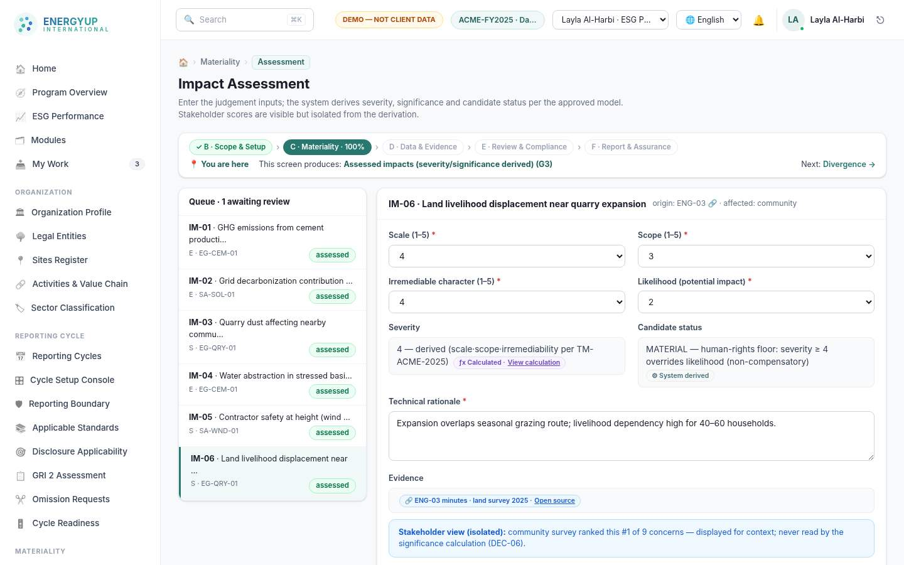
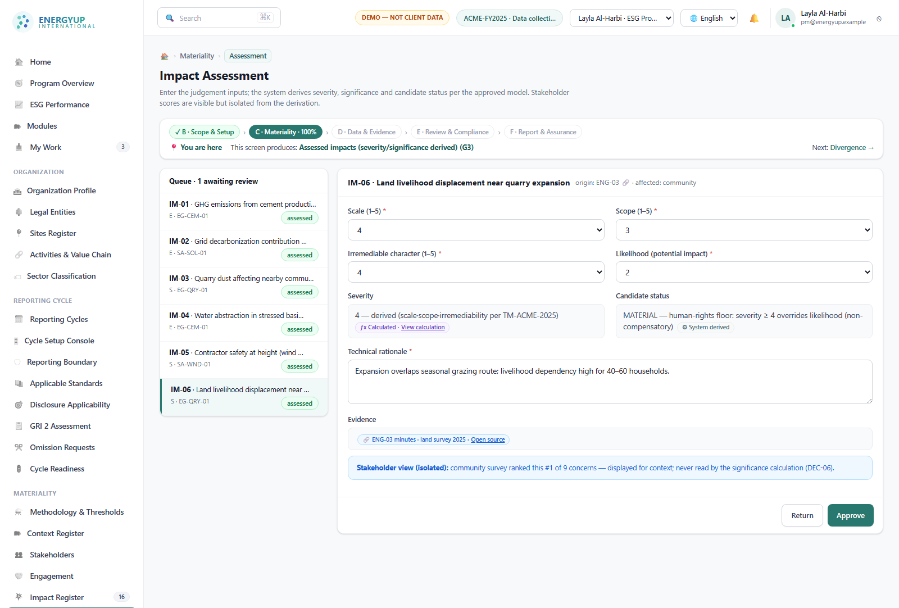
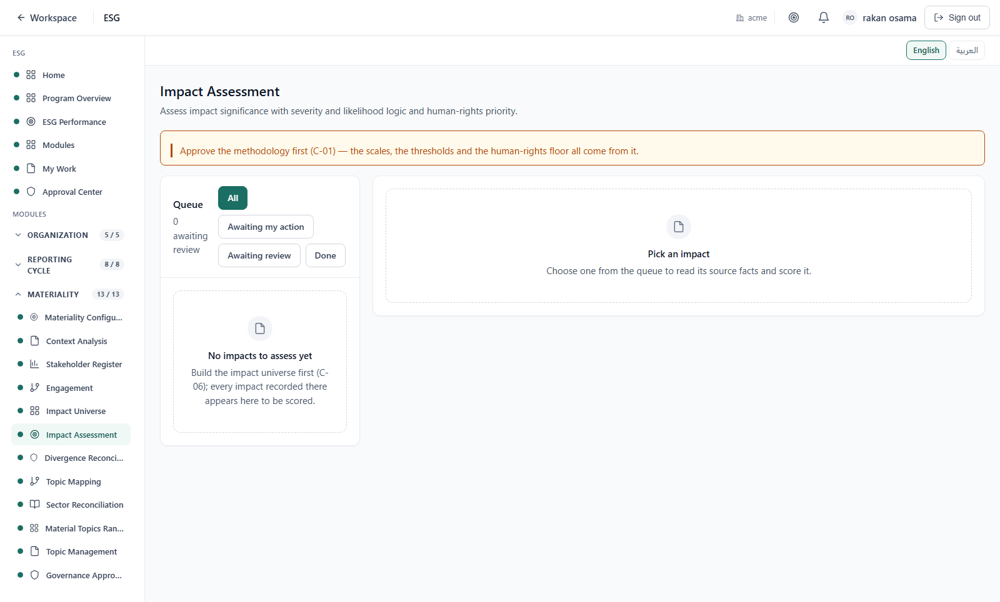

# C-07 — Impact Assessment

> 🔴 **P0 · UX 9.6.**

| | |
|---|---|
| **Route** | prototype `#/mat/assess` · .NET `/modules/esg/mat/assess` |
| **Audit** | `scr-31` · **P0** · UX **9.6** |
| **Owner role** | Technical Reviewer / Materiality Team |
| **Owns** | `ImpactAssessment` |
| **Upstream** | `mat/impacts` + approved methodology · **Downstream** `mat/diverge` (if conflict) → `mat/mapping` |
| **.NET spec** | `docs\ESG\build\04-screens\40-materiality\06-assess.md` |

---

## Purpose

> "**Enter the judgement inputs; the system derives** severity, significance and candidate status
> per the approved model. Stakeholder scores are visible but **isolated from the derivation**."

Two rules in one sentence, and both are structural:

1. **Inputs in, verdicts out.** Nobody types a significance score.
2. **The stakeholder view is walled off.** Its notice: *"community survey ranked this #1 of 9
   concerns — displayed for context; **never read by the significance calculation** (DEC-06)."*

---

## 1. What it must contain — the audit

**Inputs** Impact · scale/scope/irremediability · likelihood if potential · evidence · HR override
**Outputs** `ImpactAssessmentVersion` · significance / candidate state
**Completion gate** Assessment complete under the approved methodology

**Captured columns (8, complete — and one of only two screens with mandatory markers):**

> `Scale (1–5) *` · `Scope (1–5) *` · `Irremediable character (1–5) *` ·
> `Likelihood (potential impact) *` · `Severity` · `Candidate status` ·
> `Technical rationale *` · `Evidence`

Five mandatory fields; `Severity` and `Candidate status` are the derived pair.

**P0 hardening:** *"assessment inputs only; significance is derived from approved methodology.
**Human-rights severity override must be explicit/non-compensatory and auditable.**"*

⚠ The HR override is required and is **not a captured column or action** —
[F-18](../03-FINDINGS.md#f-18).

---

## 2. What the prototype renders

`assets/js/07-views.js:541` — 2,358 chars. Reads `D.impacts`.

| | |
|---|---|
| Tables | **none** — a queue plus a single-record detail card |
| Queue | `D.impacts.slice(0, 6)`, with `active` **hard-pinned to index 5** |
| Detail | **hard-coded to IM-06** — title, origin ENG-03, severity "4 — derived", candidate status, stakeholder notice |
| Scores | the four inputs render as selects with no save |
| Footer | `Return` and `Approve` — **both toast-only** |

The screen demonstrates the model well — you can see inputs on the left and derived severity on
the right, with the stakeholder view visibly separated. But it assesses exactly one impact, and
records nothing.

---

## 3. What .NET implements

### As it runs today

**Captured 9 Sep 2026** from `http://acme.localhost:5270` — tenant **acme**, signed in as a
Programme Manager. Gated shut, with nothing to assess.

- ✔ **The C-01 gate is explicit and names the screen by code:** *"Approve the methodology first
  (C-01) — the scales, the thresholds and the human-rights floor all come from it."*

**Queue and detail:** left **Queue** — *0 awaiting review* — with **All / Awaiting my action /
Awaiting review / Done**; right pane *"Pick an impact — Choose one from the queue to read its
**source facts** and score it."*

- ✔ **"Awaiting my action" vs "Awaiting review" is the maker–checker split**, on the screen. This
  is the local micro-flow BD-115 exempts from the Approval Center, and it is real rather than
  notional — which is the justification for the exemption.
- ✔ "read its **source facts**" — the assessor scores against the impact's own provenance, which
  is the C-02/C-04 origin chain arriving where it is used.
- ⚠ **The human-rights severity override is still not visible as an action.** The screen is empty
  and the override may live in the scoring form, so this capture neither finds nor refutes it.
  [F-18](../03-FINDINGS.md#f-18) stands for C-07 — resolve it from the field list in the frozen
  spec, or from a populated screen.
- ⚠ Likewise **DEC-06** (stakeholder scores isolated from significance) cannot be seen here. It
  needs a test.

### The code behind it

| | |
|---|---|
| Page | `Pages\Esg\Materiality\Assessment.cshtml(.cs)` |
| Service | `IImpactAssessmentService` |
| Entity | `ImpactAssessment` |
| States | `ImpactAssessmentStatus` — Assessed · Reviewed · Submitted · Returned · Frozen |
| Support | `Domain\Common\MaterialitySignificance.cs` |
| Permissions | `esg.mat-assess.{view,add,edit,delete,handover,signoff}` |

`ScoreAsync` is an **upsert** — scoring and re-scoring are the same call. `GetWorkbenchAsync`
returns the queue, so the .NET screen is genuinely multi-impact.

---

## 4. Gap

| Requirement | Audit | Prototype | .NET | Verdict |
|---|---|---|---|---|
| 4 mandatory input scores | ✔ `*` | ✔ shown | ✔ `ScoreAsync` | **OK** |
| Severity + candidate status **derived** | ✔ | ✔ labelled derived | ✔ `MaterialitySignificance` | **OK** |
| Technical rationale mandatory | ✔ `*` | ✔ shown | ✔ | **OK** |
| Evidence | ✔ | ✔ shown | *not verified* | **open** |
| **Stakeholder view isolated** | ✔ DEC-06 | ✔ notice present | *not verified* | **open** |
| Scored against the **approved** methodology version | ✔ | ✗ | *not verified* | **open** |
| **HR severity override, auditable** | ✔ **P0** | ✗ | ✗ not found | ⚪ **[F-18](../03-FINDINGS.md#f-18)** |
| Queue selectable | implied | ✗ **pinned to IM-06** | ✔ `GetWorkbenchAsync` | prototype **MISSING** |
| Scores persist | ✔ | ✗ | ✔ | prototype **STUB** |
| **Delete an assessment** | — | ✗ | ✗ **absent** | **open** |
| Reject | — | ✗ | ✗ **absent** — only Return | **by design?** |

---

## 5. CRUD & workflow

| Op | Prototype | .NET |
|---|---|---|
| Create | — | `ScoreAsync` (upsert) |
| Read | queue + pinned detail | `GetWorkbenchAsync`, `GetByImpactAsync` |
| Update | — | `ScoreAsync` |
| Delete | — | **none** |
| Submit | — | `SubmitAsync` |
| Review | `Approve` toast | `ReviewAsync` |
| Return | `Return` toast | `ReturnAsync` |
| Reject | — | **none** |

---

## 6. Approval Center

**Does not participate — deliberately.** `AssessmentModel` is one of the five page models
exempted from BD-115. Assessment review is a **technical** review by TREV against the
methodology, not a governance verdict; the governance moment is C-12.

The exemption is recorded and enforced by test. Do not route assessments to the Center.

---

## 7. Open questions

1. **Where is the human-rights severity override?** It is a P0 requirement — "explicit,
   non-compensatory and auditable" — and it appears in neither the captured columns, the
   prototype, nor any service method I could find. The prototype's *impact* register carries an
   `hr` flag; the assessment does not. **This is the biggest single gap on the screen.**
2. Does an assessment record **which MethodologyVersion it was scored under**? Without it, C-01's
   versioning is decorative.
3. **Is the DEC-06 isolation enforced, or just documented?** A stakeholder score that is stored
   on the same entity is one careless join away from entering the derivation.
4. No Delete and no Reject. Deliberate? If an assessment is wrong, is the only path a re-score?
