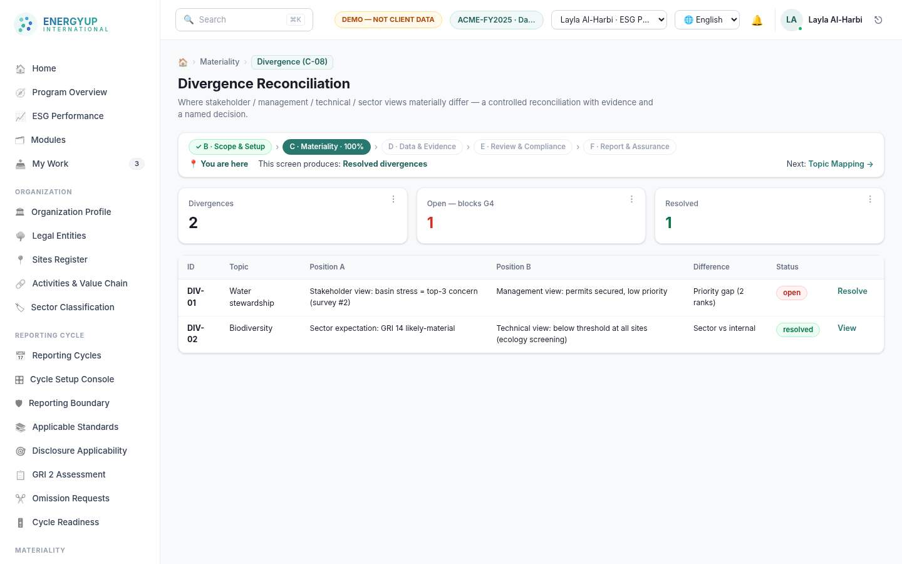
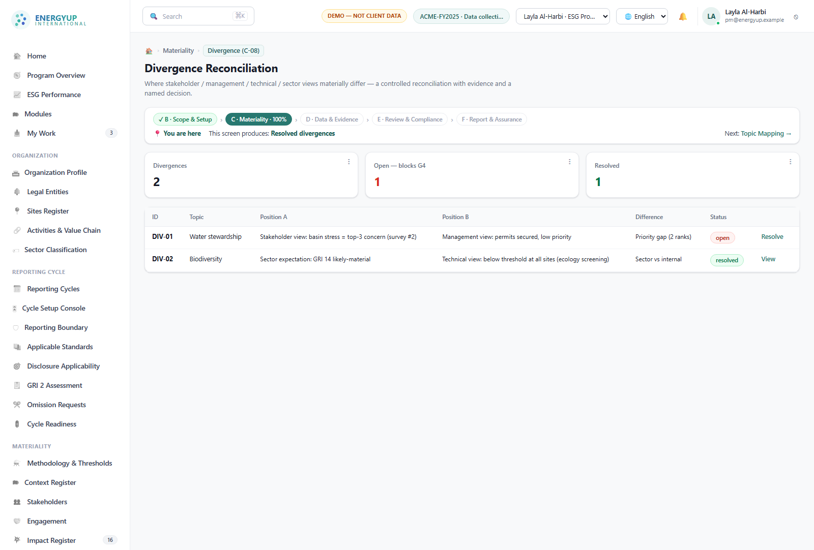
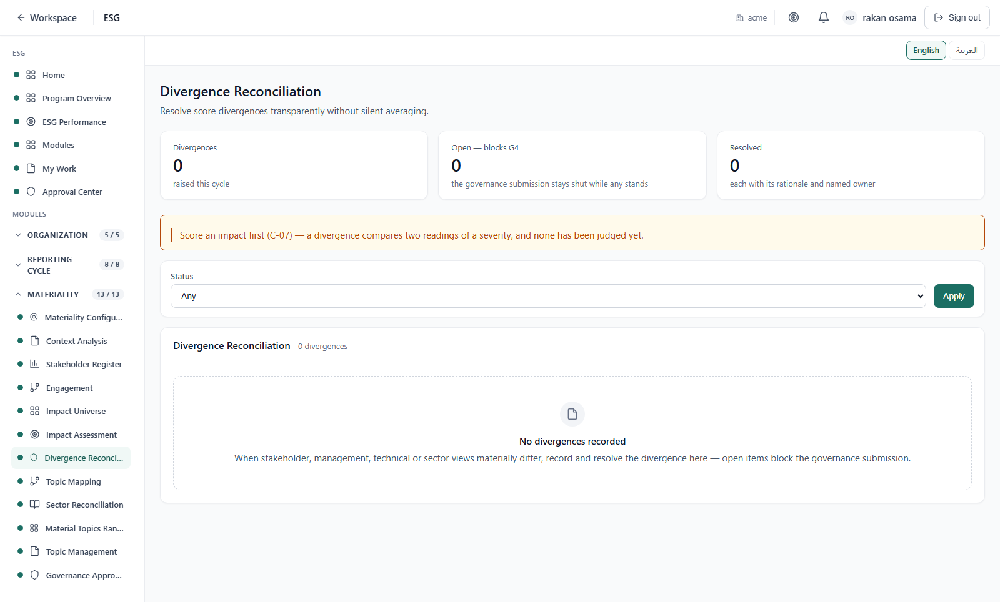

# C-08 — Divergence Reconciliation

| | |
|---|---|
| **Route** | prototype `#/mat/diverge` · .NET `/modules/esg/mat/diverge` |
| **Audit** | `scr-32` · **P1** · UX 9.2 |
| **Owner role** | Technical Reviewer / Governance |
| **Owns** | `DivergenceRecord` |
| **Upstream** | conflicting assessments/views · **Downstream** `mat/mapping` |
| **.NET spec** | `docs\ESG\build\04-screens\40-materiality\07-diverge.md` |

---

## Purpose

> "Where stakeholder / management / technical / sector views materially differ — a controlled
> reconciliation with evidence and **a named decision**."

The hardening adds the rule that matters: **"No silent averaging."** When the community says a
topic is critical and the technical assessment says it is moderate, the answer is a reasoned
decision by a named person — not the mean of two numbers.

---

## 1. What it must contain — the audit

**Inputs** Conflicting stakeholder/management/technical assessments
**Outputs** `DivergenceDecision` · resolution rationale / escalation
**Completion gate** Material divergences resolved or escalated

**Captured columns (6):**
`ID` · `Topic` · `Position A` · `Position B` · `Difference` · `Status`

**P1 hardening:** *"Show exactly which assessments/views conflict, **required resolution owner
and final rationale**. No silent averaging."*

⚠ **The hardening demands a resolution owner and a final rationale; neither is a captured
column.** The table has only `Status` — [F-18](../03-FINDINGS.md#f-18).

---

## 2. What the prototype renders

`assets/js/08-engine.js:349` — 3,101 chars. Reads **`D.divergences`** (2 rows — a real register).

| | |
|---|---|
| Table | the 6 captured columns + an actions column |
| Tiles | 3, derived |
| Row action (open) | `Resolve` → `divForm(id)` + **`divFoot(id)` — this one WRITES**: sets `d.st='resolved'`, stores `d.res`, audits, re-renders |
| Row action (resolved) | `View` → toast of the resolution |
| Add | **none** — divergences are raised, not created here |

**One of only three prototype screens with a working write.** The button is labelled "Approve
resolution", which is closer to a decision than most of the prototype manages.

---

## 3. What .NET implements

### As it runs today

**Captured 9 Sep 2026** from `http://acme.localhost:5270` — tenant **acme**, signed in as a
Programme Manager. No divergences raised.

> ### ✅ Resolution owner and final rationale **exist** — correcting §4 and the gap register
>
> The Resolved tile reads **"each with its rationale and named owner"**. Both were recorded as
> missing on the strength of the audit's chip list; the running build has them.

**Subtitle:** *"Resolve score divergences transparently **without silent averaging**."*

**Tiles:** Divergences · **Open — blocks G4** *"the governance submission stays shut while any
stands"* · **Resolved** *"each with its rationale and named owner"*

- ⚠ **The gate is called G4 here**, not G2. Add this to the gate-vocabulary reconciliation in
  [F-6](../03-FINDINGS.md#f-6) — the .NET numbering is the one to follow.
- ✔ The empty state names the four views that can diverge: **"stakeholder, management, technical
  or sector"**. The audit never enumerated them.
- **Blocker:** *"Score an impact first (C-07) — a divergence compares two readings of a severity,
  and none has been judged yet."*
- **Filter:** Status. No create action — divergences are raised from C-07, not typed here.

### The code behind it

| | |
|---|---|
| Page | `Pages\Esg\Materiality\Divergence.cshtml(.cs)` |
| Service | `IDivergenceService` |
| Entity | `DivergenceRecord` |
| States | `DivergenceStatus` Open · Resolved · Frozen |
| Resolution | `DivergenceResolution` — **AdoptStakeholderPosition · AdoptInternalPosition · BlendedPosition** |
| Permissions | `esg.mat-diverge.{view,edit,signoff}` — **no add, no delete, deliberately** |

`DivergenceResolution` is the real answer to "no silent averaging": the three outcomes are named
and one of them (`BlendedPosition`) is an explicit, recorded choice rather than an arithmetic
default.

---

## 4. Gap

| Requirement | Audit | Prototype | .NET | Verdict |
|---|---|---|---|---|
| 6-column register | ✔ | ✔ **live** | ✔ | **OK** |
| Show which views conflict | ✔ P1 | ✔ Position A / B | ✔ | **OK** |
| **Resolution owner** | ✔ P1 | ✗ not a column | ✅ **exists** — *"each with its rationale and named owner"* | ✅ **OK in .NET** |
| **Final rationale** | ✔ P1 | stored in `d.res`, not a column | ✅ **exists** — same tile | ✅ **OK in .NET** |
| No silent averaging | ✔ P1 | ✔ explicit resolve | ✔ `DivergenceResolution` | **OK** |
| Resolve | ✔ gate | ✔ **writes** | ✔ `ResolveAsync` | **OK** |
| **Escalate** | ✔ gate | ✗ | ✔ `EscalateAsync` | prototype **MISSING** |
| Create | — | ✗ | ✗ `RaiseAsync` only | **by design** |
| Delete | — | ✗ | ✔ `DeleteAsync` | **OK** in .NET |
| Blocks C-11 while open | ✔ | ✔ ranking checks it | ✔ `CountOpenAsync` | **OK** |

---

## 5. CRUD & workflow

| Op | Prototype | .NET |
|---|---|---|
| Create | — | `RaiseAsync` (raised from a conflict, not typed) |
| Read | `D.divergences` | `GetRegisterAsync`, `GetByIdAsync`, **`CountOpenAsync`** |
| Update | `divFoot()` **writes** | `UpdateAsync` |
| Delete | — | `DeleteAsync` |
| Resolve | ✔ | `ResolveAsync` |
| Escalate | — | `EscalateAsync` |
| Submit / Approve / Reject | **none** | none |

`CountOpenAsync` is what C-11 calls to disable "Send to governance" — the coupling is real in
both layers.

---

## 6. Approval Center

**Does not participate.** A divergence is resolved by the technical reviewer or escalated; it is
not a governed submission. Note `mat-diverge` does declare **`signoff`**, so resolving is treated
as a sign-off-grade act locally.

---

## 7. Open questions

1. **Add the resolution-owner and final-rationale columns.** Both are explicit P1 requirements
   and neither is visible in the register. A resolution you cannot attribute is not controlled.
2. Where does an **escalation** go? `EscalateAsync` exists; C-09 escalates to the Methodology
   Owner — is this the same destination?
3. `DivergenceStatus` has a **Frozen** state. Frozen by what — C-12's topic-set freeze? Confirm
   the coupling.
4. What raises a divergence in the first place? `RaiseAsync` is not called from this screen; the
   trigger is presumably in C-07. Document it.
