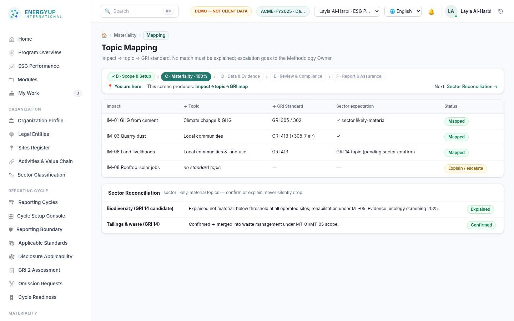
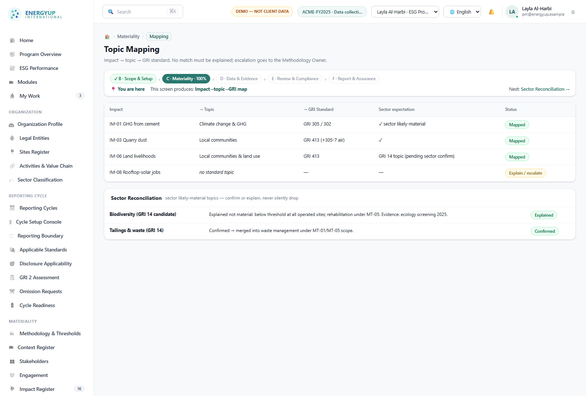
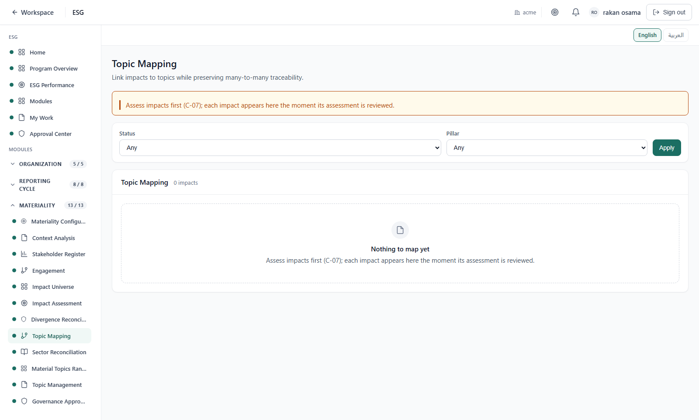

# C-09 — Topic Mapping

| | |
|---|---|
| **Route** | prototype `#/mat/mapping` · .NET `/modules/esg/mat/mapping` |
| **Audit** | `scr-33` · **P1** · UX 9.2 |
| **Owner role** | Technical Reviewer |
| **Owns** | `TopicMapping` |
| **Upstream** | assessed impacts + topic taxonomy · **Downstream** `mat/secrec` → `mat/ranking` |
| **.NET spec** | `docs\ESG\build\04-screens\40-materiality\08-mapping.md` |

---

## Purpose

> "Impact → topic → GRI standard. **No match must be explained**; escalation goes to the
> Methodology Owner."

And the rule that keeps the axes apart:

> **"do not let mapping itself decide materiality."**

Mapping says *which topic an impact belongs to*. Whether that topic is material is C-11's
decision, on evidence. Collapsing the two is how organizations end up with a material topic
nobody assessed.

---

## 1. What it must contain — the audit

**Inputs** Assessed impacts · controlled topic taxonomy · GRI topic standards
**Outputs** `TopicMappingVersion`
**Completion gate** Every assessed impact mapped **or** no-match explained

**Captured columns (5, complete):**
`Impact` · `→ Topic` · `→ GRI Standard` · `Sector expectation` · `Status`

**P1 hardening:** *"Use controlled **many-to-many** Impact↔Topic mapping. 'No match' requires
explanation/escalation; do not let mapping itself decide materiality."*

---

## 2. What the prototype renders

`assets/js/07-views.js:560` — 1,640 chars. **Fully literal.**

| | |
|---|---|
| Table 1 | the 5 captured columns — **4 hard-coded rows** (IM-01, IM-03, IM-06, IM-08) |
| Table 2 | a **sector-reconciliation card**, `<tbody>` only with **no `<thead>`**, 2 hard-coded rows |
| `D.*` reads | **zero** |
| Actions | **none whatsoever** — `pageHead` actions are `''`, no row actions, no drawer |

**The most inert screen in either group.** It renders a mapping you cannot change and a no-match
you cannot explain — while its own completion gate is "*every* assessed impact mapped or
explained".

⚠ **Table 2 duplicates C-10 Sector Reconciliation** with different, unsynchronised rows —
[F-13](../03-FINDINGS.md#f-13). `mat/secrec` owns that decision over `D.sectopics` (4 rows); this
copy has 2 and will drift.

---

## 3. What .NET implements

### As it runs today

**Captured 9 Sep 2026** from `http://acme.localhost:5270` — tenant **acme**, signed in as a
Programme Manager. Nothing to map.

> ### ✅ Many-to-many is explicit — correcting §7
>
> The subtitle reads *"Link impacts to topics **while preserving many-to-many traceability**."*
> The open question of whether the model forces a false 1:1 choice is answered: it does not.

- **Blocker:** *"Assess impacts first (C-07); each impact appears here **the moment its assessment
  is reviewed**."* Entry into mapping is triggered by **review**, not by scoring — a sharper rule
  than either the audit or the prototype states.
- **Filters:** Status · Pillar. No create action — rows are derived from assessed impacts, which
  is why the CRUD matrix shows `—` for Create.
- ✔ **No duplication of Sector Reconciliation.** The two screens are genuinely distinct in .NET,
  unlike the prototype where they render the same rows out of sync
  ([F-13](../03-FINDINGS.md#f-13)).

### The code behind it

| | |
|---|---|
| Page | `Pages\Esg\Materiality\Mapping.cshtml(.cs)` |
| Service | `ITopicMappingService` |
| Entities | `TopicMapping`, `TopicCandidate` |
| States | `TopicMappingStatus` — Pending · Mapped · Confirmed · **NoMatchExplained** · Frozen |
| Permissions | `esg.mat-mapping.{view,edit,signoff}` — **no add, no delete, deliberately** |

`NoMatchExplained` as a first-class status is the audit's rule implemented properly — a no-match
is a recorded outcome, not an empty cell.

---

## 4. Gap

| Requirement | Audit | Prototype | .NET | Verdict |
|---|---|---|---|---|
| 5-column register | ✔ | ✔ layout only | ✔ | **OK** |
| Rows from a register | — | ✗ 4 literals, 0 reads | ✔ | prototype **MISSING** |
| Map an impact to a topic | ✔ | ✗ **no actions at all** | ✔ `MapAsync` | prototype **MISSING** |
| **No-match explained** | ✔ gate | ✗ | ✔ `ExplainNoMatchAsync` + status | **OK** in .NET |
| **Escalate to Methodology Owner** | ✔ | ✗ | ✔ `EscalateAsync` | prototype **MISSING** |
| **Many-to-many Impact↔Topic** | ✔ P1 | ✗ one row per impact | ✅ **explicit** — *"preserving many-to-many traceability"* | ✅ **OK in .NET** |
| Mapping must not decide materiality | ✔ P1 | ✔ (it decides nothing) | ✔ separate from C-11 | **OK** |
| Confirm a mapping | *not captured* | ✗ | ✔ `ConfirmAsync` / `UnconfirmAsync` | **OK** in .NET |
| Sector expectation column | ✔ | ✔ | ✔ | **OK** |
| **Duplicate sector-recon table** | — | ✗ [F-13](../03-FINDINGS.md#f-13) | n/a | prototype defect |

---

## 5. CRUD & workflow

| Op | Prototype | .NET |
|---|---|---|
| Create | — | rows seeded by `IMaterialityDerivationService`; `MapAsync` is an upsert |
| Read | 4 literals | `GetRegisterAsync`, `GetByIdAsync`, **`CountPendingAsync`** |
| Update | — | `MapAsync`, `ExplainNoMatchAsync` |
| Delete | — | **none, by design** |
| Confirm / Unconfirm | — | `ConfirmAsync` / `UnconfirmAsync` |
| Escalate | — | `EscalateAsync` |
| Submit / Reject | — | **none** |

Mapping rows are **derived, then decided** — you never create one from nothing, because every row
exists because an assessed impact exists. That is why `add` and `delete` are absent from the
permission set.

---

## 6. Approval Center

**Does not participate.** `ConfirmAsync` is the local sign-off (`mat-mapping.signoff`), and
unresolved cases escalate to the Methodology Owner rather than the PM's queue.

---

## 7. Open questions

1. **Is the mapping genuinely many-to-many?** The P1 hardening requires it — one impact can
   legitimately touch two topics. `TopicMapping` looks like one row per impact; confirm the
   cardinality, because a 1:1 model silently forces a false choice.
2. **Remove the duplicate sector-reconciliation table** from this screen
   ([F-13](../03-FINDINGS.md#f-13)); C-10 owns it.
3. Where does an **escalation** surface for the Methodology Owner? Same question as C-08 — there
   is no escalation inbox in either layer that I could find.
4. What is `TopicCandidate` for, and who promotes one? It has no dedicated service; it is written
   by the derivation service and read through this register and C-11.
