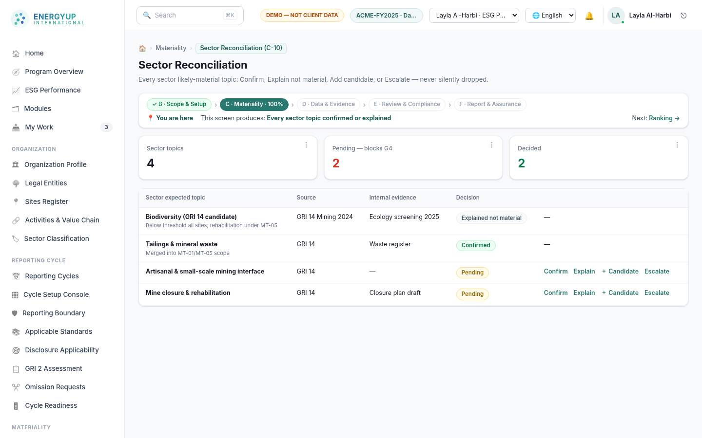
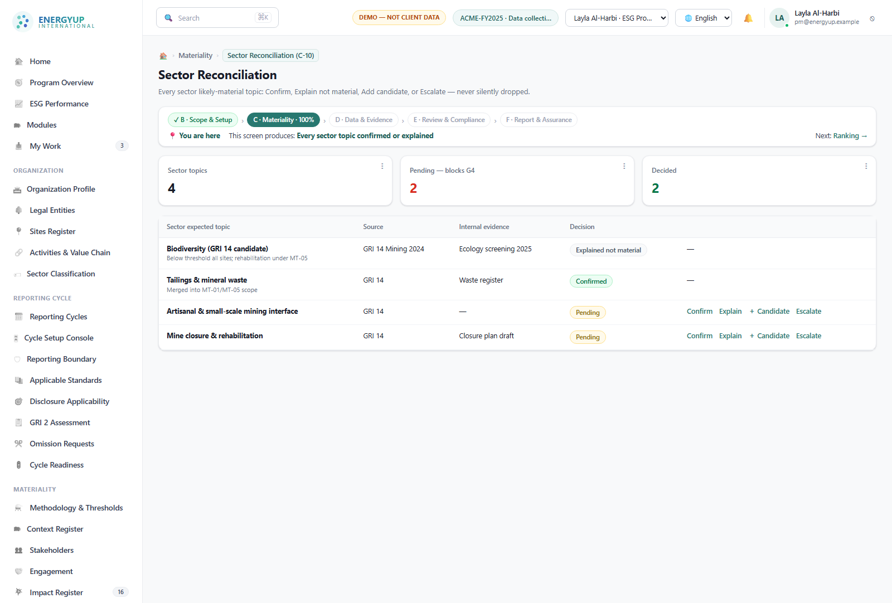
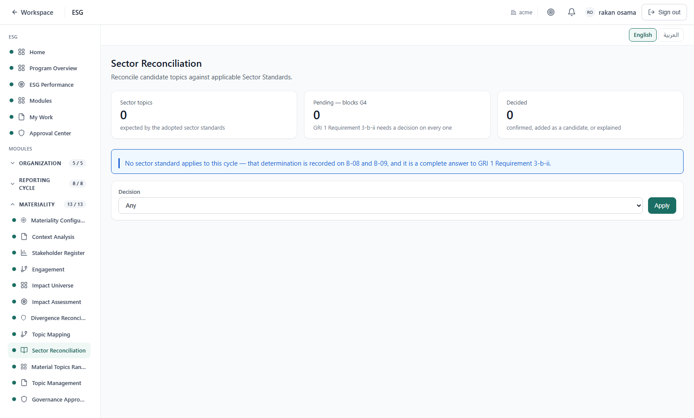

# C-10 — Sector Reconciliation

| | |
|---|---|
| **Route** | prototype `#/mat/secrec` · .NET `/modules/esg/mat/secrec` |
| **Audit** | `scr-34` · **P1** · UX 9.2 |
| **Owner role** | Technical Reviewer / Methodology Owner |
| **Owns** | `SectorReconciliation` |
| **Upstream** | topic mapping + sector standard expectations · **Downstream** `mat/ranking` |
| **.NET spec** | `docs\ESG\build\04-screens\40-materiality\09-secrec.md` |

---

## Purpose

> "Every sector likely-material topic: **Confirm, Explain not material, Add candidate, or
> Escalate — never silently dropped.**"

This is the screen that stops a company quietly ignoring a topic its own sector standard says is
likely material. GRI counts sector coverage in the in-accordance claim, so an unreconciled topic
is a claim risk, not a housekeeping item.

**It has the clearest enumerated action set of any screen in either group** — four named,
terminal outcomes.

---

## 1. What it must contain — the audit

**Inputs** Sector-standard likely-material topics · mapped impacts/topics
**Outputs** `SectorReconciliationDecision` per topic
**Completion gate** Every sector likely-material topic reconciled

**Captured columns (4 — the smallest set in the group):**
`Sector expected topic` · `Source` · `Internal evidence` · `Decision`

**P1 hardening:** *"Every sector likely-material topic must end **Confirm / Explain not material
/ Add candidate / Escalate** with evidence. **No hidden sector-topic omission.**"*

Note what is **not** captured: no owner, no status, no decision date. The four actions themselves
appear only as prose — the audit records no buttons for any screen.

---

## 2. What the prototype renders

`assets/js/08-engine.js:368` — 2,903 chars. Reads **`D.sectopics`** (4 rows — a real register).

| | |
|---|---|
| Table | `Sector expected topic · Source · Internal evidence · Decision` + actions |
| Tiles | 3, derived |
| Actions (pending rows only) | `Confirm` → **`secDecide(i,'confirmed')` writes** · `Explain` → `secExpForm()` + **`secExpFoot()` writes** status + note + audit · `＋ Candidate` → `secDecide(i,'candidate')` · `Escalate` → audit + toast only |
| Decided rows | actions cell renders `—` — **no re-open, no edit, no delete** |

**One of the three prototype screens that genuinely writes.** Two problems:

- **`＋ Candidate` does not create a candidate.** It calls `secDecide(i,'candidate')`, which sets
  the row's status to `confirmed`. No topic row is created anywhere. The action's name promises
  something it does not do.
- **`Escalate` only toasts** — an escalation is recorded in the audit log and nowhere a
  Methodology Owner would ever see it.

---

## 3. What .NET implements

### As it runs today

**Captured 9 Sep 2026** from `http://acme.localhost:5270` — tenant **acme**, signed in as a
Programme Manager. No sector standard applies to this cycle.

> ### ✅ Three terminal decisions, not four — correcting §7
>
> The Decided tile reads **"confirmed, added as a candidate, or explained"**. Escalation is not
> one of them, so the code reading was right and the audit's fourth outcome is a separate act.

**Tiles:** Sector topics *"expected by the adopted sector standards"* · **Pending — blocks G4**
*"**GRI 1 Requirement 3-b-ii** needs a decision on every one"* · **Decided**

**Notice, live:** *"**No sector standard applies to this cycle** — that determination is recorded
on B-08 and B-09, and it is **a complete answer to GRI 1 Requirement 3-b-ii**."*

- ✔ A nil return is treated as a valid answer to the requirement, and the notice says **where the
  answer came from**. This is the traceability contract working across three screens.
- ⚠ **With no sector standard in force the screen collapses to tiles + notice + a Decision
  filter — no register renders at all.** Whether it carries `Owner` and `Decided on` columns
  cannot be read from this capture, so that gap-register row **stays open**.

### The code behind it

| | |
|---|---|
| Page | `Pages\Esg\Materiality\SectorReconciliation.cshtml(.cs)` |
| Service | `ISectorReconciliationService` |
| Entity | `SectorReconciliation` |
| States | `SectorReconciliationStatus` Pending · Decided · Frozen |
| Verdicts | `SectorReconciliationVerdict` — **Covered · AddedAsMaterial · NotMaterial** |
| Permissions | `esg.mat-secrec.{view,edit,signoff}` — no add, no delete |

⚠ **Three verdicts, not four.** The audit's fourth outcome, **Escalate**, is not a verdict —
`EscalateAsync` exists as a separate method, so escalation is an action that leaves the row
`Pending` rather than a terminal decision. That is arguably more correct than the audit's
phrasing (an escalated topic is not yet reconciled), but the two documents describe different
models and the difference should be recorded.

---

## 4. Gap

| Requirement | Audit | Prototype | .NET | Verdict |
|---|---|---|---|---|
| 4-column register | ✔ | ✔ **live** | ✔ | **OK** |
| Rows seeded from the sector standard | implied | ✔ `D.sectopics` | ✔ | **OK** |
| **Confirm** | ✔ | ✔ writes | ✔ `Covered` | **OK** |
| **Explain not material** | ✔ | ✔ writes + note | ✔ `NotMaterial` | **OK** |
| **Add candidate** | ✔ | ✗ **flips status, creates nothing** | ✔ `AddedAsMaterial` | prototype **STUB** |
| **Escalate** | ✔ | ✗ toast only | ✔ `EscalateAsync` — **confirmed not a verdict**: the live tile lists **three** decisions | ✅ **model settled — see §3** |
| Evidence on every decision | ✔ P1 | `Internal evidence` column | *not verified* | **open** |
| Owner / decision date | ⚪ not captured | ✗ | *not verified* — the live register does not render with no sector standard | ⚪ **still open — re-shoot** |
| **Re-open a decision** | — | ✗ actions become `—` | ✔ `ReopenAsync` | prototype **MISSING** |
| Blocks C-11 while pending | ✔ | ✔ ranking checks it | ✔ `AllDecidedAsync` | **OK** |
| No hidden omission | ✔ P1 | ✔ every row must be decided | ✔ | **OK** |

---

## 5. CRUD & workflow

| Op | Prototype | .NET |
|---|---|---|
| Create | `＋ Candidate` — **misleading, creates nothing** | **none** — rows are seeded per sector topic |
| Read | `D.sectopics` | `GetRegisterAsync`, `GetByIdAsync`, **`AllDecidedAsync`** |
| Update | `secDecide()` / `secExpFoot()` — **write** | `DecideAsync` |
| Delete | — | **none, by design** |
| Reopen | — | `ReopenAsync` |
| Escalate | toast only | `EscalateAsync` |
| Submit / Approve / Reject | **none** | none |

---

## 6. Approval Center

**Does not participate.** The decision is terminal and local, signed off under
`mat-secrec.signoff`. Its effect reaches governance indirectly: C-11 cannot send the topic set
until `AllDecidedAsync` is true.

---

## 7. Open questions

1. **Fix or rename `＋ Candidate`.** In .NET the equivalent verdict is `AddedAsMaterial` — does
   that actually create a `TopicCandidate` row, or only label the reconciliation? If the latter,
   the topic still never reaches C-11.
2. **Escalate: verdict or action?** The audit lists it as one of four outcomes; the code makes it
   a separate method leaving the row Pending. Record which is intended — it changes what
   "reconciled" means for the gate.
3. **Who sees an escalation?** Third time this question appears (C-08, C-09, C-10). There is no
   Methodology Owner inbox in either layer.
4. Add **owner** and **decided-on** columns. A terminal governance decision with no attribution
   is not auditable.
