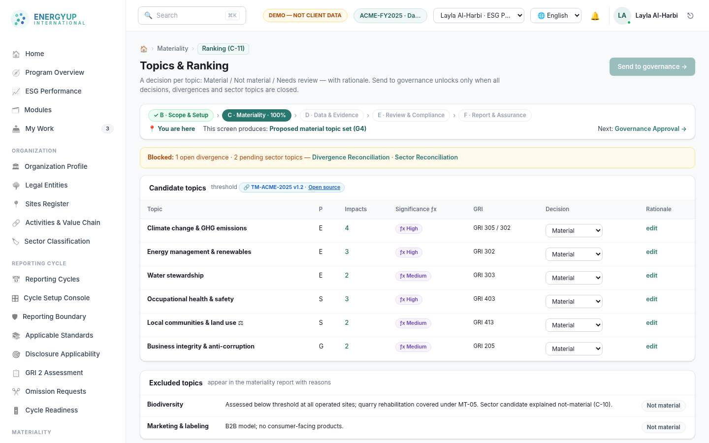
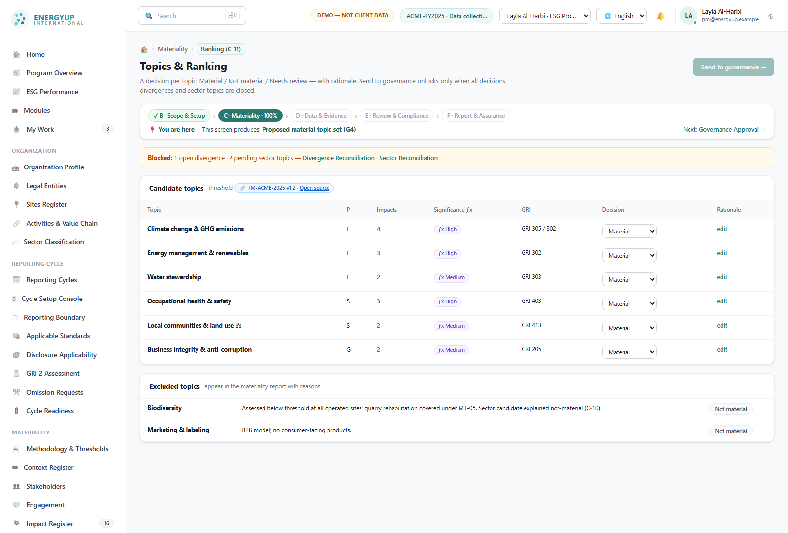
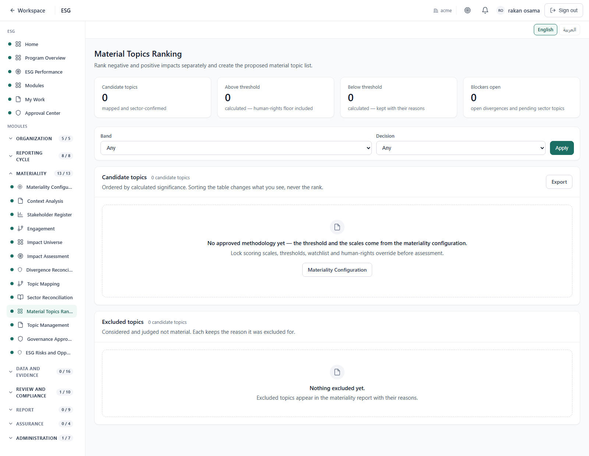

# C-11 — Topics & Ranking

| | |
|---|---|
| **Route** | prototype `#/mat/ranking` · .NET `/modules/esg/mat/ranking` |
| **Audit** | `scr-35` · **P1** · UX 9.2 |
| **Owner role** | Materiality Team / Governance |
| **Owns** | `TopicRanking` — and **submits** `MaterialTopicSetVersion` |
| **Upstream** | assessment + mapping + sector reconciliation · **Downstream** `mat/approval` |
| **.NET spec** | `docs\ESG\build\04-screens\40-materiality\10-ranking.md` |

---

## Purpose

> "A decision per topic: Material / Not material / Needs review — with rationale. **Send to
> governance unlocks only when all decisions, divergences and sector topics are closed.**"

This is **the only screen in either group where the audit names an explicit submit action**. It
is also the hand-off point: everything upstream converges here, and what leaves goes to
governance to be frozen.

---

## 1. What it must contain — the audit



**Inputs** Impact assessments · topic mappings · sector decisions · methodology threshold
**Outputs** Material / Not material / Needs review decisions · **draft `MaterialTopicSet`**
**Completion gate** Decision + rationale for **every** candidate topic

**Captured columns (7, complete):**
`Topic` · `P` · `Impacts` · `Significance ƒx` · `GRI` · `Decision` · `Rationale`

**P1 hardening:** *"Decision must be per topic with **visible supporting impacts, threshold basis
and exclusions**. **Never reduce to an opaque average score.**"*

**Visible notice** — the gate working:
> *"Blocked: 1 open divergence · 2 pending sector topics — Divergence Reconciliation · Sector
> Reconciliation"*

---

## 2. What the prototype renders



`assets/js/08-engine.js:380` — 3,046 chars. Reads **`D.topics`**, `D.excluded`,
`D.divergences`, `D.sectopics` — the most register-connected screen in the group.

| | |
|---|---|
| Table 1 | candidate topics, the 7 captured columns + actions |
| Table 2 | **excluded topics** with reasons — `<tbody>` only, no `<thead>` |
| Row action | `edit` → `rankRatForm()` — **two-argument `drawer()` ⇒ writes nothing** |
| Header | **`Send to governance →`** — correctly **disabled** while a divergence is open or a sector topic pends |

**The gate logic is genuinely implemented** — it reads `D.divergences` and `D.sectopics` and
disables the button. Then:

```js
onclick="nav('mat/approval')"
```

🔴 **[F-3](../03-FINDINGS.md#f-3) — it navigates.** No state change, no audit event, no draft
topic set, no freeze. The one named submit action in the entire audit is a hyperlink.

The excluded-topics table is a good touch and is **not** in the captured columns — the hardening
asks for "exclusions" to be visible and the prototype does it.

---

## 3. What .NET implements

### As it runs today



**Captured 9 Sep 2026** from `http://acme.localhost:5270` — tenant **acme**, signed in as a
Programme Manager. No approved methodology, so the screen is gated and both registers are
empty.

**Tiles:** Candidate topics *"mapped and sector-confirmed"* · **Above threshold** *"calculated —
**human-rights floor included**"* · Below threshold *"calculated — **kept with their reasons**"* ·
**Blockers open** *"open divergences and pending sector topics"*

- ✔ The fourth tile **counts the C-08 and C-10 dependencies** — the two G4 blockers, surfaced on
  the screen that they block.
- ✔ **"human-rights floor included"** — the C-01 floor is applied at ranking, not only at scoring.

**Two registers:**
- **Candidate topics** — *"Ordered by calculated significance. **Sorting the table changes what
  you see, never the rank.**"* An unusually careful thing to say, and the right rule.
- **Excluded topics** — *"Considered and judged not material. **Each keeps the reason it was
  excluded for.**"* … *"Excluded topics **appear in the materiality report with their reasons**."*

- ✔ **Exclusions are retained and published**, not dropped. That is the auditable half of a
  materiality decision and neither the audit nor the prototype shows it.
- **Filters:** Band · Decision · Apply. **Action:** Export.
- **Blocker:** *"No approved methodology yet — the threshold and the scales come from the
  materiality configuration"* + a **Materiality Configuration** button.
- ⚠ **"Send to governance" is not visible in this capture.** With zero candidate topics that is
  expected — but it means this screenshot **can neither confirm nor refute**
  [F-1](../03-FINDINGS.md#f-1).

### The code behind it


| | |
|---|---|
| Page | `Pages\Esg\Materiality\Ranking.cshtml(.cs)` |
| Services | `IMaterialityRankingService` · `IMaterialTopicSetWorkflowService` |
| Entities | `TopicRanking`, `MaterialTopicSet`, `MaterialTopicSetVersion` |
| States | `MaterialityDecision` — **Material · Monitored · NotMaterial** |
| Permissions | `esg.mat-ranking.{view,edit,handover}` — **no signoff**, correctly |

⚠ **The decision vocabularies differ.** Audit: *Material / Not material / **Needs review***.
Code: *Material / **Monitored** / NotMaterial*. "Monitored" is a watchlist outcome; "Needs
review" is an unfinished one. They are not the same thing, and the completion gate ("decision +
rationale for every candidate") depends on which is meant — a topic left "Needs review" should
*block* the gate, whereas "Monitored" is a legitimate final answer.

`mat-ranking` has **`handover` but no `signoff`** — exactly right: this screen submits, C-12
approves.

---

## 4. Gap

| Requirement | Audit | Prototype | .NET | Verdict |
|---|---|---|---|---|
| 7-column register | ✔ | ✔ **live** | ✔ | **OK** |
| Decision per topic + rationale | ✔ gate | ✗ **STUB** | ✔ `DecideAsync` | prototype **STUB** |
| Supporting impacts visible | ✔ P1 | ✔ `Impacts` column | ✔ | **OK** |
| Threshold basis visible | ✔ P1 | ✔ links to C-01 | *not verified* | **open** |
| Exclusions visible | ✔ P1 | ✔ second table | *not verified* | **open** |
| Never an opaque average | ✔ P1 | ✔ significance shown as `ƒx` | ✔ | **OK** |
| Gate on divergences + sector topics | ✔ | ✔ **implemented** | ✔ `CountOpenAsync`/`AllDecidedAsync` | **OK** |
| **"Send to governance" actually submits** | ✔ | 🔴 **`nav()` only** | ✔ `ProposeAsync` | **[F-3](../03-FINDINGS.md#f-3)** |
| Decision vocabulary | Material/Not material/**Needs review** | as audit | Material/**Monitored**/NotMaterial | ⚠ **differs** |
| Create / Delete a ranking row | — | ✗ | ✗ rows written on the read path | **by design** |

---

## 5. CRUD & workflow

| Op | Prototype | .NET |
|---|---|---|
| Create | — | rows written by `GetRegisterAsync` on read |
| Read | `D.topics` + `D.excluded` | `GetRegisterAsync` |
| Update | `rankRatForm()` **STUB** | `DecideAsync` |
| Delete | — | **none** |
| **Submit** | 🔴 `nav()` | **`IMaterialTopicSetWorkflowService.ProposeAsync`** |
| Approve / Reject / Return | — | **none here** — they belong to C-12 |

**The submit is on the topic set, not on the ranking.** Ranking decisions accumulate; pressing
"Send to governance" proposes the `MaterialTopicSetVersion` that wraps them. That is why
`mat-ranking` has `handover` and `mat-approval` has `signoff`.

---

## 6. Approval Center

**Submits on behalf of C-12.** `ProposeAsync` moves `MaterialTopicSetVersion`
`Draft → Proposed`, which should write the queue row.

🔴 **It does not.** See [F-1](../03-FINDINGS.md#f-1) — the projection interceptor does not
recognise `MaterialTopicSetStatus`, so the handover is skipped and the item never reaches the PM.
**Pressing "Send to governance" in the .NET app today produces a Proposed version that nobody is
asked to approve.**

---

## 7. Open questions

1. **Resolve the decision vocabulary.** Is the third value "Needs review" (blocks the gate) or
   "Monitored" (a final watchlist answer)? They imply different gate logic. If both are needed,
   that is four values.
2. **Fix [F-1](../03-FINDINGS.md#f-1) before anything else here** — the submit path is otherwise
   complete and correct, and invisibly broken at the last step.
3. `TopicRanking` rows are **written on the read path** (`GetRegisterAsync` creates them). Confirm
   that is intended; a read that writes is surprising and complicates concurrency.
4. Is the **threshold basis** shown per row, or only linked? The hardening asks for it to be
   visible against each decision.
