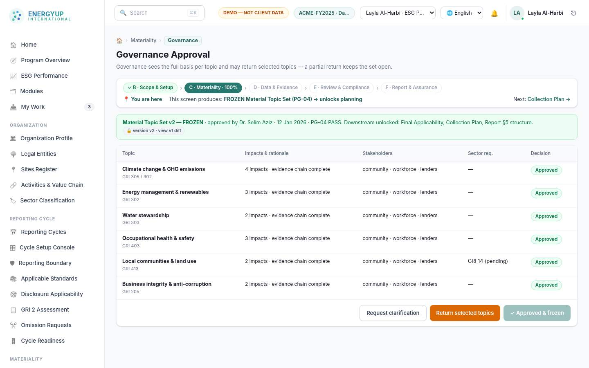
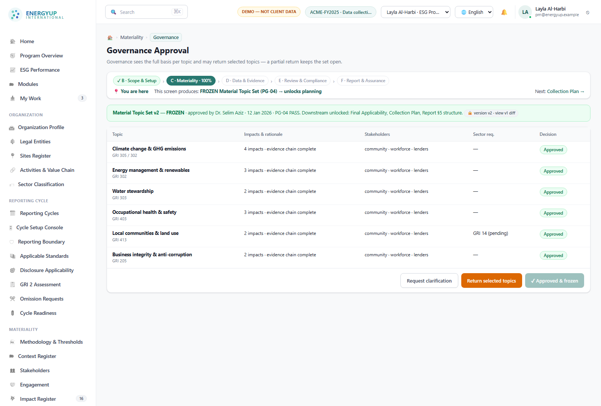
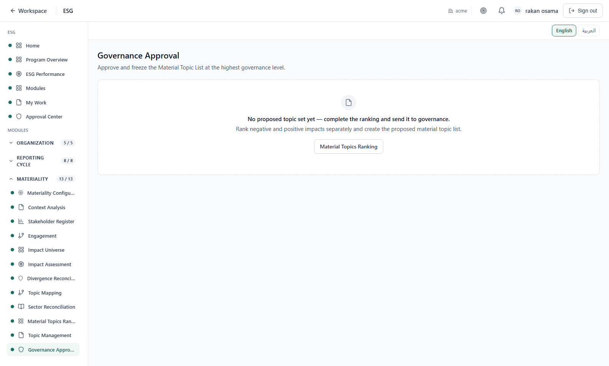

# C-12 — Governance Approval

> 🔴 **P0 · UX 9.6 — and the screen carrying the most consequential defect in this document.**

| | |
|---|---|
| **Route** | prototype `#/mat/approval` · .NET `/modules/esg/mat/approval` |
| **Audit** | `scr-36` · **P0** · UX **9.6** |
| **Owner role** | **Governance Approver** |
| **Owns** | `MaterialTopicSetVersion` |
| **Upstream** | draft topic decisions + rationale/evidence · **Downstream** `mat/topicmgmt` + `data/plan` |
| **Gate** | **PG-04** / stage gate **G2** |
| **.NET spec** | `docs\ESG\build\04-screens\40-materiality\12-approval.md` |

---

## Purpose

> "Governance sees the full basis per topic and may **return selected topics** — a **partial
> return keeps the set open**."

Approval here is a **freeze**. It creates an immutable `MaterialTopicSetVersion` and unlocks
Topic Management, the Collection Plan and Report §5. Everything Epic C does exists to reach this
moment.

---

## 1. What it must contain — the audit

**Inputs** Draft topic set · rationales · evidence · divergence/sector reconciliations
**Outputs** **Frozen `MaterialTopicSetVersion`** · governance approval audit
**Completion gate** `MaterialTopicSetVersion` approved/frozen

**Captured columns (5, complete):**
`Topic` · `Impacts & rationale` · `Stakeholders` · `Sector req.` · `Decision`

**P0 hardening:** *"approval creates an **immutable** MaterialTopicSetVersion. **Partial return
keeps unaffected decisions but records exact returned topics/reasons.**"*

**Visible notice** — the target state:
> *"Material Topic Set v2 — FROZEN · approved by Dr. Selim Aziz · 12 Jan 2026 · PG-04 PASS.
> Downstream unlocked: Final Applicability, Collection Plan, Report §5 structure.
> 🔒 version v2 · view v1 diff"*

Note three things that notice implies and the columns do not capture: a **version diff**, a
**returned-by/date**, and a **return reason** per topic.

---

## 2. What the prototype renders

`assets/js/07-views.js:573` — 1,651 chars. Reads `D.topicSet`, `D.topics`.

| | |
|---|---|
| Table | the 5 captured columns |
| `Stakeholders` cell | the literal string `community · workforce · lenders` on **every** row |
| `Decision` cell | a hard-coded `Approved` pill on **all 6 rows** — `tp.dec` from C-11 is never read |
| `Request clarification` | toast |
| **`Return selected topics`** | toast — and **there is no per-row selection UI to select with** |
| **`✓ Approved & frozen`** | **`disabled`** |

🔴 **[F-4](../03-FINDINGS.md#f-4).** The screen displays a frozen, fully approved topic set
regardless of what Ranking decided, and offers no way to approve or return anything. The P0
hardening is entirely about partial return; the prototype has neither selection nor return.

---

## 3. What .NET implements

### As it runs today

**Captured 9 Sep 2026** from `http://acme.localhost:5270` — tenant **acme**, signed in as a
Programme Manager. The screen is a single empty state.

*"**No proposed topic set yet — complete the ranking and send it to governance.**"* with a
**Material Topics Ranking** button.

> ### ⚠ This capture neither confirms nor refutes [F-1](../03-FINDINGS.md#f-1)
>
> The tenant has **no candidate topics**, so no proposal could have been made regardless of
> whether the projection works. F-1 rests on the code reading in
> `ApprovalQueueProjectionInterceptor.WasQueuedAs`, and the way to settle it is a test on a
> tenant that has ranked topics — not a screenshot.

- ⚠ What the capture *does* show: C-12 renders **nothing at all** until a proposal exists — no
  version history, no prior decisions, no register. Whether decided sets stay visible afterwards
  is untested, and it matters: this is the screen that holds the freeze record.
- Compare C-01, which shows a **Version history** table even in draft. C-12 shows none.

### The code behind it

| | |
|---|---|
| Page | `Pages\Esg\Materiality\Approval.cshtml(.cs)` — **`OnGetAsync` only, no POST handler** |
| Services | `IMaterialityApprovalService` · `IMaterialTopicSetWorkflowService` |
| Entities | `MaterialTopicSet`, `MaterialTopicSetVersion` (+ `.Transitions.cs`), `MaterialTopic` |
| States | `MaterialTopicSetStatus` — Draft · Proposed · Returned · **Frozen** · Superseded (**no Rejected**) |
| Permissions | `esg.mat-approval.{view,signoff}` — view and sign-off only |

The page renders the G2 checklist and the per-topic basis, then **links to
`/modules/esg/approvals?cycle={id}&section=mat-approval`**. It deliberately has no POST handler:
BD-115 forbids a section screen from deciding, and this is the screen most tempted to.

**Approve *is* freeze.** The Center dispatches `MaterialTopicSetVersion` → `FreezeAsync`, and
because there is no `Rejected` state, a reject falls through to `ReturnForCorrectionAsync`.

---

## 4. Gap

| Requirement | Audit | Prototype | .NET | Verdict |
|---|---|---|---|---|
| 5-column basis table | ✔ | ✔ layout only | ✔ | **OK** |
| Decision read from Ranking | implied | 🔴 hard-coded `Approved` | ✔ | prototype **STUB** |
| Stakeholders per topic | ✔ | 🔴 same literal on every row | *not verified* | prototype **STUB** |
| **Approve = immutable freeze** | ✔ **P0** | 🔴 `disabled` | ✔ `FreezeAsync` | **OK** in .NET |
| **Partial return of selected topics** | ✔ **P0** | 🔴 no selection, toast only | ⚠ `ReturnForCorrectionAsync` — **set-level** | ⚠ **may not be partial** |
| Records exact returned topics + reasons | ✔ **P0** | ✗ | ⚪ no return-reason column captured | **open** |
| Version diff (`view v1 diff`) | notice only | ✗ | *not verified* | **open** |
| Governance approval audit | ✔ | ✗ | ✔ queue + audit | **OK** in .NET |
| Downstream unlock on freeze | ✔ | ✗ | ✔ | **OK** in .NET |
| **Reaches the Approval Center** | ✔ | n/a | 🔴 **never enqueues** | **[F-1](../03-FINDINGS.md#f-1)** |

---

## 5. CRUD & workflow

| Op | Prototype | .NET |
|---|---|---|
| Create | — | opened on the C-11 read path |
| Read | `D.topicSet` | `IMaterialityApprovalService.GetAsync` |
| Update / Delete | — | **none** — a frozen set is immutable |
| Submit | — | `ProposeAsync` (from **C-11**) |
| **Approve** | `disabled` | **`FreezeAsync`** — via the Approval Center only |
| **Reject** | — | **none, by design** (DIR-001 SG-10) — falls through to Return |
| Return | toast | `ReturnForCorrectionAsync` |
| Begin review | — | `BeginReviewAsync` — validates only, commits nothing |

---

## 6. Approval Center

**Enrolled** — `MaterialTopicSetVersion` → feature key **`mat-approval`**.

🔴 **But it never arrives.** [F-1](../03-FINDINGS.md#f-1): the projection interceptor's
`WasQueuedAs` switches on the status property **by CLR type** and knows only `ApprovalStatus` and
`OmissionRequestStatus`. `MaterialTopicSetStatus` is a third enum, falls to `default: continue`,
and the method returns the current queue status — so `previous == current`, the handover is
skipped, and no `ApprovalQueueItem` row is written.

**Net effect:** C-11 proposes, the version sits at `Proposed`, the Approval Center is empty, gate
G2 never passes, and Topic Management, the Collection Plan and Report §5 stay locked. The
forward translation `ApprovalSubmissionStatus.From(MaterialTopicSetStatus)` already exists — the
interceptor simply never calls it.

**This is the single highest-value fix in this document.**

---

## 7. Open questions

1. **[F-1](../03-FINDINGS.md#f-1) — fix the projection, and add a test per enrolled status
   enum**, not per object type. A fourth enum will fail identically and just as silently.
2. **Is partial return actually partial?** The P0 hardening requires returning *selected topics*
   while keeping the rest. `ReturnForCorrectionAsync` looks set-level. If it returns the whole
   set, the P0 item is unmet.
3. **Where are the returned topics and reasons recorded?** No column captures them, and the
   Approval Center stores one note per decision, not per topic.
4. The notice promises a **version diff** (`view v1 diff`). Is it built? It is how an approver
   sees what changed since the last frozen set.
5. No `Rejected` state is deliberate — confirm it is written in the decision log, because the
   Approval Center's Reject button will silently behave as Return.
