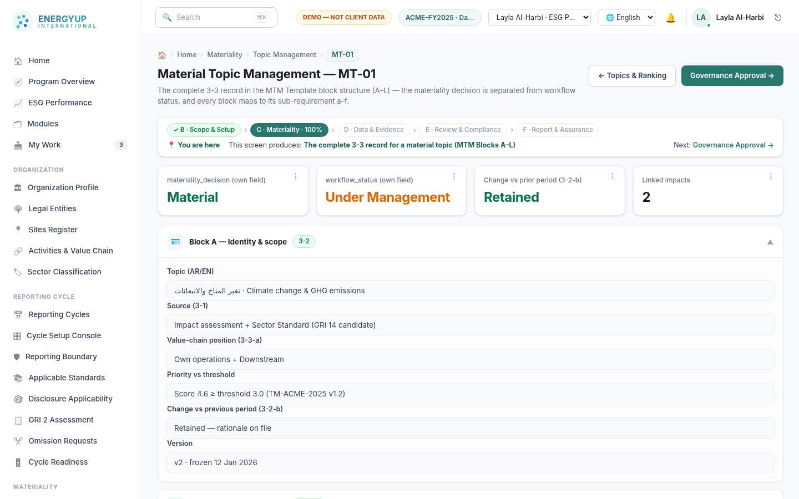
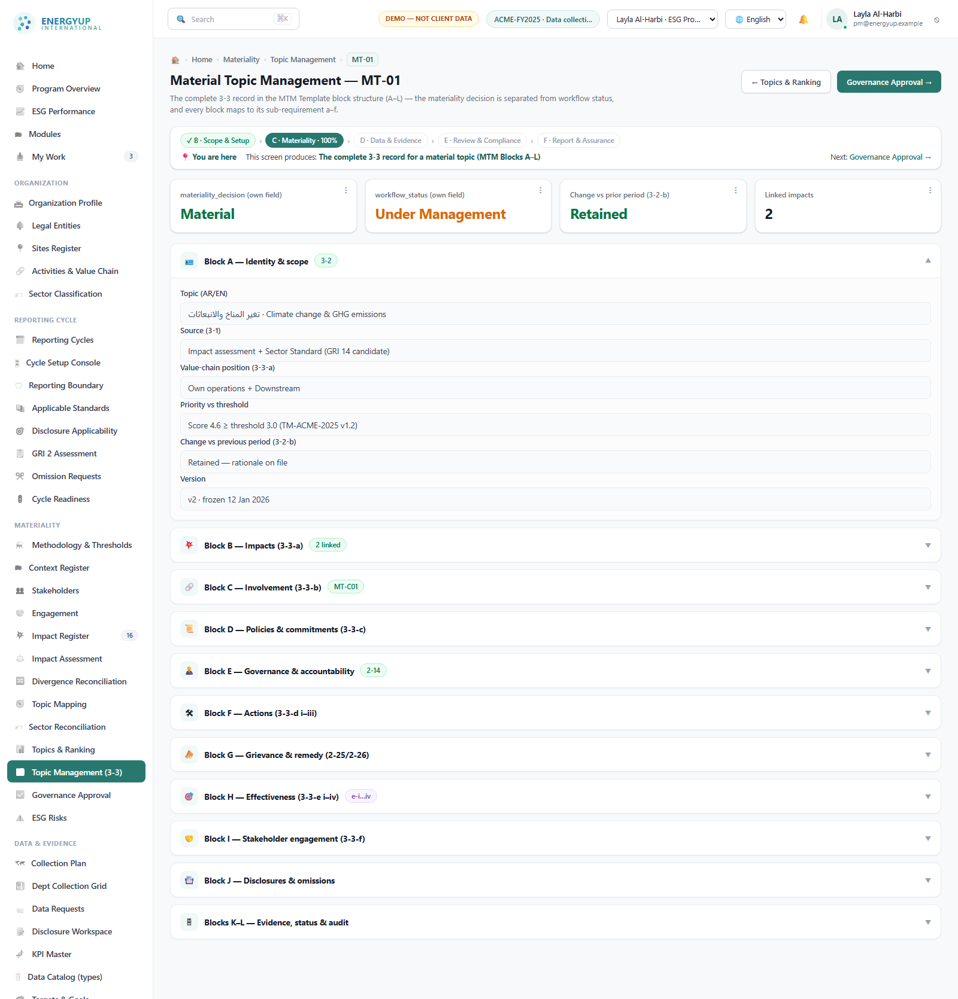
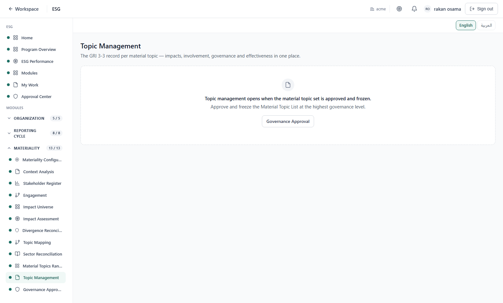

# C-13 — Material Topic Management (GRI 3-3)

| | |
|---|---|
| **Route** | prototype `#/mat/topicmgmt` · .NET `/modules/esg/mat/topicmgmt` |
| **Audit** | `scr-37` · **P1** · UX **8.8 — the lowest score in either group** |
| **Owner role** | Material Topic Owner / ESG Programme Manager |
| **Owns** | `MaterialTopic` |
| **Upstream** | **APPROVED** `MaterialTopicSetVersion` · **Downstream** `data/plan` · report structure |
| **.NET spec** | `docs\ESG\build\04-screens\40-materiality\11-topicmgmt.md` |

> **No capability id in the audit** — it labels this "GRI 3-3 management extension".
> `EsgScreenCatalog` codes it **C-13**.

---

## Purpose

> "The complete 3-3 record in the MTM Template block structure (**A–L**) — the **materiality
> decision is separated from workflow status**, and every block maps to its sub-requirement a–f."

GRI 3-3 is the disclosure that asks *how you manage* each material topic: policies, actions,
targets, grievance mechanisms, remediation, effectiveness. This screen holds that record.

---

## 1. What it must contain — the audit

**Inputs** Approved `MaterialTopicSetVersion` · GRI 3-3 management fields · policies/actions/targets
**Outputs** `MaterialTopicManagementVersion` · data/report requirements
**Completion gate** 3-3 management record complete for each approved material topic

**Captured columns — 10, AT THE CAP, and this is the worst truncation in the audit**
([F-17](../03-FINDINGS.md#f-17)): the Purpose describes **twelve blocks, A–L**, and ten chips
were captured.

> `Topic (AR/EN)` · `Source (3-1)` · `Value-chain position (3-3-a)` · `Priority vs threshold` ·
> `Change vs previous period (3-2-b)` · `Version` · `Accountable executive` · `Topic owner` ·
> `Board oversight` · `Approved by (2-14)`

**Blocks B through L are enumerated nowhere in the audit.** The captured chips look like block A
plus governance fields.

**P1 hardening — a flow defect, not merely hardening:**
> *"full GRI 3-3 management record should require an **APPROVED/FROZEN** MaterialTopicSetVersion.
> **Current nav exposes it before Governance Approval**; lock editing until approval or clearly
> mark Draft-prep mode."*

---

## 2. What the prototype renders

`assets/js/12-data-catalog.js:116` — 6,390 chars. Reads `D.topics`, `D.impacts`, `D.topicSet`,
`D.cidx`, `D.evidence`, `D.restatementsReg` — **6 registers, the most of any screen in the
group**.

| | |
|---|---|
| Layout | **11 accordion blocks**, not a table |
| Topic | **hard-pinned to `D.topics[0]` (MT-01)** — not selectable |
| Fields | every `field()` is `ro: 1` |
| Actions | header `← Ranking` / `Approval →` navigation only. **No drawer, no add, no edit, no delete, no submit, no approve** |

The accordion structure is the most useful artefact here: it is the closest thing that exists to
an enumeration of the A–L blocks, and it should be the starting point for recovering the ones the
audit truncated.

---

## 3. What .NET implements

### As it runs today

**Captured 9 Sep 2026** from `http://acme.localhost:5270` — tenant **acme**, signed in as a
Programme Manager. The screen is **gated shut**.

> ### ✅ The audit's P1 flow defect is fixed in .NET — correcting §4 and §7
>
> *"**Topic management opens when the material topic set is approved and frozen.**"* with a
> **Governance Approval** button. The audit reported *"current nav exposes it before Governance
> Approval"*; the .NET build closes it.

**Subtitle names four block families:** *"The GRI 3-3 record per material topic — **impacts,
involvement, governance and effectiveness** in one place."*

- ⚠ Four families against **nine child entities**, the prototype's **11 accordions**, and the
  audit's **twelve blocks A–L**. That is now **four different groupings** of the same record.
  [F-17](../03-FINDINGS.md#f-17) stands, and this capture adds one more to reconcile.
- ⚠ **The nav still lists Topic Management *before* Governance Approval**, so the ordering the
  audit objected to survives in the menu even though the screen itself is gated. Cosmetic, but it
  is the thing that made the flow look wrong in the first place.
- Because the screen is shut on this tenant, nothing about its register, its actions, or the three
  orphan permissions ([F-8](../03-FINDINGS.md#f-8)) can be read from it.

### The code behind it

| | |
|---|---|
| Page | `Pages\Esg\Materiality\TopicManagement.cshtml(.cs)` |
| Service | `IMaterialTopicManagementService` |
| Entity | `MaterialTopic` |
| **The 3-3 blocks as entities** | `TopicAction` · `TopicDisclosure` · `TopicEffectivenessRecord` · `TopicEngagement` · `TopicGrievanceMechanism` · `TopicInvolvement` · `TopicLesson` · `TopicPolicy` · `TopicRemedy` |
| States | `MaterialTopicWorkflowStatus` — Draft · ImpactsLinked · Assessed · PendingApproval · Approved · UnderManagement · DataCollectionComplete · EsgReviewed · AssuranceReview · Published · Locked · Restated (12 values) |
| Permissions | `esg.mat-topicmgmt.{view,add,edit,delete,handover,signoff}` |

**Nine child entities is the A–L structure, implemented.** They are the answer to the audit's
truncation — Policy, Action, Target/Effectiveness, Grievance, Remedy, Involvement, Engagement,
Lesson, Disclosure.

`MaterialTopicWorkflowStatus` (12 values) is separate from `MaterialityDecision`
(Material/Monitored/NotMaterial) — **the Purpose's "decision separated from workflow status" is
correctly implemented**.

---

## 4. Gap

| Requirement | Audit | Prototype | .NET | Verdict |
|---|---|---|---|---|
| Blocks **A–L** | ⚪ only ~A captured | ✔ 11 accordions | ✔ 9 child entities | ⚪ **enumerate and reconcile** |
| Decision separate from workflow status | ✔ | ✔ | ✔ two enums | **OK** |
| Every block maps to sub-requirement a–f | ✔ | partially labelled | *not verified* | **open** |
| Governance fields (executive, owner, board, 2-14) | ✔ | ✔ read-only | ✔ `AssignAsync` | **OK** |
| **Requires an APPROVED/FROZEN topic set** | ✔ **flow defect** | ✗ **reachable any time** | ✅ **gated** — *"opens when the material topic set is approved and frozen"* | ✅ **fixed in .NET** |
| Topic selectable | implied | ✗ **pinned to MT-01** | ✔ | prototype **MISSING** |
| Create a 3-3 record | — | ✗ | ✗ **created only by `FreezeAsync` promotion** | **by design** |
| Edit the management record | ✔ gate | ✗ all `ro:1` | ✔ `AssignAsync` (governance fields only) | ⚠ **narrow** |
| Delete | — | ✗ | ✗ — **key declared, no method** | **[F-8](../03-FINDINGS.md#f-8)** |
| Submit / Approve | — | ✗ | ✗ — **keys declared, no methods** | **[F-8](../03-FINDINGS.md#f-8)** |

⚠ `AssignAsync` assigns governance fields. **What writes the nine 3-3 child records?** No
per-block service method surfaced in the review. If the blocks cannot be filled, the screen
cannot meet its completion gate.

---

## 5. CRUD & workflow

| Op | Prototype | .NET |
|---|---|---|
| Create | — | only via `FreezeAsync` promoting approved topics |
| Read | MT-01 only | `GetAsync` |
| Update | — | `AssignAsync` — governance fields |
| Delete | — | **none** (`DeleteMatTopicMgmt` declared, unimplemented) |
| Submit | — | **none** (`HandOverMatTopicMgmt` declared, unimplemented) |
| Approve | — | **none** (`SignOffMatTopicMgmt` declared, unimplemented) |

**Three of the six declared permissions have nothing behind them** —
[F-8](../03-FINDINGS.md#f-8). An administrator can grant sign-off on Topic Management and it will
do nothing.

---

## 6. Approval Center

**Does not participate** — although `handover` and `signoff` keys exist, suggesting it was
intended to. Given the topic set is already frozen at C-12, a second approval here may be
unnecessary; if so, remove the keys.

---

## 7. Open questions

**This screen has the weakest specification in the group — lowest UX score, worst truncation, and
declared-but-unimplemented permissions.**

1. **Enumerate blocks A–L.** Reconcile the prototype's 11 accordions against the nine child
   entities and the GRI 3-3 sub-requirements a–f. Until this exists, "3-3 management record
   complete" is unmeasurable.
2. **Which service writes each block?** `AssignAsync` covers governance fields only.
3. **Lock editing until the topic set is frozen** — the audit's stated flow defect. Or mark the
   screen Draft-prep explicitly.
4. **Decide the three orphan permissions** ([F-8](../03-FINDINGS.md#f-8)): implement or remove.
5. `MaterialTopicWorkflowStatus` has 12 values reaching Published, Locked and Restated — far
   beyond this screen. Confirm which transitions this screen owns.
