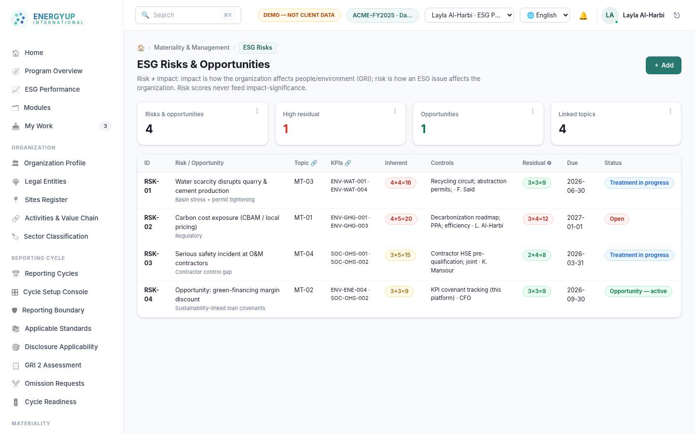
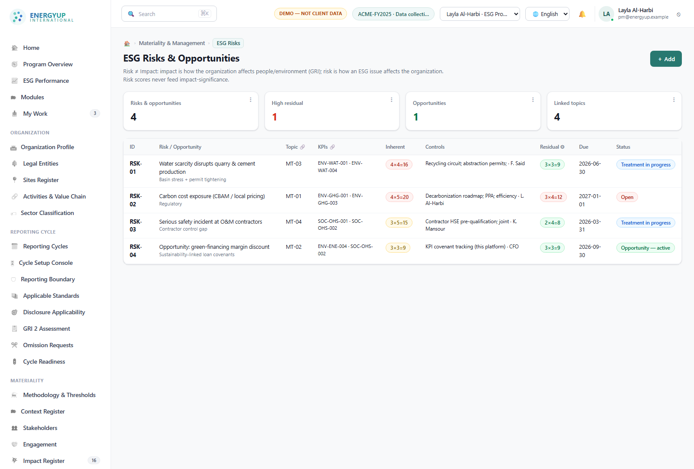
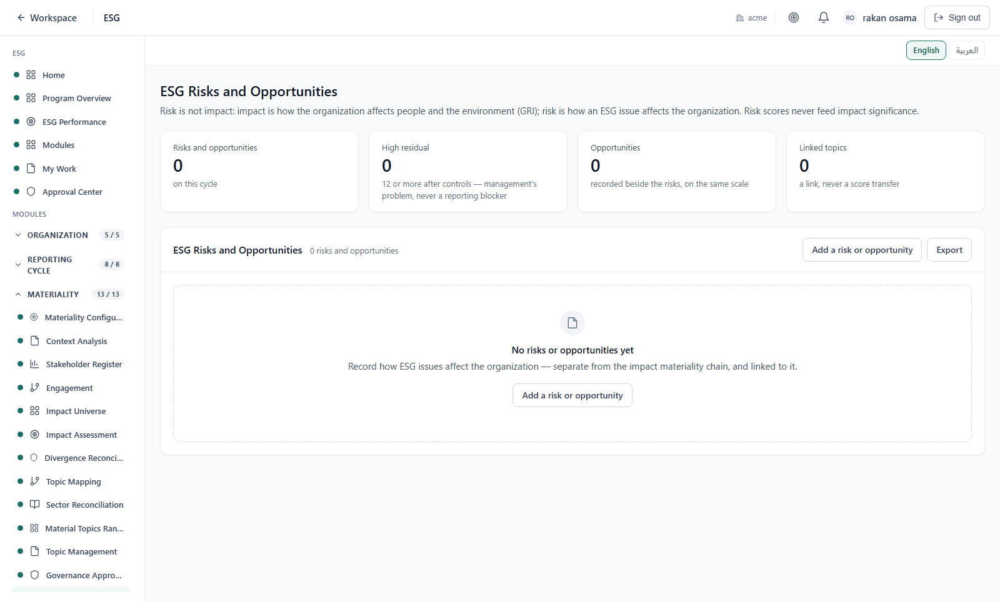

# C-14 — ESG Risks & Opportunities

| | |
|---|---|
| **Route** | prototype `#/mat/risk` · .NET `/modules/esg/mat/risk` |
| **Audit** | `scr-38` · P2 · UX 9.2 |
| **Owner role** | Risk Owner / Management |
| **Owns** | `EsgRisk` |
| **Upstream** | impacts + approved topics + strategic risk inputs |
| **Downstream** | `data/targets` · action plans · management dashboard — **never directly the claim** |
| **.NET spec** | `docs\ESG\build\04-screens\40-materiality\13-risk.md` |

> **No capability id in the audit** — labelled "ESG risk extension (non-GRI-materiality)".
> `EsgScreenCatalog` codes it **C-14**.

---

## Purpose

> "**Risk ≠ Impact**: impact is how the organization affects people/environment (GRI); risk is
> how an ESG issue affects the organization. **Risk scores never feed impact-significance.**"

This is the outward/inward distinction — GRI materiality is outward-facing (impact on the world),
financial materiality is inward-facing (impact on the company). Letting risk scores influence
material-topic status would quietly convert a GRI report into a financial-materiality report.

**Completion gate:** *"Optional — **never a GRI claim gate**."* One of only two screens in either
group that explicitly has no gate.

---

## 1. What it must contain — the audit

**Inputs** Impacts/material topics · risk likelihood/consequence · financial/strategic context
**Outputs** `RiskOpportunityVersion` · action-plan / target links (non-claim)

**Captured columns (9, complete):**
`ID` · `Risk / Opportunity` · `Topic 🔗` · `KPIs 🔗` · `Inherent` · `Controls` · `Residual ⚙` ·
`Due` · `Status`

`Residual ⚙` is derived — inherent risk reduced by controls, computed rather than typed.

**P2 hardening:** *"Keep Risk/Opportunity **separate** from GRI Impact Materiality. Any link to
topics/targets must be explicit; it must **never alter GRI claim or material-topic status
automatically**."*

---

## 2. What the prototype renders

`assets/js/13-data-model.js:409` — 3,722 chars. Reads **`D.risks`** (4 rows — a real register).

| | |
|---|---|
| Table | all 9 captured columns, correctly |
| Rows | live from `D.risks` |
| Tiles | 3 derived; the fourth, "Linked topics", is a **literal `4`** |
| **Row actions** | **none — no actions column at all** |
| Add | `＋ Add` → `riskForm()` — **two-argument `drawer()` ⇒ writes nothing** (15 fields) |

Same shape as C-06: a good, live table you cannot edit, and an Add button that discards input.

---

## 3. What .NET implements

### As it runs today

**Captured 9 Sep 2026** from `http://acme.localhost:5270` — tenant **acme**, signed in as a
Programme Manager. No risks or opportunities recorded.

> ### ✅ The P2 separation is asserted three times in the UI
>
> Subtitle: *"Risk scores **never feed impact significance**."*
> High residual: *"management's problem, **never a reporting blocker**"*.
> Linked topics: *"**a link, never a score transfer**"*.
> Designed in, visibly. A test still proves it.

**Tiles:** Risks and opportunities · **High residual** *"**12 or more** after controls"* ·
**Opportunities** *"recorded beside the risks, **on the same scale**"* · **Linked topics**

- ⚠ **New open question — the high-residual threshold is 12, the same number as C-01's
  negative-impact threshold.** Confirm whether that is a shared constant or a coincidence. If the
  risk threshold reads from the materiality methodology, that is exactly the coupling the P2 rule
  forbids, pointing the wrong way.
- ✔ Opportunities scored *on the same scale* as risks, in the same register — the audit's
  Risk/Opportunity duality, built.
- **Actions:** **Add a risk or opportunity** · Export. One of the few screens whose create action
  is visible with **no prerequisite blocker** — consistent with the audit calling it optional.
- Empty state: *"separate from the impact materiality chain, **and linked to it**"* — the whole
  rule in six words.

### The code behind it

| | |
|---|---|
| Page | `Pages\Esg\Materiality\Risk.cshtml(.cs)` |
| Services | `IEsgRiskService` · `IEsgRiskWorkflowService` |
| Entities | `EsgRisk` (+ `.Transitions.cs`), **`EsgRiskKpi`** |
| States | `EsgRiskKind` — Risk · Opportunity |
| Permissions | `esg.mat-risk.{view,add,edit,delete,handover,signoff}` — **complete** |

`EsgRiskKpi` as a separate entity implements the `KPIs 🔗` column as a real many-to-many link
rather than a text field.

**This screen has a fuller workflow than most of Materiality** — submit, begin review, approve,
reject, return — despite being the one screen the audit marks optional.

---

## 4. Gap

| Requirement | Audit | Prototype | .NET | Verdict |
|---|---|---|---|---|
| 9-column register | ✔ | ✔ **live** | ✔ | **OK** |
| Residual derived from inherent + controls | ✔ `⚙` | ✔ shown | *not verified* | **open** |
| Risk **and** Opportunity | ✔ | ✔ | ✔ `EsgRiskKind` | **OK** |
| Topic link explicit | ✔ P2 | ✔ `Topic 🔗` | ✔ | **OK** |
| KPI link explicit | ✔ | ✔ `KPIs 🔗` | ✔ `EsgRiskKpi` | **OK** |
| **Never alters claim or topic status** | ✔ **P2** | ✔ (it alters nothing) | *not verified* | **open — the rule** |
| **Never a claim gate** | ✔ | ✔ | ✔ not in `CycleReadinessGate` | **OK** |
| Create | — | ✗ **STUB** | ✔ `CreateAsync` | prototype **STUB** |
| **Edit** | — | ✗ **no row actions** | ✔ `UpdateAsync` | prototype **MISSING** |
| Delete | — | ✗ | ✔ `DeleteAsync` | **OK** in .NET |
| Submit / approve | *not captured* | ✗ | ✔ full workflow | **OK** in .NET |
| "Linked topics" tile derived | — | ✗ literal `4` | n/a | prototype defect |
| **Lock** | — | ✗ | ✗ **absent** — the only workflow verb missing | minor |

---

## 5. CRUD & workflow

| Op | Prototype | .NET |
|---|---|---|
| Create | `riskForm()` **STUB** | `CreateAsync` |
| Read | `D.risks` | `GetRegisterAsync`, `GetAsync` |
| Update | **none** | `UpdateAsync` |
| Delete | — | `DeleteAsync` |
| Submit | — | `SubmitAsync` |
| Approve / Reject / Return | — | all three + `BeginReviewAsync` |
| Lock | — | **none** |

---

## 6. Approval Center

**Participates.** `EsgRisk` → feature key **`mat-risk`**.

Worth noting the asymmetry: an optional, non-claim screen has a **complete** maker-checker flow,
while C-13 Topic Management — which holds the GRI 3-3 disclosure record — has none.

---

## 7. Open questions

1. **Is the separation from GRI materiality enforced, or only intended?** The P2 hardening is
   emphatic: risk must never automatically alter claim or material-topic status. Confirm no
   derivation reads `EsgRisk`. This is the same class of rule as DEC-06 on C-07.
2. **Is `Residual` derived?** The `⚙` says so; confirm it is computed from inherent and controls
   rather than stored as typed input.
3. Add an **edit path** — the register has no row action, mirroring C-06.
4. Why does an optional screen have a fuller workflow than C-13? Not wrong, but worth confirming
   the priorities are deliberate.
